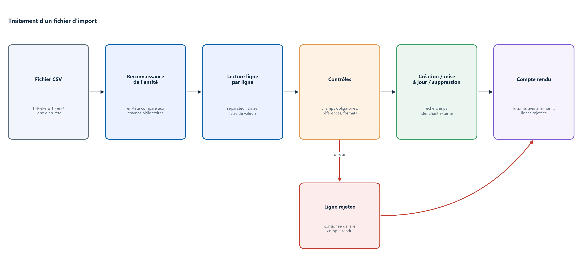

# Importer des données

## Principe

Un fichier d'import contient une seule entité. La première ligne est l'en-tête : elle liste les noms de champs du modèle d'échange. Le fichier ne déclare pas son entité : Nomadia Field Service la déduit de l'en-tête, en cherchant l'entité dont tous les champs obligatoires sont présents.


Plusieurs entités partagent des champs obligatoires proches. Incluez toujours toutes les colonnes obligatoires de l'entité visée et vérifiez, dans le compte rendu, l'entité reconnue (ligne « Header »).


## Où importer

| Point d'entrée                                             | Description                                                                                                                                  |
| ---------------------------------------------------------- | -------------------------------------------------------------------------------------------------------------------------------------------- |
| `Administration > Fichiers CSV > Importer un fichier CSV`  | Import d'un fichier, avec choix de l'encodage, des séparateurs, du format de date, du mode d'import et des options de géocodage.             |
| `Administration > Fichiers CSV > Import/export CSV global` | Import d'une archive ZIP contenant un fichier CSV par entité (format de l'export global). Encodage UTF-8 imposé.                             |
| Service web entities (SOAP ou REST)                        | Opérations SetEntitiesFromCsv, SetEntityFromProperties et setEntities (REST). Voir [API et services web d'intégration](api-services-web.md). |
| Circulation                                                | Import automatisé de fichiers, de requêtes SQL ou de messages (voir [Module Circulation](../module-circulation/module-circulation.md)).      |

## Format des fichiers CSV

### Paramètres par défaut

Les paramètres de format sont configurables. Leurs valeurs par défaut diffèrent selon le canal :

| Paramètre                               | Import par l'interface (gui.import.format) | Import serveur, WS et circulation (import.setting) | Export par l'interface (gui.export.format) |
| --------------------------------------- | ------------------------------------------ | -------------------------------------------------- | ------------------------------------------ |
| Séparateur de champs                    | ;                                          | ,                                                  | ;                                          |
| Séparateur de liste (valeurs multiples) | ,                                          | ;                                                  | ,                                          |
| Délimiteur de texte                     | "                                          | aucun                                              | "                                          |
| Format de date                          | dd/MM/yyyy                                 | yyyy/MM/dd                                         | dd/MM/yyyy                                 |
| Format d'heure                          | HH:mm                                      | HH:mm                                              | HH:mm                                      |
| Encodage                                | ISO-8859-1 proposé par défaut              | —                                                  | ISO-8859-1                                 |


Le service web SetEntitiesFromCsv a ses propres valeurs par défaut (schéma XSD) : séparateur ;, délimiteur ", date dd/MM/yyyy, séparateur de liste ,. Indiquez toujours explicitement les paramètres de format dans vos appels et vos fichiers de configuration.


### Encodage

* À l'import par l'interface, l'encodage se choisit dans le formulaire ; une marque d'ordre d'octets (BOM) UTF-8 en début de fichier est retirée automatiquement.
* L'import global (ZIP) lit les fichiers en UTF-8.
* Les exports sont produits dans l'encodage configuré (ISO-8859-1 par défaut), sans BOM.

### Séparateurs, délimiteurs et lignes

* Séparateur de champs : un seul caractère, choisi parmi , ; | : - ou la tabulation dans l'interface. Il doit être différent du séparateur de liste.
* Délimiteur de texte : ", ' ou aucun. Un délimiteur doublé à l'intérieur d'une valeur représente le caractère lui-même ; une valeur délimitée peut contenir un saut de ligne.
* Fins de ligne : CR, LF et CRLF sont acceptées.
* Une ligne qui contient moins de valeurs que l'en-tête est complétée par des valeurs vides ; une ligne qui en contient plus est rejetée.
* Les espaces en début et fin de valeur sont supprimés.

### En-tête

* Les noms de colonnes sont insensibles à la casse et aux espaces superflus.
* Les colonnes inconnues sont ignorées sans erreur : une faute de frappe dans un nom de colonne fait donc perdre la donnée sans alerte. Contrôlez vos en-têtes avec le modèle d'échange.
* Les synonymes déclarés par l'entité sont acceptés.
* Une colonne de la forme ENTITE.CHAMP (avec un point) déclenche l'import d'une entité liée.

### Valeurs

| Type                 | Règle d'import                                                                                                                                                                                | Règle d'export                                               |
| -------------------- | --------------------------------------------------------------------------------------------------------------------------------------------------------------------------------------------- | ------------------------------------------------------------ |
| Booléen              | Vrai : 1, TRUE, Y, O (sans tenir compte de la casse) ou valeur listée dans import.setting.logical.yes. Toute autre valeur non vide vaut faux. Une cellule vide conserve la valeur par défaut. | 1 ou 0                                                       |
| Nombre décimal       | Le point et la virgule sont acceptés comme séparateur décimal. Si la virgule est aussi séparateur de champs, délimitez la valeur.                                                             | Point décimal                                                |
| Date                 | Format de date de l'import (par exemple dd/MM/yyyy). Une date invalide rejette la ligne.                                                                                                      | Format de date de l'export                                   |
| Date-heure           | Date au format configuré, un espace, puis l'heure HH:mm ou HH:mm:ss.                                                                                                                          | Date et heure séparées par un espace                         |
| Heure                | HH:mm, ou un nombre entier de minutes depuis minuit.                                                                                                                                          | Format d'heure de l'export                                   |
| Durée                | Minutes (format recommandé, utilisé dans les exemples du modèle).                                                                                                                             | Minutes, ou heures si l'option « durée en heure » est cochée |
| Liste d'identifiants | Identifiants séparés par le séparateur de liste.                                                                                                                                              | Séparateur de liste de l'export                              |


Le paramètre parsing.rigorous rend les contrôles plus stricts : une valeur entière, décimale ou booléenne invalide rejette alors la ligne au lieu d'être ignorée avec un avertissement.


## Création, mise à jour et suppression

### Création ou mise à jour (comportement par défaut)

Nomadia Field Service recherche l'objet par son identifiant externe. S'il existe, il est mis à jour ; sinon il est créé. Si un champ DEPRECATEDID est fourni, Nomadia Field Service cherche aussi l'objet sous cet ancien identifiant, ce qui permet de renommer un identifiant.

### Mise à jour partielle

| Situation dans le fichier                  | Effet sur la valeur en base                                                                                            |
| ------------------------------------------ | ---------------------------------------------------------------------------------------------------------------------- |
| Colonne absente de l'en-tête               | Valeur conservée.                                                                                                      |
| Colonne présente, cellule renseignée       | Valeur remplacée.                                                                                                      |
| Colonne présente, cellule vide             | Valeur effacée (remise à vide). Pour une référence, remise à vide si le champ l'autorise ; sinon la ligne est rejetée. |
| Colonne obligatoire présente, cellule vide | Ligne rejetée, même en mise à jour.                                                                                    |


Exporter un fichier, le modifier puis le réimporter efface toutes les valeurs laissées vides. Pour mettre à jour quelques champs, n'incluez que les colonnes à modifier (avec l'identifiant).



Exception : dans l'import global (ZIP), les cellules vides sont ignorées et ne modifient pas la valeur en base.


### Modes d'import

| Mode       | Comportement                                                                   | Activation                                                       |
| ---------- | ------------------------------------------------------------------------------ | ---------------------------------------------------------------- |
| STANDARD   | Création ou mise à jour.                                                       | Défaut.                                                          |
| INSERTONLY | Création seulement ; une ligne qui correspond à un objet existant est rejetée. | Option du formulaire d'import (paramètre ModeOfImport).          |
| UPDATEONLY | Mise à jour seulement ; une ligne qui ne correspond à aucun objet est rejetée. | Option du formulaire, ou colonne d'identifiant suffixée par $ID. |

Le suffixe $ID remplace la première occurrence de ID dans le nom du champ d'identifiant : CUSTOMERID devient CUSTOMER$ID, APPOINTMENTID devient APPOINTMENT$ID. Avec cette colonne, les autres champs obligatoires ne sont pas exigés dans l'en-tête.

### Suppression

La suppression se demande ligne par ligne avec la valeur DELETE dans la colonne ACTION, pour les entités qui la prennent en charge (client, contact, intervention, indisponibilité, compétences de la ressource, priorités, jours fériés, etc. ; voir la description du champ ACTION dans la [référence du modèle d'échange](reference-modele/)). Il n'existe pas de désactivation générique par la colonne ACTION : la désactivation passe par le champ ACTIVE (0) des entités qui le possèdent, ou par le service web disabledEntities.


Pour une intervention, DELETE est une suppression physique.


## Géocodage

Pour chaque entité localisée, Nomadia Field Service détermine la position dans l'ordre suivant :

1. si la position existe déjà et que l'adresse n'a pas changé, elle est conservée ;
2. si X et Y (projection de la carte) sont fournis, ils sont utilisés tels quels ;
3. sinon, si XGEO/YGEO (longitude et latitude WGS 84) ou XYNMEA sont fournis, ils sont convertis ;
4. sinon, l'adresse est géocodée selon la tolérance et le score minimal configurés (défauts de l'interface : tolérance « au numéro », score 0,8) ;
5. en cas d'échec, la position d'un site de travail de repli est utilisée s'il a été choisi ; sinon la ligne est rejetée (« Invalid Location, cannot geocode »).

| Tolérance (service web)    | Signification              |
| -------------------------- | -------------------------- |
| AT\_STREET\_NUMBER         | Au numéro de rue (défaut). |
| AT\_STREET\_NUMBER\_STRICT | Au numéro, strict.         |
| AT\_STREET                 | À la rue.                  |
| AT\_STREET\_STRICT         | À la rue, strict.          |
| AT\_CITY                   | À la ville.                |

GEOCODING\_TYPE vaut 5 lorsque les coordonnées ont été fournies et 0 lorsque la position du site de repli a été utilisée (la ville est alors préfixée par « Error Geocoding : »). GEOCODING\_SCORE contient la note du géocodage.

## Import global (archive ZIP)

L'import global accepte une archive ZIP contenant un fichier CSV par entité, au format produit par l'export global (NN\_\<Entité>.csv). L'archive peut contenir au plus un sous-dossier. Les particularités suivantes s'appliquent :

* encodage UTF-8 ;
* les cellules vides sont ignorées ;
* les colonnes XGEO, YGEO et XYNMEA sont neutralisées (les positions sont reprises par X/Y ou géocodées) ;
* un fichier réduit à RESOURCELASTNAME et RESOURCEID crée les ressources comme non optimisables.


L'ordre de traitement des fichiers de l'archive dépend de leur nom et du système de fichiers ; il n'est pas recalculé à partir des dépendances. Conservez la numérotation NN\_ de l'export global.


## Transactions et traitement synchrone

* Chaque ligne est validée dans sa propre transaction : une ligne en erreur n'annule pas les lignes déjà importées.
* L'import depuis l'interface est synchrone : il s'exécute dans la requête HTTP et le fichier est lu ligne par ligne, sans traitement en arrière-plan.
* Aucune limite de nombre de lignes n'est définie.
