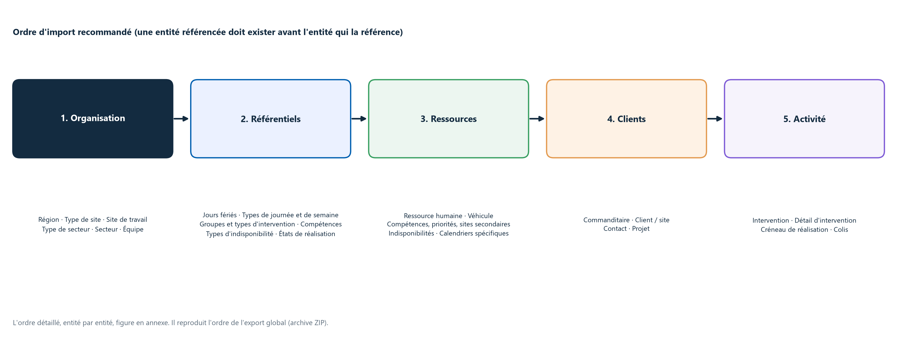

# Référentiels et ordre d'intégration

Une entité ne peut référencer qu'un objet déjà présent dans Nomadia Field Service. Les référentiels doivent donc être chargés avant les entités qui les utilisent.

## Ordre détaillé

Nomadia Field Service classe les entités par niveau de dépendance. L'export global applique ce classement pour numéroter les fichiers de l'archive. Il commence par un fichier de ressources réduit à RESOURCEID et RESOURCELASTNAME, qui permet aux référentiels de pointer vers une ressource (responsable d'équipe, référent de région) avant l'import complet des ressources. L'ordre complet (93 étapes) figure dans la page [Ordre d'intégration détaillé](../annexes/ordre-integration-detaille.md).


Pour une reprise initiale, importez les fichiers dans l'ordre de la page [Ordre d'intégration détaillé](../annexes/ordre-integration-detaille.md) et contrôlez le compte rendu de chaque fichier avant de passer au suivant.


## Dans cette section

| Page                                                                                          | Contenu                                                                   |
| --------------------------------------------------------------------------------------------- | ------------------------------------------------------------------------- |
| [Intégrer l'organisation et l'activité](organisation-activite.md)                             | Régions, sites de travail, équipes, groupes et types d'intervention       |
| [Intégrer les ressources](ressources.md)                                                      | Ressources humaines, actions spécifiques, types d'intervenant et de poste |
| [Intégrer les calendriers, horaires et indisponibilités](calendriers-indisponibilites.md)     | Modèles de journée et de semaine, jours fériés, indisponibilités          |
| [Intégrer les compétences, habilitations et règles d'affectation](competences-affectation.md) | Compétences, priorités, autorisations, préférences                        |
| [Intégrer les clients et les sites](clients-sites.md)                                         | Clients, contacts, projets, géolocalisation                               |
| [Intégrer les interventions](interventions.md)                                                | Champs, statuts et cycle de vie, actions, détails et réalisations         |
