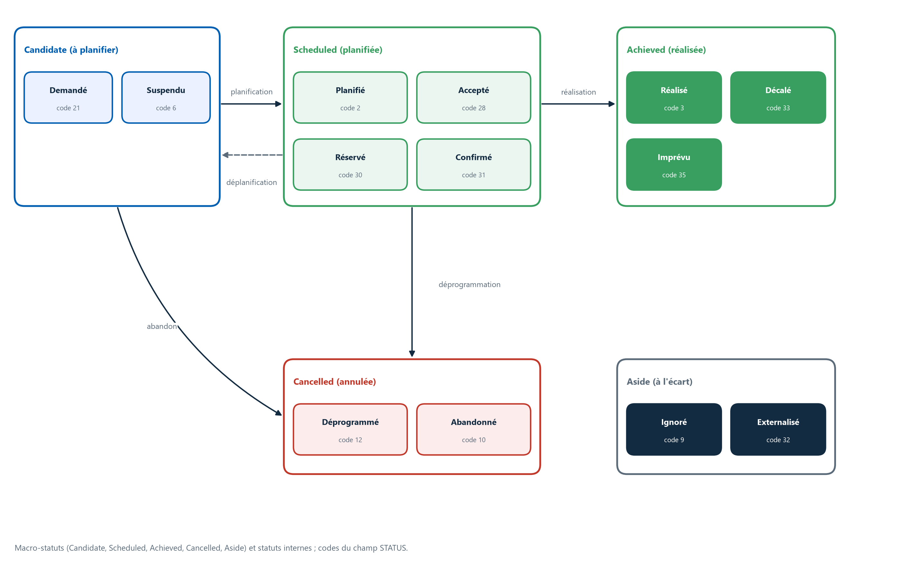

# Intégrer les interventions

L'intervention (Appointment, « rendez-vous » dans l'ancienne terminologie) décrit un travail à réaliser chez un client. Elle porte une période de réalisation possible (DATEMINBEGIN – DATEMAXEND), un ou plusieurs types d'intervention et, une fois planifiée, une date et des ressources affectées.

| Champ             | Type          | Oblig. | Référence           | Description                                                                                                                                                                                                                                                                                                                                                                                                                                                                                                                                                                                                                                                                                                                                                       | Exemple / défaut                                                                                                              |
| ----------------- | ------------- | ------ | ------------------- | ----------------------------------------------------------------------------------------------------------------------------------------------------------------------------------------------------------------------------------------------------------------------------------------------------------------------------------------------------------------------------------------------------------------------------------------------------------------------------------------------------------------------------------------------------------------------------------------------------------------------------------------------------------------------------------------------------------------------------------------------------------------- | ----------------------------------------------------------------------------------------------------------------------------- |
| APPOINTMENTID     | Identifiant   | Oui    |                     | Identifiant de l'intervention                                                                                                                                                                                                                                                                                                                                                                                                                                                                                                                                                                                                                                                                                                                                     | ex. ITV\_001                                                                                                                  |
| CUSTOMERID        | Réf.          | Oui    | Client              | Identifiant du site/client.                                                                                                                                                                                                                                                                                                                                                                                                                                                                                                                                                                                                                                                                                                                                       |                                                                                                                               |
| TASKTYPES         | Liste de réf. | Non    | Type d'intervention | Liste des types d'intervention à réaliser                                                                                                                                                                                                                                                                                                                                                                                                                                                                                                                                                                                                                                                                                                                         | ex. TT\_001;TT\_002                                                                                                           |
| DURATION          | Durée         | Non    |                     | Durée estimée de cette intervention exprimée en minutes.                                                                                                                                                                                                                                                                                                                                                                                                                                                                                                                                                                                                                                                                                                          | ex. 120                                                                                                                       |
| DATEMINBEGIN      | Date (début)  | Non    |                     | Date de début de la période de réalisation possible de cette intervention                                                                                                                                                                                                                                                                                                                                                                                                                                                                                                                                                                                                                                                                                         | ex. JJ/MM/AAAAA                                                                                                               |
| DATEMAXEND        | Date (fin)    | Non    |                     | Date de fin de la période de réalisation possible de cette intervention                                                                                                                                                                                                                                                                                                                                                                                                                                                                                                                                                                                                                                                                                           | ex. JJ/MM/AAAAA                                                                                                               |
| EXPECTEDDATE      | Date          | Non    |                     | La date attendue est utilisée de préférence pour placer ce rendez-vous                                                                                                                                                                                                                                                                                                                                                                                                                                                                                                                                                                                                                                                                                            | défaut 2013/01/15                                                                                                             |
| DAILYSTARTTIMEMIN | Heure         | Non    |                     | Heure la plus tôt à partir de laquelle un rendez-vous peut être placé                                                                                                                                                                                                                                                                                                                                                                                                                                                                                                                                                                                                                                                                                             |                                                                                                                               |
| PRIORITY          | Entier        | Non    |                     | Priorité associée à l'intervention entre 0 et 100. Elle peut être hérité du site/client.                                                                                                                                                                                                                                                                                                                                                                                                                                                                                                                                                                                                                                                                          | ex. 50 · défaut 0 (signifiant pas de priorité)                                                                                |
| REQUESTEDMANPOWER | Entier        | Non    |                     | Nombre d'intervenants nécessaires à la réalisation de cette intervention (min 1, max 10)                                                                                                                                                                                                                                                                                                                                                                                                                                                                                                                                                                                                                                                                          | ex. 1                                                                                                                         |
| QUALIFICATIONS    | Liste de réf. | Non    | Compétence          | Liste des compétences nécessaires à la réalisation de cette intervention                                                                                                                                                                                                                                                                                                                                                                                                                                                                                                                                                                                                                                                                                          | ex. QUA\_001;QUA\_002                                                                                                         |
| WORKSITEID        | Réf.          | Non    | Site de travail     | Agence de rattachement de cette intervention                                                                                                                                                                                                                                                                                                                                                                                                                                                                                                                                                                                                                                                                                                                      | ex. WKS\_001                                                                                                                  |
| STATUS            | Chaîne        | Non    |                     | État de l'intervention (lié au cycle de vie. 21: demandé, 2: planifié, 30: réservé, 31: confirmé, 10: abandonné, 6: suspendu, 3: réalisé. Les états suivants sont seulement disponibles à l'export, 12: déprogrammé, 33: déplacé, 35: imprévu)                                                                                                                                                                                                                                                                                                                                                                                                                                                                                                                    |                                                                                                                               |
| PROGRESSIONSTEP   | Chaîne        | Non    |                     | étape de progression dans le cycle de vie de la planification. Valeurs possibles (code ou chaîne acceptés): 0:scheduling \[à planifier] (par défaut), 5:back\_scheduling \[planifié par le backoffice], 10:ongoing \[en cours], 15:partially\_done \[effectué en partie], 20:done \[effectué], 50:completed \[terminé], 100:closed \[fermé]                                                                                                                                                                                                                                                                                                                                                                                                                       | ex. 10 ou ONGOING ou ongoing (pour indiquer que le rendez-vous est déjà en cours) · défaut 0 ou nul, signifiant planification |
| DATEAPPOINTMENT   | Date          | Non    |                     | Date de la visite telle que connue dans Nomadia Field Service                                                                                                                                                                                                                                                                                                                                                                                                                                                                                                                                                                                                                                                                                                     | ex. JJ/MM/AAAA                                                                                                                |
| ASSIGNEDRESOURCES | Liste de réf. | Non    | Ressource humaine   | Liste des intervenant affectés à cette intervention une fois la planification effectuée                                                                                                                                                                                                                                                                                                                                                                                                                                                                                                                                                                                                                                                                           | ex. TECH\_001;TECH\_002                                                                                                       |
| ACTION            | Chaîne        | Non    |                     | Champ technique permettant de déclencher une action après import du rendez vous ("SCHEDULE": déclenche une recherche optimisée de créneau pour ce rendez vous après son import, "CLEAR\_NOTIFICATIONS": efface les notifications de rendez-vous, "OUTSOURCE": pour externaliser un sous-traitant, "INSOURCE": pour dé-référencer un sous-traitant, "SEARCH\_PERIODIC": pour rechercher un rendez-vous périodique d'id inconnu, en fournissant son id de client ainsi que la date et l'état, "DELETE": pour supprimer physiquement un rendez-vous, "CLEAR\_ACHIEVEMENTS": pour effacer les réalisations d'un rendez-vous, "CLEAR\_ACHIEVEMENTS\_BY\_DAY": pour effacer et remplacer les réalisations du même jour que la date de début de la nouvelle réalisation) |                                                                                                                               |


Le champ AppointmentCustomer (entité du même nom) est un identifiant partagé qui permet d'importer dans une même ligne une intervention et son client.


## Statuts et cycle de vie

Le statut d'une intervention (STATUS) est un code numérique. Chaque statut appartient à un macro-statut.

| Code | Statut (code interne) | Libellé     | Macro-statut | Signification                                                               |
| ---- | --------------------- | ----------- | ------------ | --------------------------------------------------------------------------- |
| 21   | REQUESTED             | Demandé     | Candidate    | À planifier par tous les moyens.                                            |
| 6    | SUSPENDED             | Suspendu    | Candidate    | À planifier, mais exclu de l'optimisation globale.                          |
| 2    | PLANNED               | Planifié    | Scheduled    | Planifié ; peut être déplacé et réaffecté.                                  |
| 28   | ACCEPTED              | Accepté     | Scheduled    | Planifié ; peut être déplacé mais pas réaffecté à une autre ressource.      |
| 30   | RESERVED              | Réservé     | Scheduled    | Planifié ; ne peut plus être déplacé mais peut être réaffecté.              |
| 31   | CONFIRMED             | Confirmé    | Scheduled    | Planifié ; ni déplaçable ni réaffectable.                                   |
| 3    | REALIZED              | Réalisé     | Achieved     | Réalisé le jour prévu par la ressource affectée.                            |
| 33   | SHIFTED               | Décalé      | Achieved     | Réalisé, mais pas le jour prévu ou pas par la ressource affectée.           |
| 35   | HAPPENED              | Imprévu     | Achieved     | Réalisé sans avoir été planifié.                                            |
| 12   | REMOVED               | Déprogrammé | Cancelled    | Ne sera pas réalisé ; avait été planifié.                                   |
| 10   | ABANDONED             | Abandonné   | Cancelled    | Ne sera pas réalisé ; n'avait pas été planifié.                             |
| 9    | IGNORED               | Ignoré      | Aside        | Sorti du système ; ignoré par tous les traitements jusqu'à sa restauration. |
| 32   | EXTERNALIZED          | Externalisé | Aside        | Confié à un sous-traitant.                                                  |

### Règles de changement de statut à l'import

Nomadia Field Service refuse ou convertit certains changements demandés par import :

* une intervention planifiée (macro-statut Scheduled) ne peut pas passer à Abandonné (10) ni à Imprévu (35) ; une demande d'abandon d'une intervention déjà planifiée est convertie en Déprogrammé (12) ;
* une intervention à planifier (Candidate) ne peut pas passer directement à Déprogrammé (12), Réalisé (3) ou Décalé (33). Une demande « Réalisé » sur une intervention jamais planifiée est convertie en Imprévu (35), à condition que les dates de réalisation soient fournies ; sinon elle est refusée ;
* une intervention réalisée ne peut pas changer de statut à l'intérieur du macro-statut Achieved ;
* demander un statut planifié pour une intervention qui ne l'est pas déclenche une planification ;
* pour une intervention à plusieurs ressources, le passage à Réalisé peut attendre que chaque ressource ait terminé (paramètre eachResourceMustTerminate, actif par défaut) ; l'étape de progression passe alors à PARTIALLY\_DONE.


Le code 0 (UNKNOWN) ou le statut actuel ne modifie pas le statut. Le code 40 (HISTORIZED) n'est pas un statut métier : il sert à masquer des copies historisées.


### Étapes de progression

En complément du statut, le champ PROGRESSIONSTEP (code ou libellé) suit l'avancement : SCHEDULING (0, à planifier), IN\_PREPARATION (-10), BACK\_SCHEDULING (2), MERGED (3), REFUSED (4), SUPPORTED (5), PINNED (7), ONGOING\_TRIP\_TO\_APPT (8), ONGOING (10), PARTIALLY\_DONE (15), DONE (20), COMPLETED (50), CLOSED (100).

## Actions sur les interventions

La colonne ACTION accepte une ou plusieurs valeurs, séparées par le séparateur de liste.

| Valeur                                             | Effet                                                                                               |
| -------------------------------------------------- | --------------------------------------------------------------------------------------------------- |
| SCHEDULE                                           | Lance une recherche optimisée de créneau après l'import de l'intervention.                          |
| DELETE                                             | Supprime physiquement l'intervention.                                                               |
| UNEXPECT                                           | Annule une date attendue et restaure le client.                                                     |
| CLEAR\_NOTIFICATIONS                               | Efface les notifications de l'intervention.                                                         |
| CLEAR\_ACHIEVEMENTS / CLEAR\_ACHIEVEMENTS\_BY\_DAY | Efface les réalisations (toutes, ou celles du jour de la nouvelle date de début de réalisation).    |
| OUTSOURCE / INSOURCE                               | Affecte un sous-traitant / retire le sous-traitant et repasse l'intervention au statut Demandé.     |
| SEARCH, SEARCH\_PERIODIC                           | Recherche d'une intervention périodique à réaliser ou réactiver (SEARCH est destiné à disparaître). |
| DELETEMULTIMEDIA                                   | Purge les fichiers multimédias rattachés (photos, documents, rapports).                             |

## Détails, réalisations et colis

* Détail d'intervention (AppointmentDetail) : lignes de détail (produit, matériel, quantités) rattachées par APPOINTMENTID.
* Créneau de réalisation (AchievementSlot) : réalisation déclarée par ressource (dates, ressources, statut).
* Colis (Parcel) et ramassage-livraison groupés (GroupedPickupDelivery) pour les activités de livraison.
