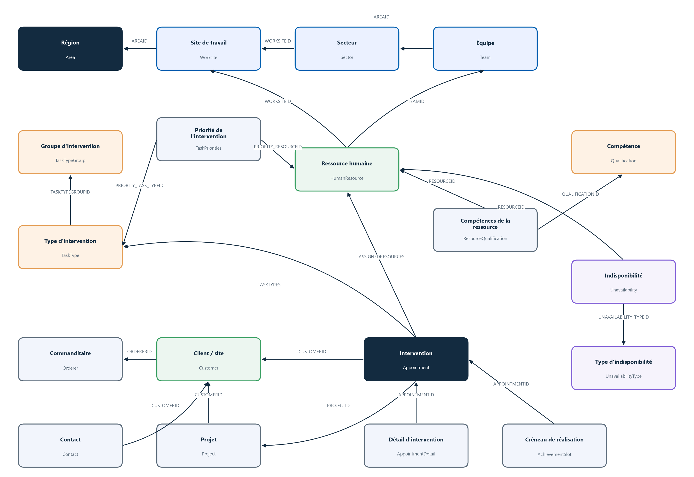

# Concepts et modèle d'échange

## Le modèle d'échange

Le modèle d'échange décrit chaque entité et chacun de ses champs par son nom, son type, son caractère obligatoire, son éventuelle restriction à l'import ou à l'export et l'entité qu'il référence. Le modèle est consultable :

* dans l'application, depuis `Administration > Fichiers CSV > Modèle d'import/export CSV` ;
* par service web, avec les opérations ListEntities et GetExchangeModel (voir [API et services web d'intégration](api-services-web.md)) ;
* dans la [référence du modèle d'échange](reference-modele/).

## Principales entités et relations

## Types de données

| Type (genre)                             | Signification                                                                                        | Format                                  | Exemple                     |
| ---------------------------------------- | ---------------------------------------------------------------------------------------------------- | --------------------------------------- | --------------------------- |
| ID                                       | Identifiant externe de l'entité                                                                      | Texte                                   | CLI\_1001                   |
| ID\_FOREIGN                              | Identifiant externe d'une entité référencée (doit exister)                                           | Texte                                   | AG\_PARIS\_N                |
| IDS\_LIST                                | Liste d'identifiants externes séparés par le séparateur de liste                                     | Texte                                   | TT\_ENTRETIEN,TT\_DEPANNAGE |
| STRING / TEXT                            | Chaîne de caractères / texte libre                                                                   | Texte                                   | Boulangerie des Lilas       |
| BOOLEAN                                  | Valeur logique                                                                                       | Voir [Importer des données](imports.md) | 1                           |
| INTEGER / REAL                           | Nombre entier / nombre décimal                                                                       | Nombre                                  | 60 / 12.5                   |
| DATE, PERIOD\_STARTDATE, PERIOD\_ENDDATE | Date ; les deux derniers bornent une période                                                         | Format de date de l'import              | 16/11/2026                  |
| DATETIME                                 | Date et heure                                                                                        | date + espace + heure                   | 16/11/2026 08:30            |
| TIME                                     | Heure du jour                                                                                        | HH:mm ou minutes                        | 08:30                       |
| DURATION                                 | Durée                                                                                                | Minutes (ou HH:mm)                      | 60                          |
| LOCATION\_\*                             | Éléments d'adresse : ADDRESS, CITY, CODEZONE, COUNTRY, ADDRESSINFO, BUILDING, DISTRICT, INITIALINPUT | Texte                                   | 12 rue des Lilas            |
| LOCATION\_X / \_Y                        | Coordonnées cartographiques dans la projection de la carte                                           | Nombre                                  | —                           |
| LOCATION\_XGEO / \_YGEO                  | Longitude / latitude en degrés décimaux (WGS 84)                                                     | Nombre                                  | 2.3912 / 48.8786            |
| LOCATION\_XYNMEA                         | Position au format GPS NMEA                                                                          | Texte                                   | —                           |
| GEOCODING\_TYPE / \_SCORE                | Qualité du géocodage (renseignée par Nomadia Field Service)                                          | Nombre                                  | 5 / 1.0                     |
| CSVSET                                   | Jeu d'enregistrements liés (détails) contenu dans une cellule                                        | Texte structuré                         | —                           |

## Colonnes d'import et d'export

Dans les tableaux de référence, la colonne I/E indique si un champ est accepté à l'import (I), produit à l'export (E) ou les deux (I/E). Un champ marqué E est ignoré à l'import. Six entités sont uniquement exportables : événements d'agenda (AgendaEvent), événements d'application (ApplicationEvent), résumés journaliers et hebdomadaires d'agenda (AgendaDaySummary, AgendaWeekSummary), journal (Journal) et résultats de rapport (ReportResult).

## Synonymes

Certaines entités acceptent d'anciens noms de colonnes, appelés synonymes, pour rester compatibles avec des fichiers existants. Par exemple, l'entité Client accepte CUSTOMERTYPE pour CUSTOMERTYPEID. Les synonymes sont listés dans la [référence du modèle d'échange](reference-modele/) ; utilisez de préférence le nom actuel.
