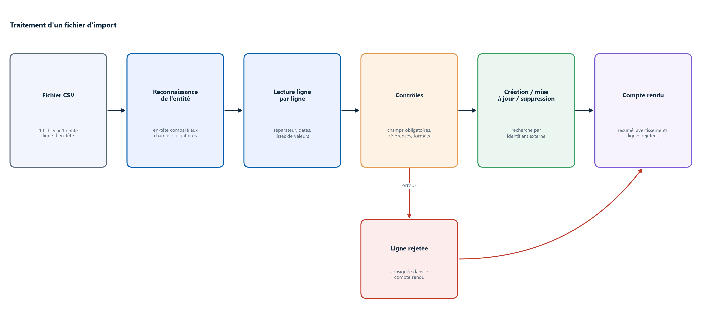

# Validation des données et gestion des erreurs

## Contrôles réalisés

| Contrôle                                                        | Niveau  | Conséquence                                                                                           |
| --------------------------------------------------------------- | ------- | ----------------------------------------------------------------------------------------------------- |
| En-tête reconnu (champs obligatoires présents, ou colonne …$ID) | Fichier | Import du fichier arrêté si aucune entité ne correspond.                                              |
| Nombre de valeurs de la ligne                                   | Ligne   | Rejet si la ligne a plus de valeurs que l'en-tête.                                                    |
| Champ obligatoire renseigné                                     | Ligne   | Rejet (code REQUIREDFIELDNOTPROVIDED).                                                                |
| Référence existante (ID\_FOREIGN, IDS\_LIST)                    | Ligne   | Rejet : « Object not found for field X with value Y ».                                                |
| Format de date, d'heure, de nombre                              | Ligne   | Rejet (date) ; avertissement ou rejet selon parsing.rigorous (nombres, booléens).                     |
| Mode d'import (INSERTONLY, UPDATEONLY)                          | Ligne   | Rejet : « Not allowed to create new record » / « Not allowed to update the existing record ».         |
| Géocodage                                                       | Ligne   | Rejet si l'adresse ne peut pas être localisée et qu'aucun site de repli n'est défini.                 |
| Changement de statut d'intervention                             | Ligne   | Changement refusé ou converti (voir [Intégrer les interventions](integrer-donnees/interventions.md)). |



## Codes d'erreur d'import

| Code | Nom                      | Signification                      |
| ---- | ------------------------ | ---------------------------------- |
| 0    | SUCCESS                  | Ligne importée.                    |
| 1    | UNKNOWNERROR             | Erreur non qualifiée.              |
| 2    | REFENTENTENITYNOTFOUND   | Entité référencée introuvable.     |
| 3    | TARGETENTITYNOTFOUND     | Objet à mettre à jour introuvable. |
| 4    | REQUIREDFIELDNOTPROVIDED | Champ obligatoire non renseigné.   |
| 6    | SAVEINDATABASEERROR      | Erreur d'enregistrement en base.   |

## Compte rendu d'import

L'import par l'interface produit deux fichiers texte, consultables depuis l'administration : Result\_\<fichier>\<horodatage>.txt (lignes importées) et ErrResult\_\<fichier>\<horodatage>.txt (lignes rejetées). Chaque ligne a la forme numéro;true|false;message, la ligne d'en-tête étant notée Header. Ces fichiers sont purgés après le délai import.setting.delayBeforeDeleteReports (1 jour par défaut).


```csv
Header;true;Import  : Customer
CUSTOMERID;CUSTOMERNAME;WORKSITEID;ADDRESS;CODEZONE;CITY;XGEO;YGEO
1;true; Customer Id: CLI_1001  successfully  updated
2;false;Object not found for field WORKSITEID with value AG_LYON
```

