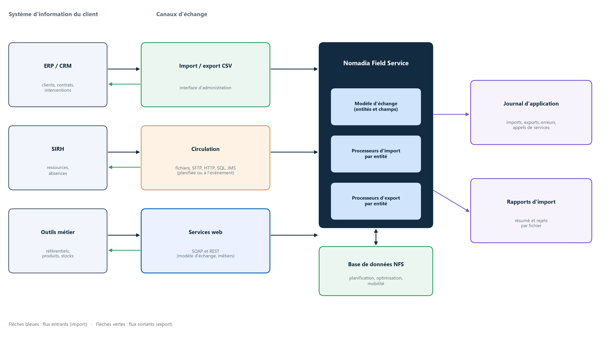
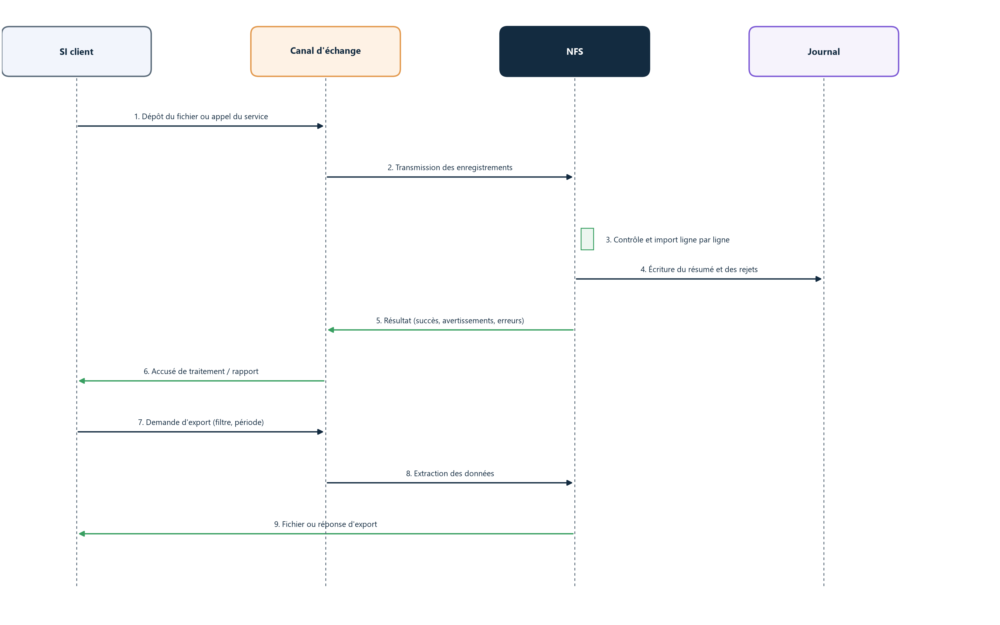

# Vue d'ensemble de l'intégration

## Principe

Nomadia Field Service échange ses données avec le système d'information du client à travers un modèle d'échange unique. Ce modèle décrit chaque entité (client, ressource, intervention, etc.) sous forme d'une liste de champs nommés en majuscules (par exemple CUSTOMERID, CUSTOMERNAME). Le même modèle sert à l'import et à l'export, quel que soit le canal utilisé.

Chaque entité est traitée par un processeur dédié qui contrôle les valeurs, résout les références vers les autres entités et crée, met à jour ou supprime les objets correspondants.

## Canaux d'échange

| Canal                                                                     | Usage type                                                                                       | Format                         | Déclenchement             |
| ------------------------------------------------------------------------- | ------------------------------------------------------------------------------------------------ | ------------------------------ | ------------------------- |
| Import / export CSV (interface d'administration)                          | Reprise initiale, corrections ponctuelles, contrôles                                             | CSV                            | Manuel                    |
| Import / export global (archive ZIP)                                      | Copie complète d'un environnement, reprise multi-entités                                         | ZIP de fichiers CSV            | Manuel                    |
| Services web d'échange (entities, exportEntities, exchangeModel)          | Connecteur applicatif, flux unitaires ou par lots                                                | SOAP (XML), REST (JSON ou XML) | Appel du système client   |
| Services web métier (prise de rendez-vous, optimisation, géocodage, etc.) | Intégration temps réel d'un portail ou d'un outil de prise de rendez-vous                        | SOAP, REST                     | Appel du système client   |
| Circulation                                                               | Flux automatisés : dépôt de fichiers, SFTP, HTTP, base SQL, JMS, envoi d'entités vers un webhook | CSV, XML, JSON, SQL            | Planifié ou à l'événement |


La circulation (moteur de flux automatisés) fait l'objet d'une documentation dédiée : voir [Module Circulation](../module-circulation/module-circulation.md). Ce guide en présente uniquement le rôle ; tous les canaux s'appuient sur le même modèle d'échange décrit ici.


## Architecture et flux d'échange

Les données entrantes passent toujours par le modèle d'échange avant d'atteindre la base de Nomadia Field Service. Les traitements d'import et d'export alimentent le journal d'application, consultable dans l'interface d'administration ou exportable (entités ApplicationEvent et Journal).

## Séquence d'intégration type

