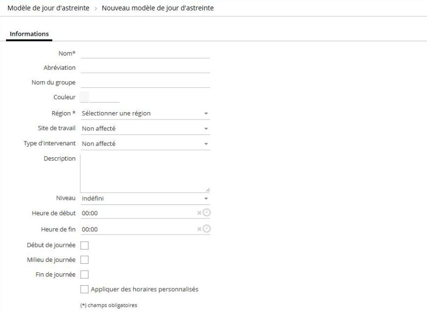
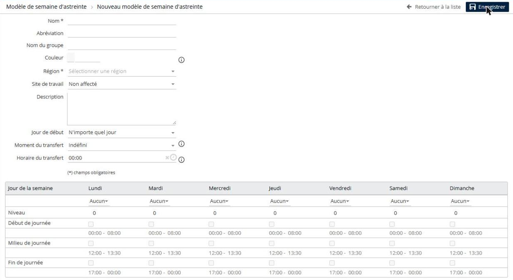

# Paramétrer les astreintes

Une astreinte réserve des plages horaires à certaines activités, par exemple une matinée dédiée aux urgences. Le paramétrage se fait en deux niveaux :

* le **modèle de jour d'astreinte** définit une plage horaire ;
* le **modèle de semaine d'astreinte** associe un modèle de jour à chaque jour de la semaine.

## Accéder à la fonctionnalité

**Navigation :** `Administration > Données entreprise > Astreintes > Modèle de jour`

**Navigation :** `Administration > Données entreprise > Astreintes > Modèle de semaine`

Les listes se filtrent par **Région** et par **Site de travail**.

## Créer un modèle de jour d'astreinte

1. Sélectionnez **Créer un modèle de jour d'astreinte**.
2. Renseignez le **Nom** et la **Région**.
3. Complétez si besoin l'**Abréviation**, le **Nom du groupe**, la **Couleur**, le **Site de travail**, le **Type d'intervenant** et la **Description**.
4. Choisissez le **Niveau**.
5. Définissez la plage avec l'**Heure de début** et l'**Heure de fin**.
6. Cochez si besoin **Début de journée**, **Milieu de journée** ou **Fin de journée**, ou **Appliquer des horaires personnalisés**.
7. Sélectionnez **Enregistrer**.

## Créer un modèle de semaine d'astreinte

1. Sélectionnez **Créer un modèle de semaine d'astreinte**.
2. Renseignez le **Nom** et la **Région**, puis si besoin l'**Abréviation**, le **Nom du groupe**, la **Couleur**, le **Site de travail** et la **Description**.
3. Choisissez le **Jour de début** : `N'importe quel jour` ou un jour précis.
4. Choisissez le **Moment du transfert** : **Indéfini**, **En début de journée**, **Après le déjeuner** ou **Jusque fin de Soirée**.
5. Renseignez si besoin l'**Horaire du transfert**.
6. Dans le tableau, sélectionnez un modèle de jour pour chaque jour de la semaine. Le tableau affiche le **Niveau** et les plages **Début de journée**, **Milieu de journée** et **Fin de journée**.
7. Sélectionnez **Enregistrer**.


D'après son info-bulle, l'**Horaire du transfert** précise une heure exacte. Il est ignoré lorsque sa valeur est `00:00`, car le choix d'un **Moment du transfert** suffit en général.


## Points d'attention

* Créez les modèles de jour avant le modèle de semaine : la semaine se compose de modèles de jour existants.
* Les champs **Nom** et **Région** sont obligatoires.
