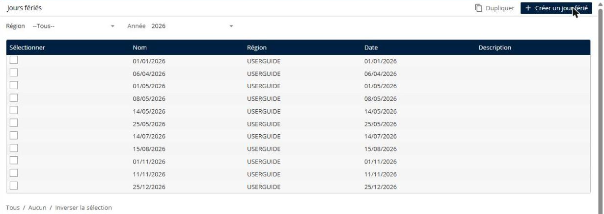
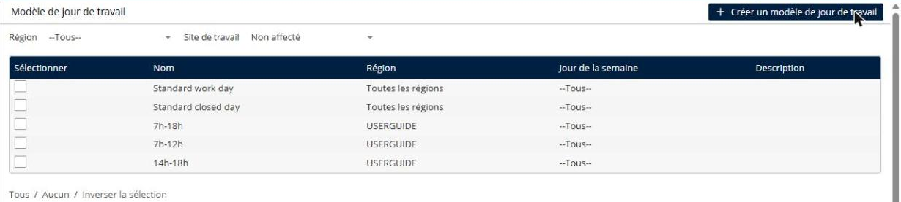
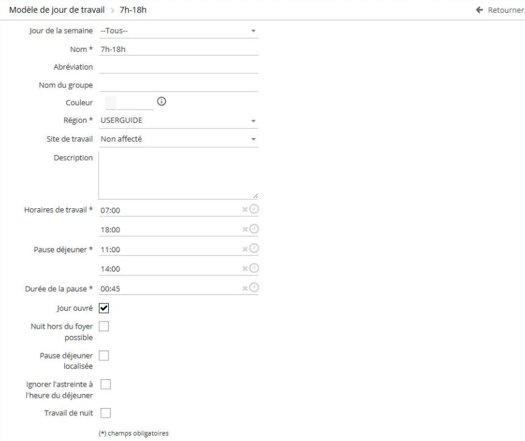
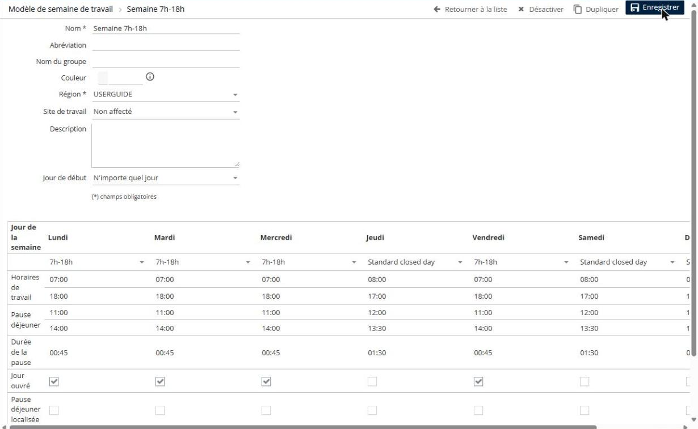

# Gérer les calendriers

Les calendriers définissent le temps de travail de référence :

* les **jours fériés** de chaque région ;
* les **modèles de jour** et les **modèles de semaine** de travail, appliqués ensuite aux ressources, aux types d'intervenant ou aux secteurs ;
* les **périodes de vente**, qui sont des plages de dates nommées.

## Accéder à la fonctionnalité

| Entrée            | Navigation                                                              | Filtres de la liste     |
| ----------------- | ----------------------------------------------------------------------- | ----------------------- |
| Jours fériés      | `Administration > Données entreprise > Calendriers > Jours fériés`      | Région, Année           |
| Modèle de jour    | `Administration > Données entreprise > Calendriers > Modèle de jour`    | Région, Site de travail |
| Modèle de semaine | `Administration > Données entreprise > Calendriers > Modèle de semaine` | Région, Site de travail |
| Période de vente  | `Administration > Données entreprise > Calendriers > Période de vente`  | Région                  |

## Gérer les jours fériés

La liste affiche, pour l'année choisie, le **Nom**, la **Région**, la **Date** et la **Description** de chaque jour férié.

Pour créer un jour férié :

1. Sélectionnez **Créer un jour férié**.
2. Renseignez le **Nom**, la **Région** et la **Date**, puis si besoin l'**Abréviation** et la **Description**.
3. Sélectionnez **Enregistrer**.

Le bouton **Dupliquer** de la liste permet, d'après son info-bulle, de copier les jours fériés de l'année affichée sur l'année suivante.

## Créer un modèle de jour

La liste affiche le **Nom**, la **Région**, le **Jour de la semaine** et la **Description** de chaque modèle.

1. Sélectionnez **Créer un modèle de jour de travail**.
2. Choisissez le **Jour de la semaine** auquel le modèle s'applique, ou `--Tous--`.
3. Renseignez le **Nom** et la **Région**, puis si besoin l'**Abréviation**, le **Nom du groupe**, la **Couleur**, le **Site de travail** et la **Description**.
4. Renseignez les **Horaires de travail**, la **Pause déjeuner** (plage) et la **Durée de la pause**.
5. Cochez les options utiles : **Jour ouvré**, **Nuit hors du foyer possible**, **Pause déjeuner localisée**, **Ignorer l'astreinte à l'heure du déjeuner**, **Travail de nuit**.
6. Sélectionnez **Enregistrer**.

## Créer un modèle de semaine

1. Sélectionnez **Créer un modèle de semaine de travail**.
2. Renseignez le **Nom** et la **Région**, puis si besoin l'**Abréviation**, le **Nom du groupe**, la **Couleur**, le **Site de travail**, la **Description** et le **Jour de début**.
3. Dans le tableau, sélectionnez un modèle de jour pour chaque jour de la semaine. Les horaires du modèle choisi s'affichent dans la colonne.
4. Sélectionnez **Enregistrer**.

Un modèle de semaine peut ensuite être sélectionné dans la liste **Modèle de semaine** d'une ressource humaine, d'un type d'intervenant ou d'un secteur.

## Créer une période de vente

1. Sélectionnez **Créer une période de vente**.
2. Renseignez le **Nom** et la **Région**, puis si besoin l'**Abréviation** et la **Description**.
3. Renseignez la période **Du** / **Au**.
4. Sélectionnez **Enregistrer**.

## Points d'attention

* Créez les modèles de jour avant les modèles de semaine.
* Les listes de jours fériés et de modèles proposent les liens **Tous**, **Aucun** et **Inverser la sélection** pour sélectionner plusieurs lignes.
