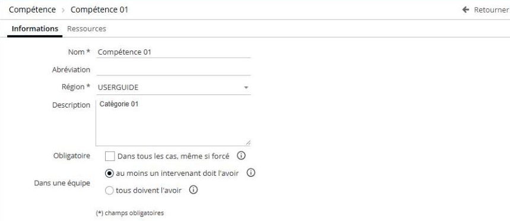
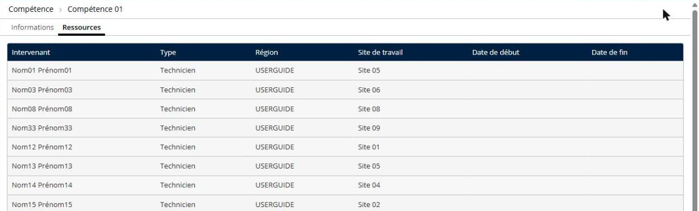

# Gérer les compétences et les autorisations

Les **compétences** décrivent les savoir-faire des ressources. Les **autorisations** décrivent leurs habilitations, par exemple une clé ou un badge d'accès. Elles sont attribuées sur la fiche de chaque ressource humaine, et les compétences sont exigées par les types d'intervention.

## Accéder à la fonctionnalité

**Navigation :** `Administration > Données entreprise > Compétence`

**Navigation :** `Administration > Données entreprise > Autorisation`

Chaque liste affiche le **Nom**, la **Région** et la **Description**. Le filtre **Région** permet de la restreindre.

## Créer une compétence

1. Sélectionnez **Créer une compétence**.
2. Renseignez le **Nom** et la **Région**, puis si besoin l'**Abréviation** et la **Description**.
3. Réglez les options :
   * **Obligatoire – Dans tous les cas, même si forcé** ;
   * **Dans une équipe** : **au moins un intervenant doit l'avoir** ou **tous doivent l'avoir**.
4. Sélectionnez **Enregistrer**.

Les options sont expliquées par des info-bulles :

| Option                                   | Info-bulle                                                                                                                                                    |
| ---------------------------------------- | ------------------------------------------------------------------------------------------------------------------------------------------------------------- |
| **Dans tous les cas, même si forcé**     | Si coché, une tâche nécessitant cette compétence ne peut pas être affectée à quelqu'un qui ne l'a pas, même en essayant de la forcer avec des droits étendus. |
| **au moins un intervenant doit l'avoir** | Pour les rendez-vous multi-intervenants, il suffit qu'un intervenant possède la compétence.                                                                   |
| **tous doivent l'avoir**                 | Pour les rendez-vous multi-intervenants, chaque intervenant doit posséder la compétence.                                                                      |

## Consulter les ressources d'une compétence

L'onglet **Ressources** de la fiche liste les intervenants qui possèdent la compétence, avec leur **Type**, leur **Région**, leur **Site de travail** et la période (**Date de début**, **Date de fin**).

## Créer une autorisation

1. Sélectionnez **Créer une autorisation**.
2. Renseignez le **Nom** et la **Région**, puis si besoin l'**Abréviation** et la **Description**.
3. Cochez si besoin **Obligatoire – Dans tous les cas, même si forcé**. L'info-bulle est la même que pour une compétence.
4. Sélectionnez **Enregistrer**.

## Points d'attention

* Pour attribuer une compétence à une ressource, utilisez l'onglet **Compétences** de sa fiche. Consultez [Gérer les ressources humaines](ressources-humaines.md).
* Pour exiger une compétence sur un type d'intervention, consultez [Paramétrer les interventions](interventions.md).
