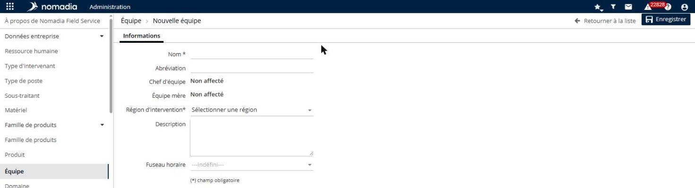
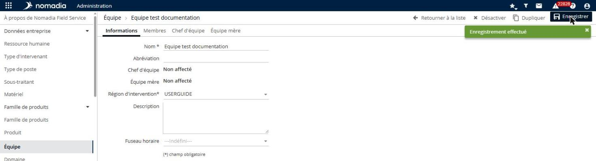
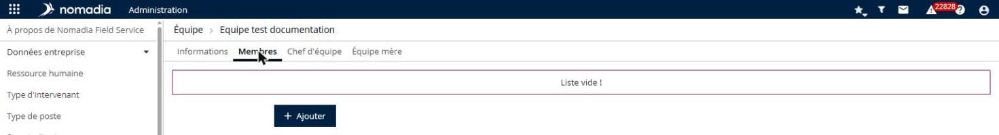

# Gérer les équipes

Une équipe regroupe des ressources humaines. Les équipes sont utilisées notamment pour afficher le planning par équipe.

## Accéder à la fonctionnalité

**Navigation :** `Administration > Données entreprise > Équipe`

La liste des équipes s'affiche avec les colonnes **Nom**, **Région** et **Description**. Le filtre **Région** permet de la restreindre.

## Créer une équipe

1. Sélectionnez **Créer une équipe**.
2. Dans l'onglet **Informations**, saisissez le **Nom**.
3. Sélectionnez la **Région d'intervention**.
4. Complétez si besoin l'**Abréviation**, la **Description** et le **Fuseau horaire**.
5. Sélectionnez **Enregistrer**.

Les champs **Nom** et **Région d'intervention** sont obligatoires.

## Résultat

La notification **Enregistrement effectué** s'affiche. La fiche de l'équipe affiche les onglets **Informations**, **Membres**, **Chef d'équipe** et **Équipe mère**, ainsi que les boutons **Retourner à la liste**, **Désactiver**, **Dupliquer** et **Enregistrer**.

## Consulter les membres

Sélectionnez l'onglet **Membres**. Pour une nouvelle équipe, la liste affiche **Liste vide !**. Le bouton **Ajouter** est disponible sous la liste.

