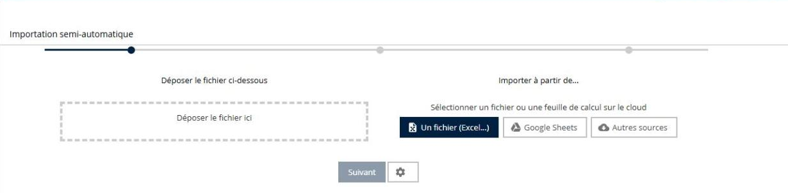
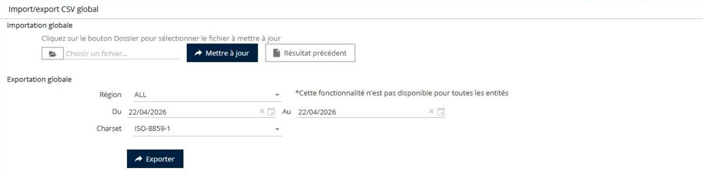
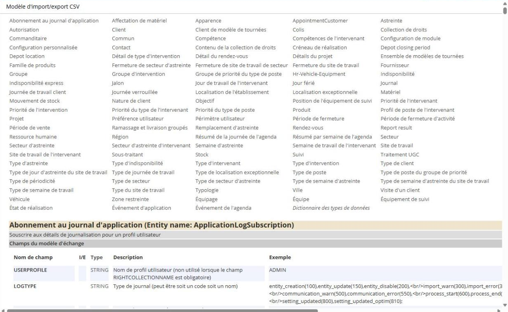

# Gérer les fichiers d'échange

En plus de l'[import](../imports-exports/importer-fichier-csv.md) et de l'[export](../imports-exports/exporter-fichier-csv.md) d'un fichier CSV, l'administration propose d'autres outils d'échange de données.

## Avant de commencer

Un import modifie les données de l'application. Vérifiez le fichier et testez-le sur un petit volume avant un import complet.

## Accéder à la fonctionnalité

| Entrée                         | Navigation                                                       |
| ------------------------------ | ---------------------------------------------------------------- |
| Importation semi-automatique   | `Administration > Fichiers CSV > Importation semi-automatique`   |
| Import/export CSV global       | `Administration > Fichiers CSV > Import/export CSV global`       |
| Modèle d'import/export CSV     | `Administration > Fichiers CSV > Modèle d'import/export CSV`     |
| Listeners de la circulation    | `Administration > Fichiers CSV > Listeners de la circulation`    |
| Liens d'exportation prédéfinis | `Administration > Fichiers CSV > Liens d'exportation prédéfinis` |
| Fichiers spécifiques           | `Administration > Fichiers spécifiques > …`                      |
| Fichiers XML                   | `Administration > Fichiers XML > …`                              |

## Utiliser l'importation semi-automatique

L'**Importation semi-automatique** se déroule en plusieurs étapes, matérialisées par une barre de progression.

1. Déposez le fichier dans la zone **Déposer le fichier ici**, ou choisissez une source sous **Importer à partir de…** : **Un fichier (Excel…)**, **Google Sheets** ou **Autres sources**.
2. Sélectionnez **Suivant** et suivez les étapes.

## Importer ou exporter toutes les données

La page **Import/export CSV global** comporte deux zones.

* **Importation globale** : sélectionnez le fichier avec le bouton Dossier (**Choisir un fichier…**), puis **Mettre à jour**. Le bouton **Résultat précédent** affiche le résultat du dernier import.
* **Exportation globale** : choisissez la **Région**, la période **Du** / **Au** et le **Charset**, puis sélectionnez **Exporter**.


D'après le message affiché sur la page, l'exportation globale n'est pas disponible pour toutes les entités.


## Consulter le modèle d'import/export CSV

La page **Modèle d'import/export CSV** décrit le format d'échange de chaque entité.

1. En haut de la page, sélectionnez l'entité, par exemple **Client**, **Rendez-vous** ou **Ressource humaine**.
2. Consultez sa description et le tableau **Champs du modèle d'échange** : **Nom de champ**, **I/E**, **Type**, **Description** et **Exemple**.

Le lien **Dictionnaire des types de données** décrit les types utilisés.

La même page est accessible depuis `Administration > API Nomadia Field Service > Modèle d'import/export CSV`.

## Autres entrées

| Entrée                                                                            | Contenu                                                                                                                                                                                                       |
| --------------------------------------------------------------------------------- | ------------------------------------------------------------------------------------------------------------------------------------------------------------------------------------------------------------- |
| **Listeners de la circulation**                                                   | Liste des listeners HTTP de la circulation. Le message **Pas de listeners** s'affiche lorsqu'aucun n'est défini.                                                                                              |
| **Liens d'exportation prédéfinis**                                                | Page **Exporter les agendas** : liste de liens d'export, par exemple les interventions des quatre prochaines semaines pour toutes les régions ou pour une région.                                             |
| **Fichiers spécifiques > Exporter des POI TomTom / Masternaut / Garmin / en KML** | Page **Entités à exporter** : choisissez l'**Entité**, le **Filtrage** (**Aucun**, **Région** ou **Ressource humaine**), puis **Exporter**.                                                                   |
| **Fichiers spécifiques > Importer une simulation GTM**                            | **Mode de remplissage**, **Association de champ NFS - GTM**, options **Autorise la création des secteurs manquants** et **Autorise la création de villes manquantes**, sélection du fichier, puis **Upload**. |
| **Fichiers XML > Fichier d'optimisation**                                         | Onglets **Télécharger** et **Mettre à jour** du fichier de paramétrage d'optimisation.                                                                                                                        |
| **Fichiers XML > Fichier de circulation**                                         | Onglets **Télécharger**, **Mettre à jour**, **Visualiser** et **Documentation**. Après la mise à jour, un message indique si la configuration est valide.                                                     |
| **Fichiers XML > Exemples de circulation**                                        | Liste d'exemples de fichiers de configuration de circulation.                                                                                                                                                 |
| **Fichiers XML > Journaux**                                                       | Réglage du **Niveau de journalisation**, bouton **Voir les journaux** et **Appliquer**.                                                                                                                       |


Les fichiers d'optimisation et de circulation pilotent le fonctionnement de l'application. Téléchargez toujours la version en place avant d'en charger une nouvelle avec **Mettre à jour**.

