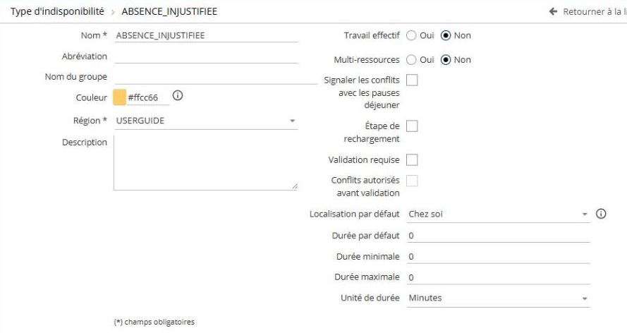
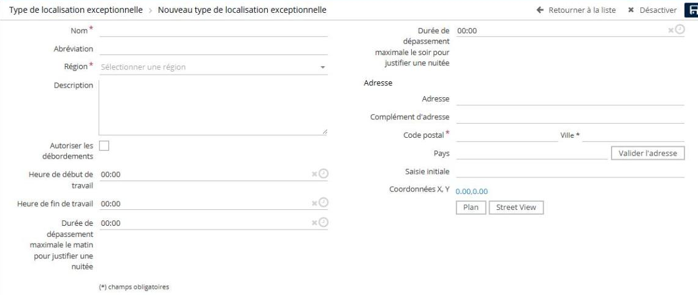

# Paramétrer les types d'indisponibilité et de localisation exceptionnelle

Les **types d'indisponibilité** qualifient les absences et les activités hors rendez-vous des ressources : congé, réunion, formation… Ils sont proposés lors de la [création d'une indisponibilité](../indisponibilites/creer-indisponibilite.md).

Les **types de localisation exceptionnelle** décrivent un lieu de travail temporaire, avec ses horaires et son adresse.

## Accéder à la fonctionnalité

**Navigation :** `Administration > Données entreprise > Type d'indisponibilité`

**Navigation :** `Administration > Données entreprise > Type de localisation exceptionnelle`

La liste des types d'indisponibilité affiche le **Nom**, la **Région**, le **Nom du groupe** et la **Description**. Elle se filtre par **Région** et par **Nom du groupe**.

## Paramétrer un type d'indisponibilité

1. Sélectionnez **Créer un type d'indisponibilité**, ou sélectionnez une ligne de la liste.
2. Renseignez le **Nom** et la **Région**, puis si besoin l'**Abréviation**, le **Nom du groupe**, la **Couleur** et la **Description**.
3. Réglez les options décrites ci-dessous.
4. Sélectionnez **Enregistrer**.

| Champ                                                        | Valeurs                  |
| ------------------------------------------------------------ | ------------------------ |
| **Travail effectif**                                         | Oui / Non                |
| **Multi-ressources**                                         | Oui / Non                |
| **Signaler les conflits avec les pauses déjeuner**           | Case à cocher            |
| **Étape de rechargement**                                    | Case à cocher            |
| **Validation requise**                                       | Case à cocher            |
| **Conflits autorisés avant validation**                      | Case à cocher            |
| **Localisation par défaut**                                  | Voir le tableau suivant  |
| **Durée par défaut**, **Durée minimale**, **Durée maximale** | Valeurs numériques       |
| **Unité de durée**                                           | Minutes, Heures ou Jours |

Les valeurs de **Localisation par défaut** sont expliquées par une info-bulle :

| Valeur                                      | Info-bulle                                                                                                                                             |
| ------------------------------------------- | ------------------------------------------------------------------------------------------------------------------------------------------------------ |
| **Chez soi**                                | Par défaut, l'indisponibilité est localisée chez l'intervenant.                                                                                        |
| **Sur le lieu de travail**                  | Par défaut, l'indisponibilité est localisée sur le lieu de travail principal de l'intervenant.                                                         |
| **Dans le secteur**                         | L'indisponibilité est localisée au secteur de la ressource.                                                                                            |
| **Non renseignée mais nécessaire**          | Aucune localisation par défaut mais l'indisponibilité doit être localisée.                                                                             |
| **Pas de position nécessaire**              | Aucune localisation par défaut et l'indisponibilité n'est pas obligatoirement localisée.                                                               |
| **Au lieu de départ/arrivée de la tournée** | Par défaut, l'indisponibilité est localisée sur le départ de l'intervenant, ou sur son lieu d'arrivée pour une indisponibilité qui se termine le soir. |


D'après l'info-bulle du champ **Couleur**, la couleur ne s'applique correctement qu'aux éléments dont la référence externe est renseignée.


## Paramétrer un type de localisation exceptionnelle

1. Sélectionnez **Créer un type de localisation exceptionnelle**.
2. Renseignez le **Nom** et la **Région**, puis si besoin l'**Abréviation** et la **Description**.
3. Réglez les horaires :
   * **Autoriser les débordements** ;
   * **Heure de début de travail** et **Heure de fin de travail** ;
   * **Durée de dépassement maximale le matin pour justifier une nuitée** ;
   * **Durée de dépassement maximale le soir pour justifier une nuitée**.
4. Renseignez le bloc **Adresse** (**Code postal** et **Ville** obligatoires), puis sélectionnez **Valider l'adresse**.
5. Sélectionnez **Enregistrer**.

