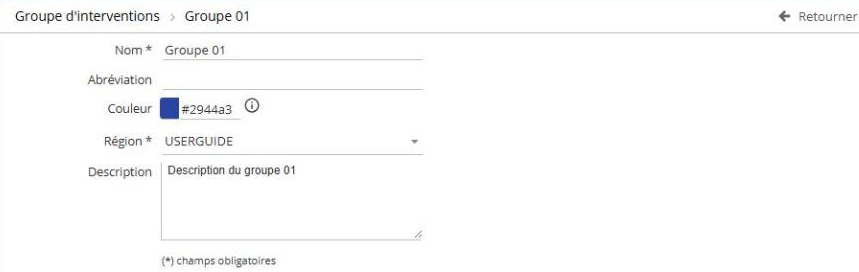
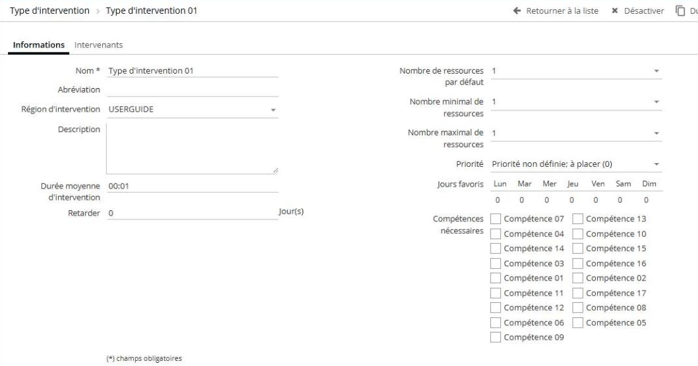

# Paramétrer les interventions

Un **type d'intervention** correspond à la tâche réalisée lors d'un rendez-vous. Les types sont rangés dans des **groupes d'interventions**, qui représentent les grandes activités de l'entreprise.

## Accéder à la fonctionnalité

**Navigation :** `Administration > Données entreprise > Intervention > Groupe d'interventions`

**Navigation :** `Administration > Données entreprise > Intervention > Type d'intervention`

* La liste des groupes se filtre par **Région**.
* La liste des types se filtre par **Groupe d'interventions** : sélectionnez un groupe pour afficher ses types.

## Créer un groupe d'interventions

1. Sélectionnez **Créer un groupe d'interventions**.
2. Renseignez le **Nom** et la **Région**.
3. Complétez si besoin l'**Abréviation**, la **Couleur** et la **Description**.
4. Sélectionnez **Enregistrer**.

## Créer un type d'intervention

1. Dans la liste des types, sélectionnez le **Groupe d'interventions** concerné.
2. Sélectionnez **Créer un type d'intervention**.
3. Renseignez le **Nom**, puis si besoin l'**Abréviation**, la **Région d'intervention** et la **Description**.
4. Renseignez la **Durée moyenne d'intervention** au format `HH:mm` et, si besoin, la valeur **Retarder** en jours.
5. Réglez les champs de planification décrits ci-dessous.
6. Cochez les **Compétences nécessaires**.
7. Sélectionnez **Enregistrer**.

| Champ                               | Valeurs                                                                                                                                               |
| ----------------------------------- | ----------------------------------------------------------------------------------------------------------------------------------------------------- |
| **Nombre de ressources par défaut** | 1 à 9                                                                                                                                                 |
| **Nombre minimal de ressources**    | 1 à 9                                                                                                                                                 |
| **Nombre maximal de ressources**    | 1 à 9                                                                                                                                                 |
| **Priorité**                        | Priorité non définie; à placer (0), Non prioritaire (5), Placement souhaitable (25), À placer (50), Placement prioritaire (80), Placement exigé (100) |
| **Jours favoris**                   | Une valeur par jour, de **Lun** à **Dim**                                                                                                             |
| **Compétences nécessaires**         | Liste des compétences à cocher                                                                                                                        |

L'onglet **Intervenants** liste les intervenants rattachés au type, avec leur **Région**, leur **Site de travail** et leur **Type**.

## Points d'attention

* Le champ **Nom** est obligatoire.
* Les compétences proposées sont celles créées dans [Gérer les compétences et les autorisations](competences-autorisations.md).
* L'autorisation de planifier chaque type d'intervention se règle par type d'intervenant, dans l'onglet **Priorités**. Consultez [Gérer les types d'intervenant et les types de poste](types-intervenant-poste.md).
