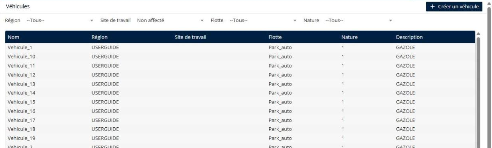
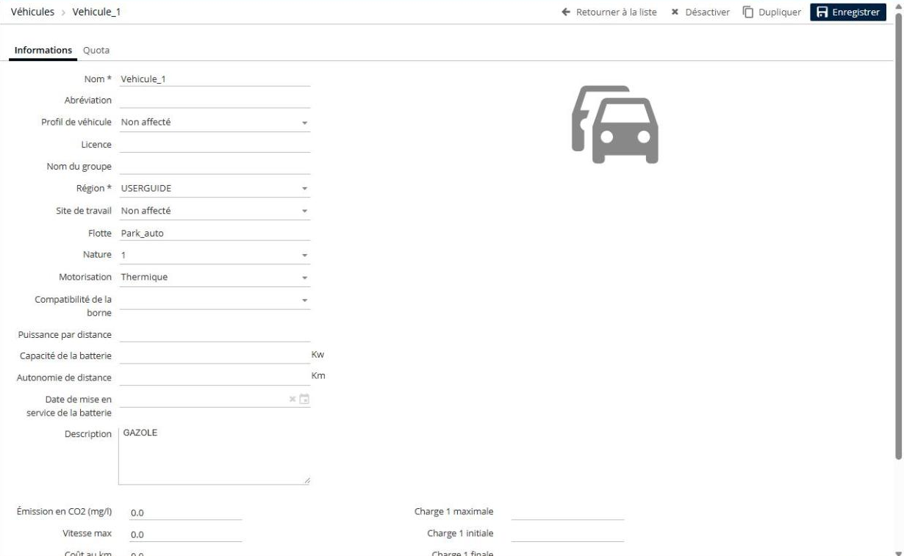
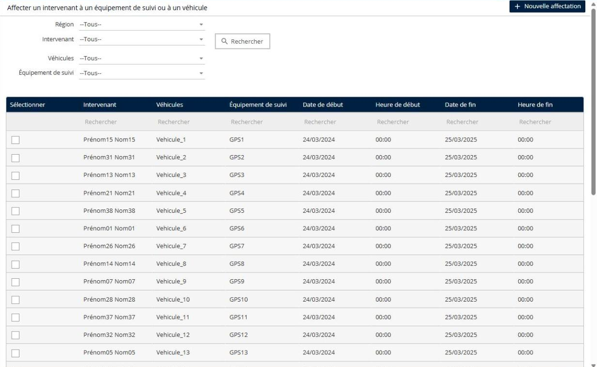

# Gérer la mobilité

Le groupe **Mobilité** décrit les véhicules et les équipements de suivi (par exemple des boîtiers GPS), et les affecte aux intervenants.

## Accéder à la fonctionnalité

| Entrée               | Navigation                                         |
| -------------------- | -------------------------------------------------- |
| Véhicules            | `Administration > Mobilité > Véhicules`            |
| Équipement de suivi  | `Administration > Mobilité > Équipement de suivi`  |
| Affectations         | `Administration > Mobilité > Affectations`         |
| Utilitaires de suivi | `Administration > Mobilité > Utilitaires de suivi` |
| Paramètres           | `Administration > Mobilité > Paramètres`           |

## Gérer les véhicules

La liste se filtre par **Région**, **Site de travail**, **Flotte** et **Nature**. Elle affiche le **Nom**, la **Région**, le **Site de travail**, la **Flotte**, la **Nature** et la **Description** de chaque véhicule.

1. Sélectionnez **Créer un véhicule**, ou sélectionnez un véhicule de la liste.
2. Dans l'onglet **Informations**, renseignez le **Nom** et la **Région**.
3. Complétez les autres champs utiles :
   * **Abréviation**, **Profil de véhicule**, **Licence**, **Nom du groupe**, **Site de travail**, **Flotte**, **Nature**, **Motorisation** ;
   * pour un véhicule électrique : **Compatibilité de la borne**, **Puissance par distance**, **Capacité de la batterie**, **Autonomie de distance**, **Date de mise en service de la batterie** ;
   * **Émission en CO2**, **Vitesse max**, **Coût au km** et les charges (**Charge 1 maximale**, **Charge 1 initiale**, **Charge 1 finale**…).
4. Complétez si besoin l'onglet **Quota**.
5. Sélectionnez **Enregistrer**.

## Gérer les équipements de suivi

La liste affiche le **Nom**, la **Région** et la **Description** de chaque équipement. Pour créer un équipement, sélectionnez **Créer un équipement de suivi**, renseignez le **Nom** et la **Région**, puis si besoin l'**Abréviation** et la **Description**, et sélectionnez **Enregistrer**.

## Affecter un véhicule ou un équipement à un intervenant

La page **Affecter un intervenant à un équipement de suivi ou à un véhicule** liste les affectations existantes.

1. Filtrez si besoin par **Région**, **Intervenant**, **Véhicules** ou **Équipement de suivi**, puis sélectionnez **Rechercher**.
2. Pour créer une affectation, sélectionnez **Nouvelle affectation**.

La liste affiche l'**Intervenant**, le **Véhicule**, l'**Équipement de suivi** et la période d'affectation (**Date de début**, **Heure de début**, **Date de fin**, **Heure de fin**). Chaque colonne dispose d'un champ **Rechercher**.

## Régler le suivi

* **Utilitaires de suivi** : la case **Autoriser le suivi quotidien**, puis **Enregistrer**.
* **Paramètres** : le **Serveur de positions** et trois seuils, puis **Enregistrer** :
  * **Rayon dans lequel les intervenants en mouvement sont considérés comme étant sur leur trajet idéal** (en mètres) ;
  * **Rayon dans lequel les intervenants à l'arrêt sont considérés comme ayant rejoint leur destination** (en mètres) ;
  * **Limite avant qu'une position ne soit considérée comme ancienne** (en minutes).
