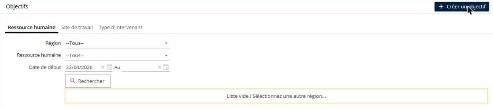
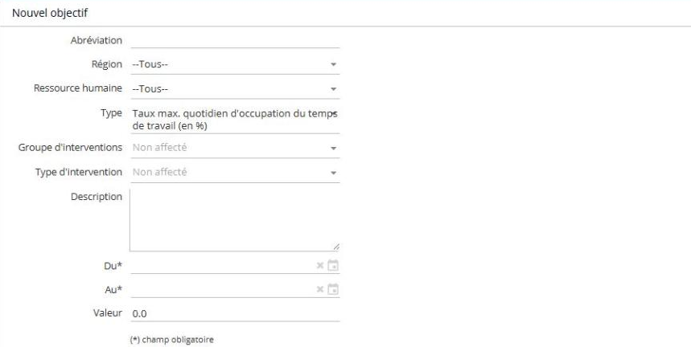
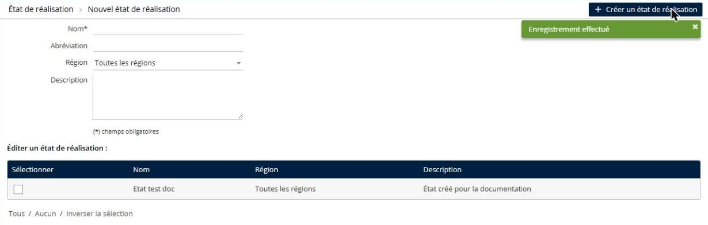
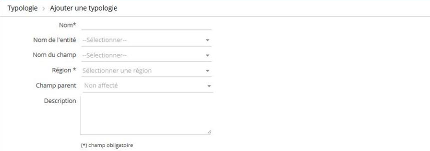

# Gérer les objectifs, le suivi de l'activité et les typologies

Ces entrées complètent le paramétrage de l'activité :

* les **objectifs** fixent une valeur cible sur une période pour une ressource, un site de travail ou un type d'intervenant ;
* les **états de réalisation** et les **suites à donner** sont des listes de valeurs personnalisables pour le suivi des rendez-vous ;
* les **typologies** sont des listes de valeurs rattachées à un champ d'une entité.

## Accéder à la fonctionnalité

| Entrée              | Navigation                                                                        |
| ------------------- | --------------------------------------------------------------------------------- |
| Objectifs           | `Administration > Données entreprise > Objectifs`                                 |
| État de réalisation | `Administration > Données entreprise > Suivi de l'activité > État de réalisation` |
| Suite à donner      | `Administration > Données entreprise > Suivi de l'activité > Suite à donner`      |
| Typologie           | `Administration > Données entreprise > Typologie`                                 |

## Rechercher des objectifs

La page **Objectifs** comporte trois onglets : **Ressource humaine**, **Site de travail** et **Type d'intervenant**.

1. Sélectionnez l'onglet correspondant au niveau de l'objectif.
2. Renseignez la **Région**, l'élément concerné (par exemple **Ressource humaine**) et la période **Date de début** / **Au**.
3. Sélectionnez **Rechercher**.

## Créer un objectif

1. Sélectionnez **Créer un objectif**.
2. Renseignez la **Région** et l'élément concerné, par exemple la **Ressource humaine**.
3. Choisissez le **Type** d'objectif.
4. Précisez si besoin le **Groupe d'interventions** et le **Type d'intervention**.
5. Renseignez la période **Du** / **Au** et la **Valeur**.
6. Sélectionnez **Enregistrer**.

Le champ **Type** propose notamment : **Taux max. quotidien d'occupation du temps de travail (en %)**, **Chiffre d'affaires**, **Nombre de rendez-vous pris**, **Nombre de rendez-vous**, **Chiffre d'affaire quotidien**, **Nombre quotidien de rendez-vous**, **Nombre quotidien de rendez-vous pris** et **Nombre de réunions quotidiennes**.

## Limiter le nombre de rendez-vous par jour

Un objectif **Nombre quotidien de rendez-vous** défini sur une ressource humaine agit comme une limite : lors de la recherche de créneaux, de la planification et de l'optimisation, un créneau qui ferait dépasser cette valeur un jour donné n'est pas proposé pour la ressource.

* Avec un **Groupe d'interventions** et un **Type d'intervention**, seuls les rendez-vous de ce type sont comptés.
* Avec un groupe et **--Tous--**, tous les rendez-vous du groupe sont comptés.
* Les rendez-vous sans groupe d'interventions ne sont pas comptés.

**Exemple :** pour qu'un intervenant ne réalise qu'un rendez-vous de type « Matin » et un rendez-vous de type « Soir » par jour, créez deux objectifs **Nombre quotidien de rendez-vous** de valeur 1 : l'un sur le type « Matin », l'autre sur le type « Soir ».


La limite est journalière. Les rendez-vous déjà planifiés ne sont pas retirés du planning à la création de l'objectif. Ne confondez pas **Nombre quotidien de rendez-vous** et **Nombre quotidien de rendez-vous pris**.


## Gérer les états de réalisation et les suites à donner

Les deux entrées fonctionnent de la même façon : le formulaire de saisie s'affiche en haut de la page et la liste des valeurs existantes en dessous.

1. Ouvrez **État de réalisation** ou **Suite à donner**.
2. Renseignez le **Nom**, puis si besoin l'**Abréviation**, la **Région** et la **Description**.
3. Sélectionnez **Créer un état de réalisation** ou **Créer un suivi**.

La notification **Enregistrement effectué** s'affiche et la valeur apparaît dans la liste, sous le formulaire.

Par défaut, la **Région** vaut `Toutes les régions`. Les liens **Tous**, **Aucun** et **Inverser la sélection** facilitent la sélection des lignes.

## Créer une typologie

1. Sélectionnez **Créer une typologie**.
2. Renseignez le **Nom** et la **Région**.
3. Choisissez le **Nom de l'entité**, par exemple `APPOINTMENT`, `CUSTOMER`, `RESOURCE` ou `WORKSITE`, puis le **Nom du champ**.
4. Choisissez si besoin un **Champ parent** et saisissez une **Description**.
5. Sélectionnez **Enregistrer**.

