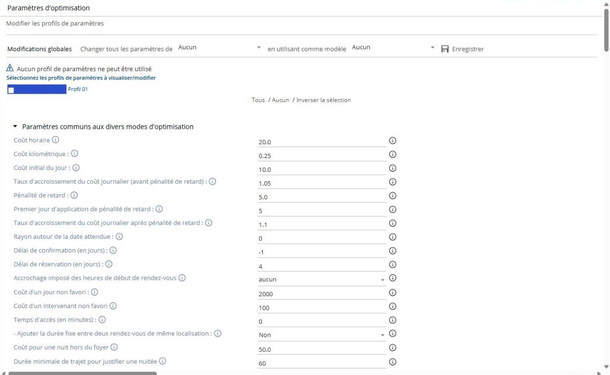
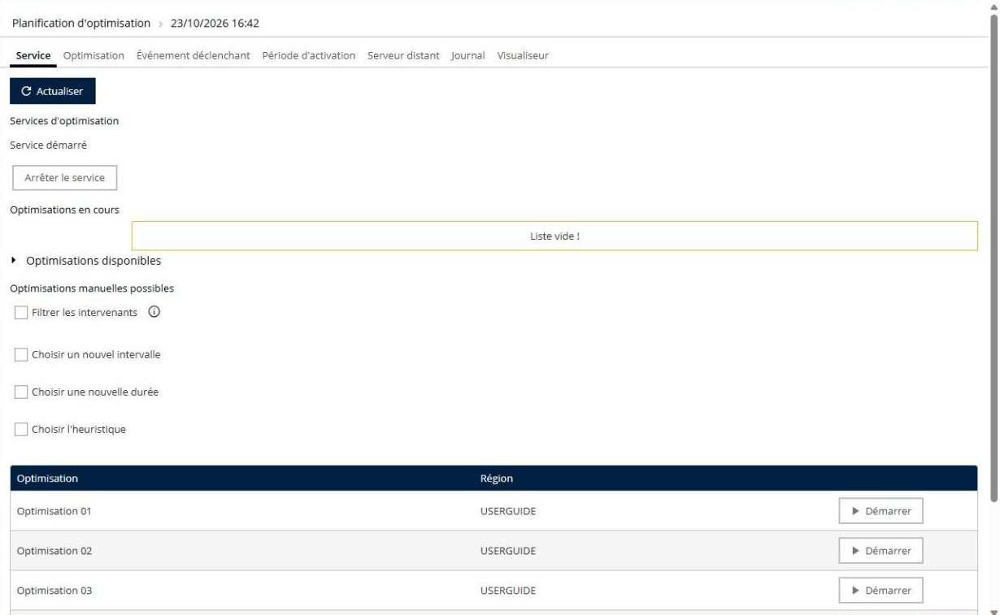
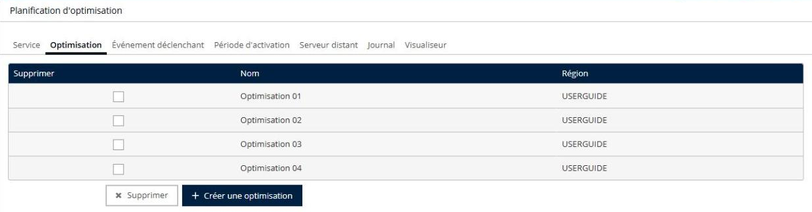
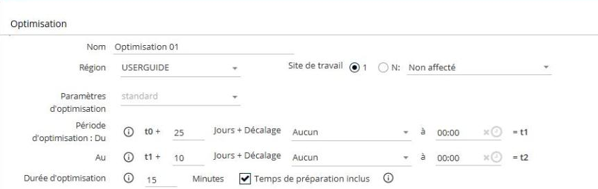
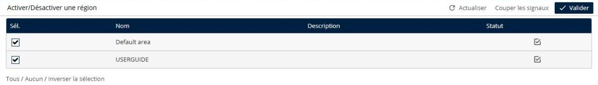

# Paramétrer l'optimisation

Le groupe **Optimisation** regroupe le paramétrage des moteurs d'optimisation de Nomadia Field Service :

* les **profils de paramètres**, qui expriment les coûts et les contraintes pris en compte ;
* la **planification des optimisations**, qui définit quand et sur quel périmètre une optimisation s'exécute ;
* l'**activation des régions** ;
* l'**export et l'import** d'une optimisation globale.

## Avant de commencer

Ces réglages modifient le résultat des optimisations pour toutes les régions concernées. Faites valider toute modification par le responsable du paramétrage, et testez-la sur une période limitée.

## Accéder à la fonctionnalité

| Entrée                        | Navigation                                                      |
| ----------------------------- | --------------------------------------------------------------- |
| Paramètres d'optimisation     | `Administration > Optimisation > Paramètres d'optimisation`     |
| Planification d'optimisation  | `Administration > Optimisation > Planification d'optimisation`  |
| Activer/Désactiver une région | `Administration > Optimisation > Activer/Désactiver une région` |
| Importer/exporter une optim   | `Administration > Optimisation > Importer/exporter une optim`   |

## Modifier un profil de paramètres

1. Ouvrez **Paramètres d'optimisation**.
2. Sous **Sélectionnez les profils de paramètres à visualiser/modifier**, cochez le ou les profils concernés.
3. Ouvrez la section utile :
   * **Paramètres communs aux divers modes d'optimisation** ;
   * **Paramètres relatifs à l'optimisation temps réel** ;
   * **Paramètres relatifs à l'optimisation batch**.
4. Modifiez les valeurs. L'icône d'information de chaque ligne affiche l'aide du paramètre.
5. Sélectionnez **Enregistrer**.

Les paramètres communs comprennent notamment le **Coût horaire**, le **Coût kilométrique**, le **Coût initial du jour**, la **Pénalité de retard**, le **Délai de confirmation (en jours)**, le **Délai de réservation (en jours)**, le **Coût d'un jour non favori**, le **Coût d'un intervenant non favori**, le **Coût pour une nuit hors du foyer** et la **Durée minimale de trajet pour justifier une nuitée**.

La ligne **Modifications globales** permet de **Changer tous les paramètres de** un profil **en utilisant comme modèle** un autre profil, puis d'**Enregistrer**.

## Planifier une optimisation

La page **Planification d'optimisation** comporte les onglets suivants :

| Onglet                    | Contenu                                                                                                                                   |
| ------------------------- | ----------------------------------------------------------------------------------------------------------------------------------------- |
| **Service**               | État du service d'optimisation, optimisations en cours et optimisations disponibles, avec un bouton **Démarrer** par optimisation         |
| **Optimisation**          | Liste des optimisations planifiées, boutons **Créer une optimisation** et **Supprimer**                                                   |
| **Événement déclenchant** | Liste des événements (**Nom**, **Détail**, par exemple un horaire quotidien), boutons **Créer un événement déclenchant** et **Supprimer** |
| **Période d'activation**  | Liste des périodes d'activation, boutons **Créer une période d'activation** et **Supprimer**                                              |
| **Serveur distant**       | Serveurs d'optimisation, avec leur **Niveau de priorité**, leur **Type** et leur **Statut**                                               |
| **Journal**               | Recherche dans le journal des optimisations, par **Résultat**, **Région**, **Nom** et **Période**                                         |
| **Visualiseur**           | Onglet de visualisation                                                                                                                   |

Dans l'onglet **Service**, la zone **Optimisations manuelles possibles** propose les options **Filtrer les intervenants**, **Choisir un nouvel intervalle**, **Choisir une nouvelle durée** et **Choisir l'heuristique** avant de lancer une optimisation avec **Démarrer**.

### Créer une optimisation planifiée

L'onglet **Optimisation** liste les optimisations planifiées avec leur **Nom** et leur **Région**.

1. Dans l'onglet **Optimisation**, sélectionnez **Créer une optimisation**, ou sélectionnez une optimisation de la liste.
2. Renseignez le **Nom**, la **Région**, le **Site de travail** et le profil de **Paramètres d'optimisation**.
3. Définissez la **Période d'optimisation** :
   * **Du** : `t0 +` un nombre de jours, avec un **Décalage** et une heure, ce qui donne `t1` ;
   * **Au** : `t1 +` un nombre de jours, avec un **Décalage** et une heure, ce qui donne `t2`.
4. Renseignez la **Durée d'optimisation** en minutes et cochez si besoin **Temps de préparation inclus**.
5. Réglez les options : moteur d'optimisation, **Actif**, **Type d'optimisation** (**Rapide** ou **Total**), **Simulation**, **Génération de rendez-vous récurrents avant optimisation**, **Génération des nuitées avant optimisation**, **Repositionner les visites au plus tôt**, **Utilisation des périodes de vente**.
6. Ajoutez un **Événement déclenchant** et, si besoin, une **Période d'activation**.
7. Sélectionnez **Enregistrer**.

D'après les info-bulles :

* `t1`, début de la période, est calculé à partir du moment de déclenchement de l'optimisation (`t0`), décalé d'un nombre de jours ;
* `t2`, fin de la période, est calculé en nombre de jours à partir de `t1` ;
* lorsque **Temps de préparation inclus** est coché, la durée d'optimisation comprend le temps de préparation et de recherche d'un serveur d'optimisation ; sinon, elle ne compte que le temps passé à optimiser.

## Activer ou désactiver une région

La page **Activer/Désactiver une région** liste les régions avec leur **Statut**.

1. Cochez les régions dans la colonne **Sél.**
2. Sélectionnez **Valider**.

Les boutons **Actualiser** et **Couper les signaux** sont également proposés.

## Exporter ou importer une optimisation globale

La page **Optimisation globale** comporte deux onglets.

* **Exporter** : choisissez le format d'**Exportation vers**, la région, le **Site de travail**, les **Ressources**, la **Période d'optimisation**, le **Type d'optimisation** et le **Modèle d'optimisation**, puis sélectionnez **Valider**.
* **Importation** : sélectionnez le fichier avec le bouton Dossier, puis **Mettre à jour**.


Le bouton **Arrêter le service** de l'onglet **Service** arrête le service d'optimisation. Ne l'utilisez qu'en accord avec le responsable de l'exploitation.

