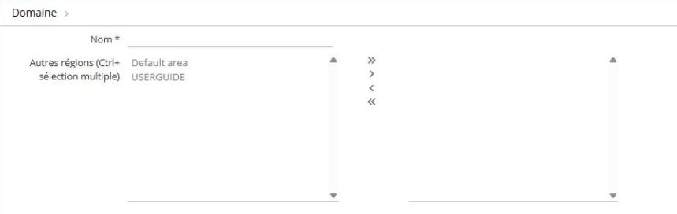
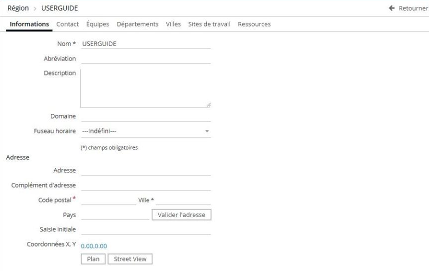
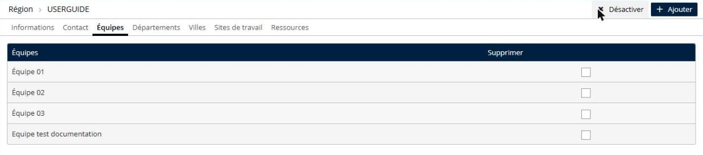
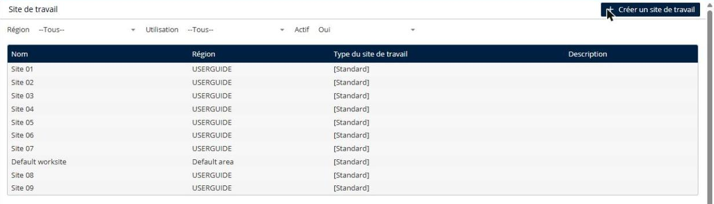
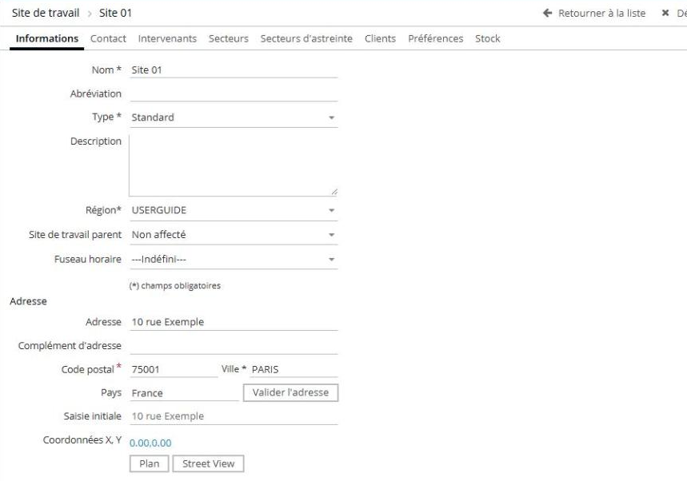
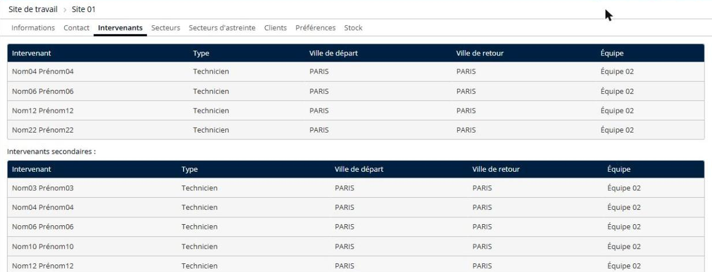
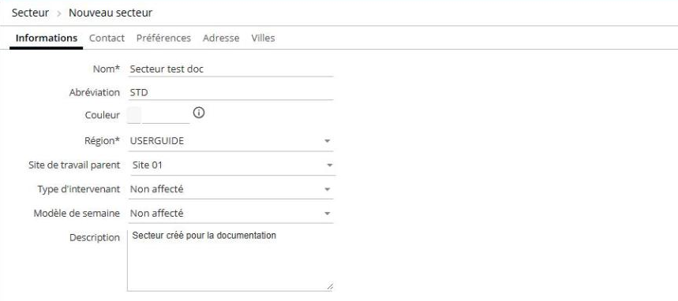
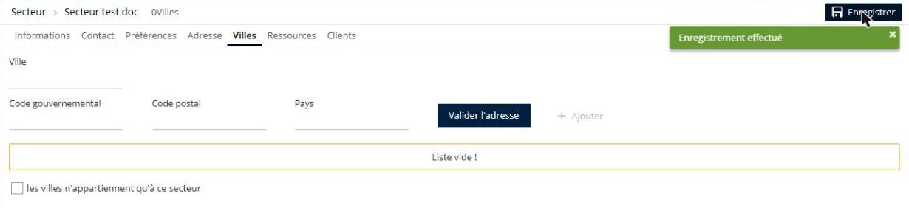

# Gérer l'organisation géographique

L'organisation géographique structure les données de l'application :

* le **domaine** regroupe des régions ;
* la **région** est la zone de rattachement des ressources, des équipes et des données de paramétrage ;
* le **site de travail** représente un lieu de travail commun à plusieurs intervenants : agence, dépôt, magasin… ;
* le **secteur** et le **secteur d'astreinte** découpent l'activité, par exemple par villes.

## Accéder à la fonctionnalité

| Entrée              | Navigation                                                  | Filtres de la liste        |
| ------------------- | ----------------------------------------------------------- | -------------------------- |
| Domaine             | `Administration > Données entreprise > Domaine`             | —                          |
| Région              | `Administration > Données entreprise > Région`              | Domaine                    |
| Site de travail     | `Administration > Données entreprise > Site de travail`     | Région, Utilisation, Actif |
| Secteur             | `Administration > Données entreprise > Secteur`             | Région, Site de travail    |
| Secteur d'astreinte | `Administration > Données entreprise > Secteur d'astreinte` | Région, Site de travail    |

## Domaine

La fiche d'un domaine contient le **Nom**\* et deux listes :

* **Autres régions (Ctrl+ sélection multiple)** : régions disponibles ;
* à droite, les régions du domaine.

Sélectionnez une ou plusieurs régions, puis utilisez les boutons **>** et **<** pour déplacer la sélection, ou **>>** et **<<** pour déplacer toutes les régions. Sélectionnez ensuite **Enregistrer**.

## Région

La liste affiche le **Nom**, le **Domaine** et la **Description** de chaque région. La fiche comporte les onglets suivants :

| Onglet               | Contenu                                                                                                                       |
| -------------------- | ----------------------------------------------------------------------------------------------------------------------------- |
| **Informations**     | Nom\*, Abréviation, Description, Domaine, Fuseau horaire et bloc **Adresse**                                                  |
| **Contact**          | Contact 1 et Contact 2 : Civilité, Prénom, Nom, Poste occupé, Téléphone portable, Téléphone bureau, E-mail prof., Description |
| **Équipes**          | Équipes rattachées à la région                                                                                                |
| **Départements**     | Départements de la région                                                                                                     |
| **Villes**           | Villes de la région                                                                                                           |
| **Sites de travail** | Sites de travail de la région                                                                                                 |
| **Ressources**       | Ressources de la région                                                                                                       |

Dans l'onglet **Équipes**, le bouton **Ajouter** permet de rattacher une équipe. Pour retirer une équipe, cochez-la dans la colonne **Supprimer**.

## Site de travail

La liste affiche le **Nom**, la **Région**, le **Type du site de travail** et la **Description**. Par défaut, le filtre **Actif** est positionné sur `Oui`.

La fiche comporte les onglets **Informations**, **Contact**, **Intervenants**, **Secteurs**, **Secteurs d'astreinte**, **Clients**, **Préférences** et **Stock**.

L'onglet **Informations** contient :

* **Nom**\*, **Abréviation**, **Type**\* (par exemple `Standard`), **Description**, **Région**\*, **Site de travail parent** et **Fuseau horaire** ;
* le bloc **Adresse**, avec les boutons **Valider l'adresse**, **Plan** et **Street View**.

L'onglet **Intervenants** liste les intervenants rattachés au site, avec leur **Type**, leur **Ville de départ**, leur **Ville de retour** et leur **Équipe**. Une seconde liste présente les **Intervenants secondaires**.

L'onglet **Clients** liste les clients rattachés au site. L'onglet **Stock** présente les champs **Stock** et **Stock2**.

Sur la fiche d'un site de travail, les boutons **Désactiver**, **Supprimer** et **Dupliquer** sont disponibles.

## Secteur

1. Sélectionnez **Créer un secteur**.
2. Renseignez le **Nom** et la **Région**.
3. Complétez si besoin l'**Abréviation**, la **Couleur**, le **Site de travail parent**, le **Type d'intervenant**, le **Modèle de semaine** et la **Description**.
4. Sélectionnez **Enregistrer**.

Après l'enregistrement, la fiche affiche les onglets **Informations**, **Contact**, **Préférences**, **Adresse**, **Villes**, **Ressources** et **Clients**.

Dans l'onglet **Villes**, renseignez la **Ville**, le **Code gouvernemental**, le **Code postal** et le **Pays**, sélectionnez **Valider l'adresse**, puis **Ajouter**. La case **les villes n'appartiennent qu'à ce secteur** est proposée sous la liste.

## Secteur d'astreinte

La fiche d'un secteur d'astreinte comporte les onglets **Informations**, **Contact**, **Adresse**, **Villes** et **Clients**. L'onglet **Informations** contient le **Nom**\*, l'**Abréviation**, la **Couleur**, la **Région**\*, le **Site de travail** et la **Description**.

## Points d'attention

* Les adresses peuvent être contrôlées avec **Valider l'adresse** avant l'enregistrement.
* Pour les équipes, consultez [Gérer les équipes](equipes.md).
