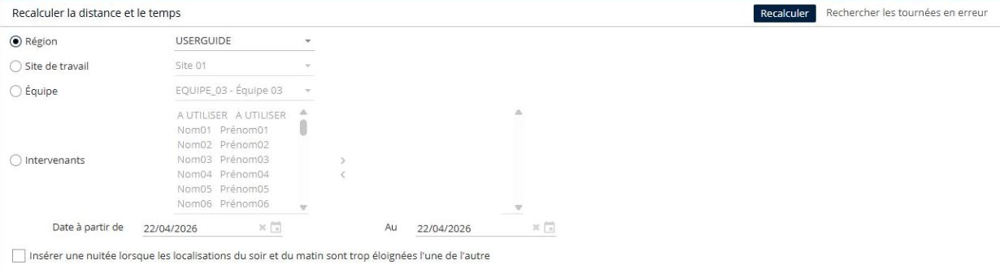
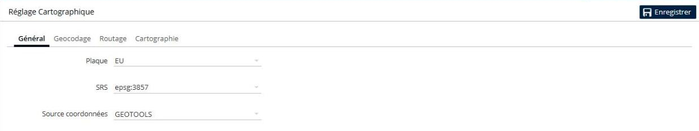

# Utiliser les outils d'administration

Le groupe **Outils** rassemble des fonctions de maintenance : recalcul des temps de trajet, contrôle des services, journaux et réglages cartographiques. Le groupe **API Nomadia Field Service** donne accès à la documentation de l'API.

## Avant de commencer

Ces outils agissent sur l'ensemble de l'application. Réservez-les aux administrateurs et utilisez-les en accord avec le support Nomadia.

## Accéder à la fonctionnalité

| Entrée                       | Navigation                                                                |
| ---------------------------- | ------------------------------------------------------------------------- |
| Outils avancés               | `Administration > Outils > Outils avancés`                                |
| Recalculer la distance       | `Administration > Outils > Recalculer la distance`                        |
| Vérifier l'état des serveurs | `Administration > Outils > Vérifier l'état des serveurs`                  |
| Journaux                     | `Administration > Outils > Journaux`                                      |
| Dump de la thread JVM        | `Administration > Outils > Dump de la thread JVM`                         |
| Services cartographiques     | `Administration > Outils > Services cartographiques`                      |
| Documentation de l'API       | `Administration > API Nomadia Field Service > Documentation`              |
| Modèle d'import/export CSV   | `Administration > API Nomadia Field Service > Modèle d'import/export CSV` |

## Recalculer les distances et les temps de trajet

1. Ouvrez **Recalculer la distance**.
2. Choisissez le périmètre : **Région**, **Site de travail**, **Équipe** ou **Intervenants**. Pour les intervenants, sélectionnez-les dans la liste de gauche et utilisez les flèches pour les ajouter.
3. Renseignez la période **Date à partir de** / **Au**.
4. Cochez si besoin **Insérer une nuitée lorsque les localisations du soir et du matin sont trop éloignées l'une de l'autre**.
5. Sélectionnez **Recalculer**.

Le bouton **Rechercher les tournées en erreur** est également proposé sur cette page.

## Outils avancés

La page **Outils avancés** propose les actions suivantes, chacune avec son bouton :

* **Mise à jour des distances et temps de trajet** ;
* **Comparer les distances et temps de trajet** ;
* **Liste des déplacements impossibles avec le serveur de distance utilisé**, sur une période **Du** / **Au** ;
* **Renouvelle le cache du référentiel** ;
* **Réinitialiser le cache des propriétés** ;
* **Encrypter les mots de passe** (ne s'applique qu'aux mots de passe non déjà encryptés).


Ces actions agissent sur toute l'application. Utilisez-les uniquement à la demande du support.


## Régler les services cartographiques

La page **Réglage Cartographique** comporte les onglets **Général**, **Geocodage**, **Routage** et **Cartographie**. L'onglet **Général** contient la **Plaque**, le **SRS** et la **Source coordonnées**. Sélectionnez **Enregistrer** après modification.

## Autres outils

* **Vérifier l'état des serveurs** affiche un rapport de test des services utilisés par l'application.
* **Journaux** affiche la page **Niveau de journalisation** : niveau par composant, bouton **Tout modifier**, affichage des derniers journaux, boutons **Voir les journaux** et **Appliquer**. La même page est accessible depuis le groupe **Fichiers XML**.
* **Dump de la thread JVM** est un outil technique destiné au support.

## Consulter la documentation de l'API

* **Documentation** ouvre la documentation de l'API de Nomadia Field Service.
* **Modèle d'import/export CSV** décrit les champs d'échange de chaque entité. Consultez [Gérer les fichiers d'échange](fichiers-echanges.md).
