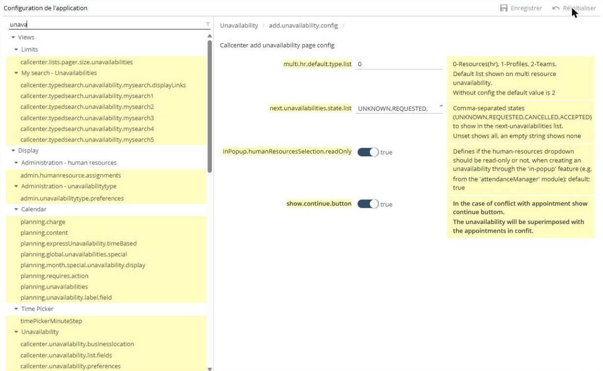
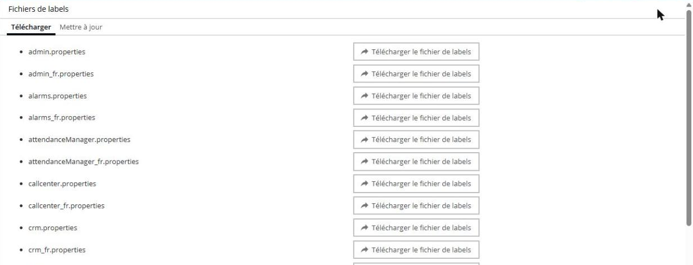
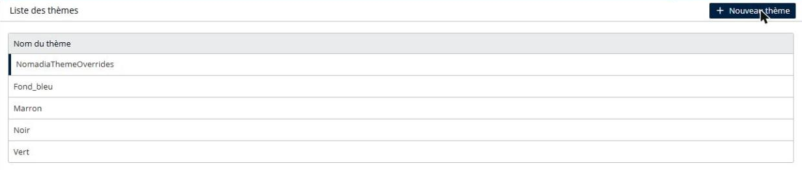
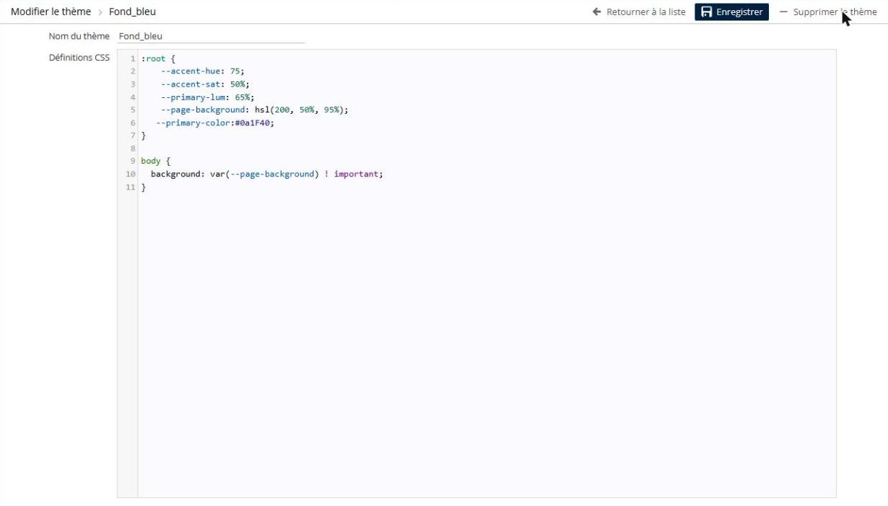
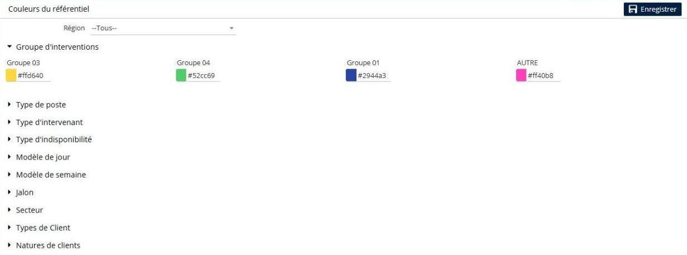
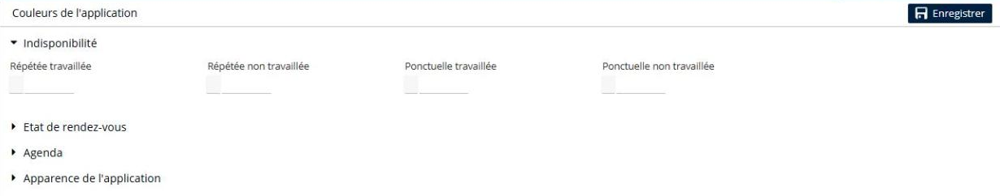

# Personnaliser l'application

Le groupe **Personnalisation** adapte l'application à votre organisation : paramètres de fonctionnement, libellés affichés, thème graphique et couleurs.

## Avant de commencer

Ces réglages s'appliquent à tous les utilisateurs. Notez la valeur d'origine d'un paramètre avant de la modifier.

## Accéder à la fonctionnalité

| Entrée                         | Navigation                                                                 |
| ------------------------------ | -------------------------------------------------------------------------- |
| Configuration de l'application | `Administration > Personnalisation > Configuration de l'application`       |
| Labels                         | `Administration > Personnalisation > Labels`                               |
| Thèmes                         | `Administration > Personnalisation > Thèmes`                               |
| Couleurs du référentiel        | `Administration > Personnalisation > Couleurs > Couleurs du référentiel`   |
| Couleurs de l'application      | `Administration > Personnalisation > Couleurs > Couleurs de l'application` |

## Modifier un paramètre de l'application

1. Ouvrez **Configuration de l'application**.
2. Saisissez une partie du nom du paramètre dans le champ de filtre, en haut de l'arborescence.
3. Dans l'arborescence, sélectionnez le groupe de paramètres. Les éléments correspondant au filtre sont surlignés.
4. Dans le panneau de droite, modifiez la valeur. L'aide affichée à droite de chaque paramètre décrit son effet et ses valeurs possibles.
5. Sélectionnez **Enregistrer**.

Le bouton **Réinitialiser** est proposé à côté de **Enregistrer**.


Un paramètre modifié agit sur toute l'application. Modifiez uniquement les paramètres dont vous connaissez l'effet, et testez le résultat.


## Télécharger et mettre à jour les libellés

La page **Fichiers de labels** comporte deux onglets.

* **Télécharger** : chaque fichier de libellés (`.properties`) est listé avec le bouton **Télécharger le fichier de labels**.
* **Mettre à jour** : sélectionnez le fichier modifié avec le bouton Dossier (**Choisir un fichier…**), puis sélectionnez **Mettre à jour**.

## Gérer les thèmes

La page **Liste des thèmes** affiche le **Nom du thème** de chaque thème.

1. Sélectionnez **Nouveau thème**, ou sélectionnez un thème de la liste.
2. Renseignez le **Nom du thème**.
3. Saisissez les **Définitions CSS** dans l'éditeur.
4. Sélectionnez **Enregistrer**.

Sur la page **Modifier le thème**, le bouton **Supprimer le thème** supprime le thème affiché.

## Modifier les couleurs du référentiel

La page **Couleurs du référentiel** attribue une couleur à chaque élément des données de l'entreprise. Les éléments sont regroupés en sections repliables : **Groupe d'interventions**, **Type de poste**, **Type d'intervenant**, **Type d'indisponibilité**, **Modèle de jour**, **Modèle de semaine**, **Jalon**, **Secteur**, **Types de Client** et **Natures de clients**.

1. Filtrez si besoin par **Région**.
2. Ouvrez la section concernée.
3. Choisissez la couleur avec le sélecteur ou saisissez son code hexadécimal, par exemple `#2944a3`.
4. Sélectionnez **Enregistrer**.


Le chargement de cette page peut prendre plusieurs secondes.


## Modifier les couleurs de l'application

La page **Couleurs de l'application** définit les couleurs d'affichage communes, en quatre sections :

* **Indisponibilité** : **Répétée travaillée**, **Répétée non travaillée**, **Ponctuelle travaillée**, **Ponctuelle non travaillée** ;
* **Etat de rendez-vous** : une couleur par état, par exemple **Planifié**, **Confirmé**, **Réalisé** ou **Abandonné** ;
* **Agenda** : temps de parcours, jour férié, pause déjeuner, horaire non travaillé, jours de la semaine, marqueurs de rendez-vous… ;
* **Apparence de l'application** : **Bannière**.

Sélectionnez **Enregistrer** pour appliquer les modifications.
