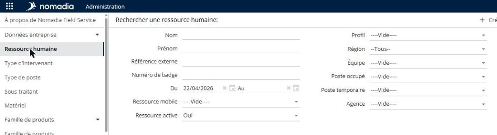
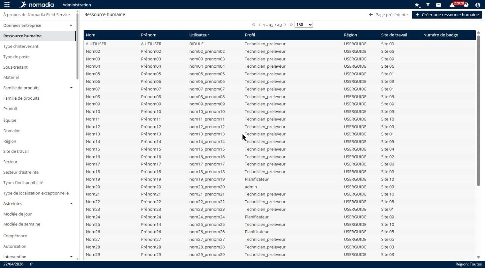
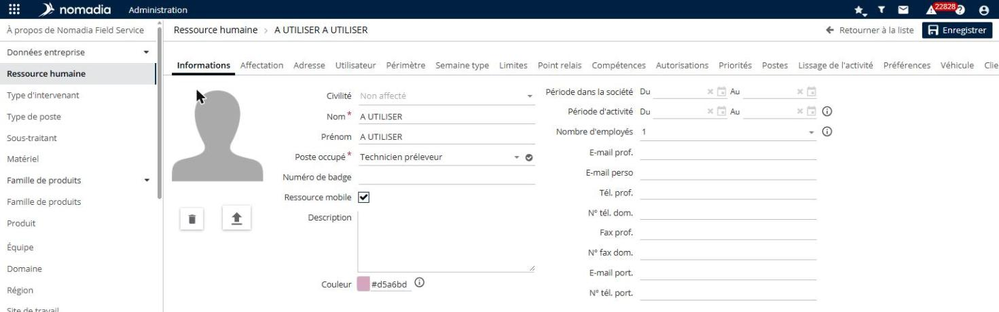
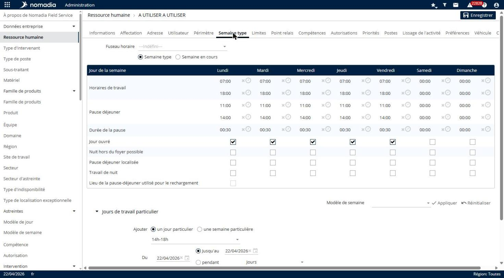

# Gérer les ressources humaines

Une ressource humaine représente une personne de l'organisation : intervenant de terrain, planificateur ou administrateur. Sa fiche regroupe ses informations, son affectation, son compte utilisateur, ses horaires et ses compétences.

## Accéder à la fonctionnalité

**Navigation :** `Administration > Données entreprise > Ressource humaine`

## Rechercher une ressource humaine

La page **Rechercher une ressource humaine:** propose les critères **Nom**, **Prénom**, **Référence externe**, **Numéro de badge**, **Du** / **Au**, **Ressource mobile**, **Ressource active**, **Profil**, **Région**, **Équipe**, **Poste occupé**, **Poste temporaire** et **Agence**.

1. Renseignez les critères souhaités.
2. Sélectionnez **Rechercher**.

La liste affiche le **Nom**, le **Prénom**, l'**Utilisateur**, le **Profil**, la **Région**, le **Site de travail** et le **Numéro de badge**.

Les boutons **Créer une ressource humaine** et **Exporter** sont disponibles en haut de la page de recherche.

## Consulter la fiche d'une ressource

Sélectionnez une ligne de la liste. La fiche **Ressource humaine** s'ouvre sur l'onglet **Informations**.

La fiche comporte les onglets suivants : **Informations**, **Affectation**, **Adresse**, **Utilisateur**, **Périmètre**, **Semaine type**, **Limites**, **Point relais**, **Compétences**, **Autorisations**, **Priorités**, **Postes**, **Lissage de l'activité**, **Préférences**, **Véhicule** et **Clients**.

| Onglet           | Principaux champs                                                                                                                                                                                     |
| ---------------- | ----------------------------------------------------------------------------------------------------------------------------------------------------------------------------------------------------- |
| **Informations** | Civilité, Nom\*, Prénom, Poste occupé\*, Numéro de badge, Ressource mobile, Description, Couleur, Période dans la société, Période d'activité, Nombre d'employés, e-mails et téléphones               |
| **Affectation**  | Région d'appartenance, Équipe, Site de travail principal, Sites de travail secondaires, Secteurs d'astreinte                                                                                          |
| **Utilisateur**  | Profil, Mode d'identification (compte local, annuaire LDAP ou authentification SSO), Utilisateur\*, obligation de changer de mot de passe à la prochaine connexion, Point d'entrée dans l'application |
| **Semaine type** | Fuseau horaire, horaires de travail et pause déjeuner par jour, jours ouvrés, modèle de semaine, jours de travail particuliers                                                                        |
| **Limites**      | Définition du temps de travail, cumul du temps d'intervention par jour, semaine et mois, et autres contraintes                                                                                        |
| **Compétences**  | Niveau d'expérience, Pondération de la vitesse d'exécution, liste des compétences avec période d'activation                                                                                           |

## Définir la semaine type

L'onglet **Semaine type** présente un tableau par jour de la semaine :

* **Horaires de travail** (début et fin) ;
* **Pause déjeuner** (plage) et **Durée de la pause** ;
* **Jour ouvré** ;
* **Nuit hors du foyer possible**, **Pause déjeuner localisée**, **Travail de nuit**.

Sous le tableau :

* la liste **Modèle de semaine**, avec **Appliquer** et **Réinitialiser**, permet d'appliquer un modèle ;
* la section **Jours de travail particulier** permet d'ajouter un jour ou une semaine particulière sur une période.

Sélectionnez **Enregistrer** pour enregistrer les modifications de la fiche.
