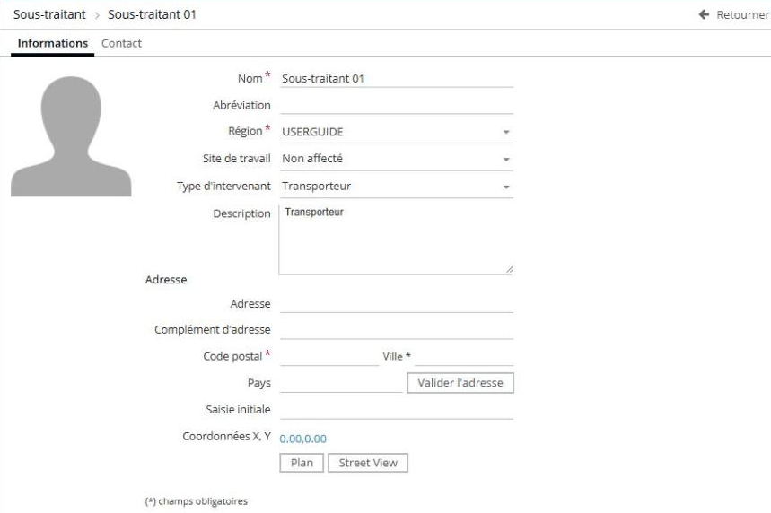
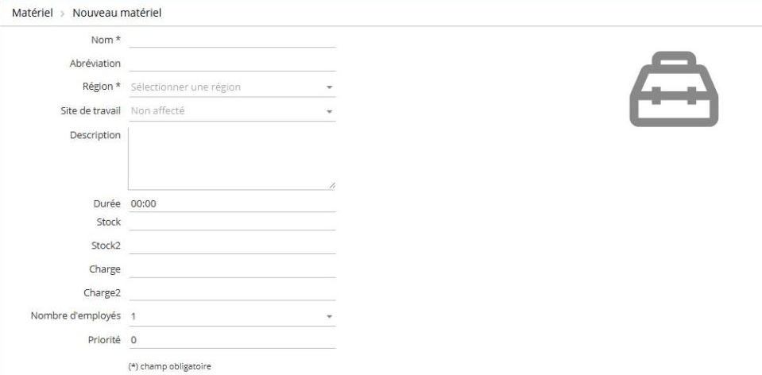
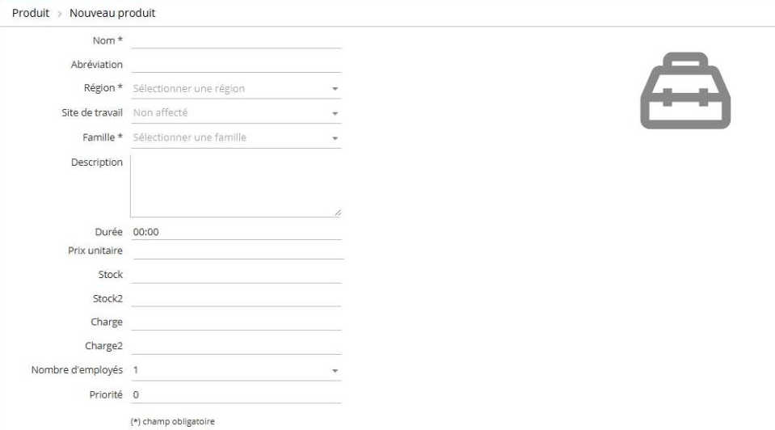

# Gérer les sous-traitants, le matériel et les produits

Ces entrées décrivent les acteurs et les objets liés aux interventions : sous-traitants auxquels une intervention peut être confiée, matériel nécessaire, produits livrés ou concernés par l'intervention.

## Accéder à la fonctionnalité

| Entrée              | Navigation                                                                        | Filtres de la liste                          |
| ------------------- | --------------------------------------------------------------------------------- | -------------------------------------------- |
| Sous-traitant       | `Administration > Données entreprise > Sous-traitant`                             | Région                                       |
| Matériel            | `Administration > Données entreprise > Matériel`                                  | Région, Site de travail                      |
| Famille de produits | `Administration > Données entreprise > Famille de produits > Famille de produits` | Région                                       |
| Produit             | `Administration > Données entreprise > Famille de produits > Produit`             | Région, Site de travail, Famille de produits |

Chaque page propose un bouton **Créer…** en haut à droite. Les fiches se gèrent selon les [principes communs de l'administration](./).

## Sous-traitant

La fiche d'un sous-traitant comporte les onglets **Informations** et **Contact**.

L'onglet **Informations** contient :

* **Nom**\*, **Abréviation**, **Région**\*, **Site de travail**, **Type d'intervenant** et **Description** ;
* le bloc **Adresse** : **Adresse**, **Complément d'adresse**, **Code postal**\*, **Ville**\*, **Pays**, **Saisie initiale** et **Coordonnées X, Y**.

Les boutons **Valider l'adresse**, **Plan** et **Street View** permettent de contrôler la localisation.

## Matériel

La fiche d'un matériel ne comporte qu'une page :

* **Nom**\*, **Abréviation**, **Région**\*, **Site de travail**, **Description** ;
* **Durée**, **Stock**, **Stock2**, **Charge**, **Charge2** ;
* **Nombre d'employés** et **Priorité**.

## Famille de produits

Une famille de produits regroupe des produits. Sa fiche contient le **Nom**\*, l'**Abréviation**, la **Région**\* et la **Description**.

## Produit

La fiche d'un produit reprend les champs du matériel et ajoute :

* **Famille**\* : famille de produits de rattachement ;
* **Prix unitaire**.


Créez la famille de produits avant le produit : le champ **Famille** est obligatoire.

