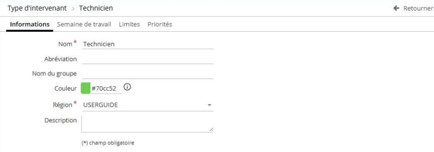
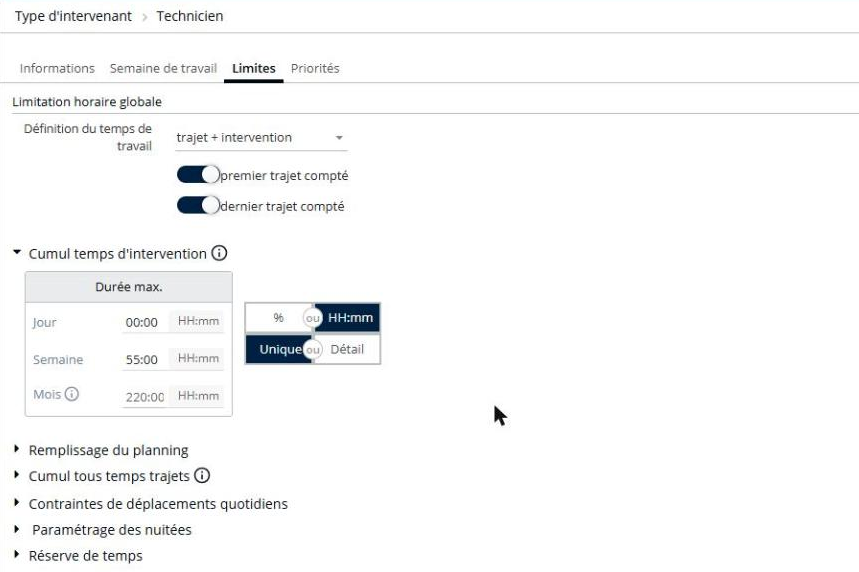
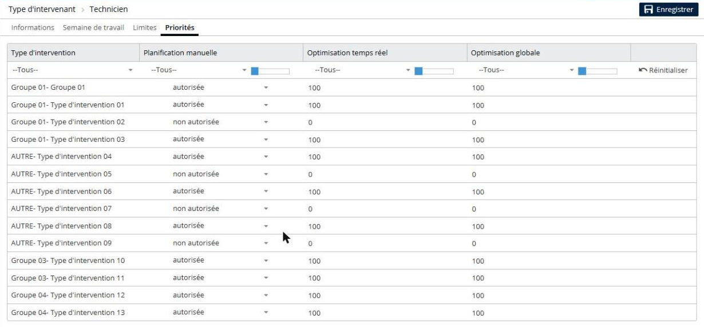
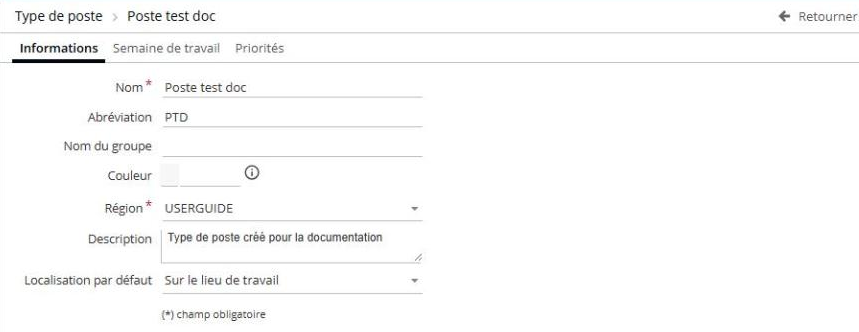

# Gérer les types d'intervenant et les types de poste

Le type d'intervenant et le type de poste décrivent la fonction d'une ressource humaine. Ils portent des valeurs par défaut (semaine de travail, limites, priorités) que vous pouvez ensuite affiner sur la fiche de chaque ressource.

## Accéder à la fonctionnalité

**Navigation :** `Administration > Données entreprise > Type d'intervenant`

**Navigation :** `Administration > Données entreprise > Type de poste`

Chaque liste affiche les colonnes **Nom**, **Région** et **Description**. Le filtre **Région** permet de la restreindre.

## Paramétrer un type d'intervenant

1. Sélectionnez **Créer un type d'intervenant**.
2. Dans l'onglet **Informations**, renseignez le **Nom** et la **Région**, puis si besoin l'**Abréviation**, le **Nom du groupe**, la **Couleur** et la **Description**.
3. Sélectionnez **Page suivante** pour passer aux onglets **Semaine de travail**, **Limites** et **Priorités**.
4. Sélectionnez **Enregistrer**.

Pour modifier un type existant, sélectionnez sa ligne dans la liste : tous les onglets sont alors accessibles directement.

La fiche comporte les onglets suivants :

| Onglet                 | Contenu                                                                                                                                                                     |
| ---------------------- | --------------------------------------------------------------------------------------------------------------------------------------------------------------------------- |
| **Informations**       | Nom\*, Abréviation, Nom du groupe, Couleur, Région\*, Description                                                                                                           |
| **Semaine de travail** | Liste **Modèle de semaine** et tableau par jour : Horaires de travail, Pause déjeuner, Durée de la pause, Jour ouvré, Pause déjeuner localisée, Nuit hors du foyer possible |
| **Limites**            | Limitation horaire globale et contraintes de temps de travail                                                                                                               |
| **Priorités**          | Autorisation de planification et priorité d'optimisation par type d'intervention                                                                                            |

### Onglet Limites

La section **Limitation horaire globale** propose :

* **Définition du temps de travail**, par exemple `trajet + intervention` ;
* les options **premier trajet compté** et **dernier trajet compté**.

Les sections repliables suivantes complètent le paramétrage : **Cumul temps d'intervention** (durée maximale par **Jour**, **Semaine** et **Mois**, exprimée en `%` ou en `HH:mm`, en mode **Unique** ou **Détail**), **Remplissage du planning**, **Cumul tous temps trajets**, **Contraintes de déplacements quotidiens**, **Paramétrage des nuitées** et **Réserve de temps**.

### Onglet Priorités

Le tableau liste chaque type d'intervention, précédé de son groupe, avec trois colonnes :

* **Planification manuelle** : `autorisée` ou `non autorisée` ;
* **Optimisation temps réel** : valeur de priorité ;
* **Optimisation globale** : valeur de priorité.

Les filtres en tête de colonne permettent de restreindre la liste. Le bouton **Réinitialiser** efface les filtres.

## Paramétrer un type de poste

La création d'un type de poste se fait en plusieurs pages.

1. Sélectionnez **Créer un type de poste**.
2. Dans l'onglet **Informations**, renseignez le **Nom** et la **Région**, puis si besoin l'**Abréviation**, le **Nom du groupe**, la **Couleur**, la **Description** et la **Localisation par défaut**.
3. Sélectionnez **Page suivante** pour passer à l'onglet **Semaine de travail**, puis à l'onglet **Priorités**. **Page précédente** permet de revenir en arrière.
4. Sélectionnez **Enregistrer**.

La **Localisation par défaut** propose les valeurs **Position non renseignée mais nécessaire**, **À la maison**, **Sur le lieu de travail** et **Pas de position nécessaire**.

Les onglets **Semaine de travail** et **Priorités** fonctionnent comme ceux du type d'intervenant.

## Points d'attention

* Les champs **Nom** et **Région** sont obligatoires.
* Une fois l'élément enregistré, les boutons **Désactiver** et **Dupliquer** sont disponibles.
* Pour affecter un type à une ressource, consultez [Gérer les ressources humaines](ressources-humaines.md).
