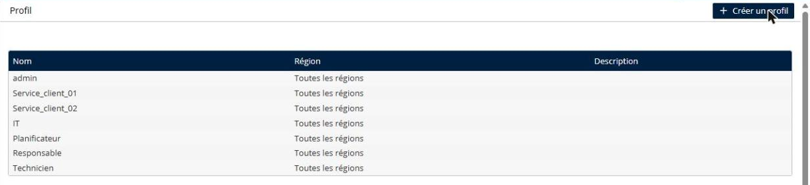
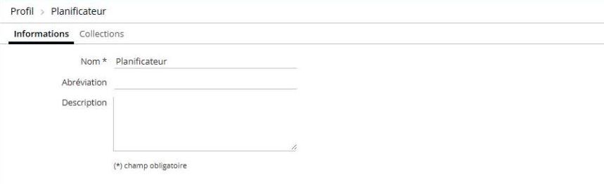
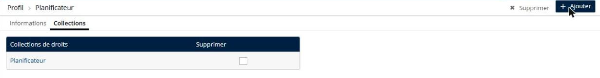
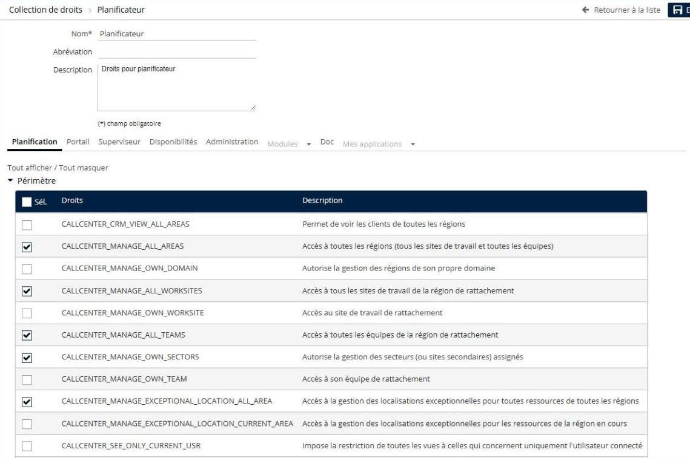
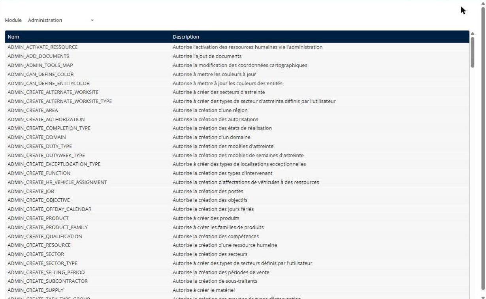
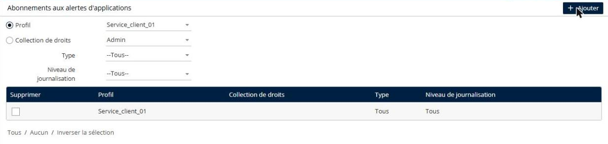

# Gérer les profils et les droits

Les droits d'un utilisateur se définissent en trois niveaux :

* un **droit d'accès** autorise une action précise, par exemple créer une région ;
* une **collection de droits** regroupe des droits d'accès, module par module ;
* un **profil** rassemble une ou plusieurs collections de droits. Il est attribué à l'utilisateur dans l'onglet **Utilisateur** de sa fiche ressource humaine.

## Avant de commencer

Ces pages modifient ce que les utilisateurs peuvent voir et faire. Testez chaque modification avec un compte de test avant de l'appliquer aux profils en service.

## Accéder à la fonctionnalité

| Entrée                 | Navigation                                               |
| ---------------------- | -------------------------------------------------------- |
| Profil                 | `Administration > Utilisateurs > Profil`                 |
| Collection de droits   | `Administration > Utilisateurs > Collection de droits`   |
| Droits d'accès         | `Administration > Utilisateurs > Droits d'accès`         |
| Abonnement aux alertes | `Administration > Utilisateurs > Abonnement aux alertes` |

## Gérer un profil

La liste affiche le **Nom**, la **Région** et la **Description** de chaque profil.

1. Sélectionnez **Créer un profil**, ou sélectionnez une ligne de la liste.
2. Dans l'onglet **Informations**, renseignez le **Nom**, puis si besoin l'**Abréviation** et la **Description**.
3. Sélectionnez **Enregistrer**.

L'onglet **Collections** liste les **Collections de droits** du profil :

* **Ajouter** rattache une collection ;
* pour retirer une collection, cochez-la dans la colonne **Supprimer**, puis sélectionnez **Supprimer**.

## Gérer une collection de droits

1. Sélectionnez **Créer une collection de droits d'accès**, ou sélectionnez une ligne de la liste.
2. Renseignez le **Nom**, puis si besoin l'**Abréviation** et la **Description**.
3. Sélectionnez l'onglet du module à paramétrer : **Planification**, **Portail**, **Superviseur**, **Disponibilités**, **Administration**, **Doc**, ou un module du menu **Modules** (**Strategic planning**, **Sectorisation**, **Réalisation**, **Tracking**, **Zones d'accès restreint**, **Gestion de stock**, **Rapports**). Le menu **Mes applications** donne accès aux applications complémentaires.
4. Dans chaque section, cochez les droits à accorder dans la colonne **Sél.**
5. Sélectionnez **Enregistrer**.

Les droits sont regroupés en sections repliables, par exemple **Périmètre**, **Agenda**, **Client**, **Rendez-vous** ou **Optimisation**. Le lien **Tout afficher / Tout masquer** ouvre ou ferme toutes les sections. Chaque ligne indique le nom technique du droit et sa **Description**.

## Consulter les droits d'accès

La page **Droits d'accès** liste les droits disponibles, avec leur **Nom** et leur **Description**. Choisissez le **Module** pour afficher ses droits : **Administration**, **Planification**, **Portail**, **Superviseur**, **Disponibilités**, **Sectorisation**, **Réalisation**, **Doc**…

## Gérer les abonnements aux alertes

La page **Abonnements aux alertes d'applications** définit quels utilisateurs reçoivent les alertes de l'application.

1. Choisissez la cible : **Profil** ou **Collection de droits**, puis sélectionnez la valeur dans la liste.
2. Choisissez le **Type** d'alerte, par exemple **Erreur lors d'une importation** ou **Avertissement d'optimisation en batch**, ou `--Tous--`.
3. Choisissez le **Niveau de journalisation**.
4. Sélectionnez **Ajouter**.

L'abonnement est créé dès la sélection de **Ajouter**. Il apparaît dans la liste avec le **Profil**, la **Collection de droits**, le **Type** et le **Niveau de journalisation**.

Pour supprimer un abonnement, cochez sa ligne dans la colonne **Supprimer**, puis sélectionnez **Supprimer**.


Vérifiez la cible, le type et le niveau avant de sélectionner **Ajouter** : aucune confirmation n'est demandée.


## Points d'attention

* Pour attribuer un profil à un utilisateur, consultez l'onglet **Utilisateur** dans [Gérer les ressources humaines](ressources-humaines.md).
* Les droits du module Administration se trouvent dans l'onglet **Administration** de la collection, et sont listés dans **Droits d'accès** avec le module `Administration`.
