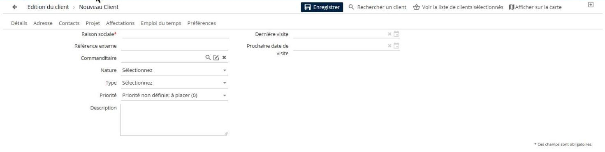
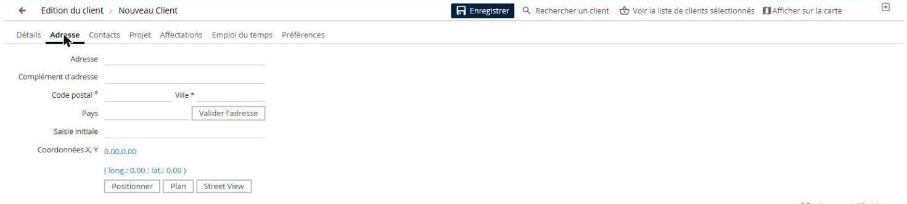
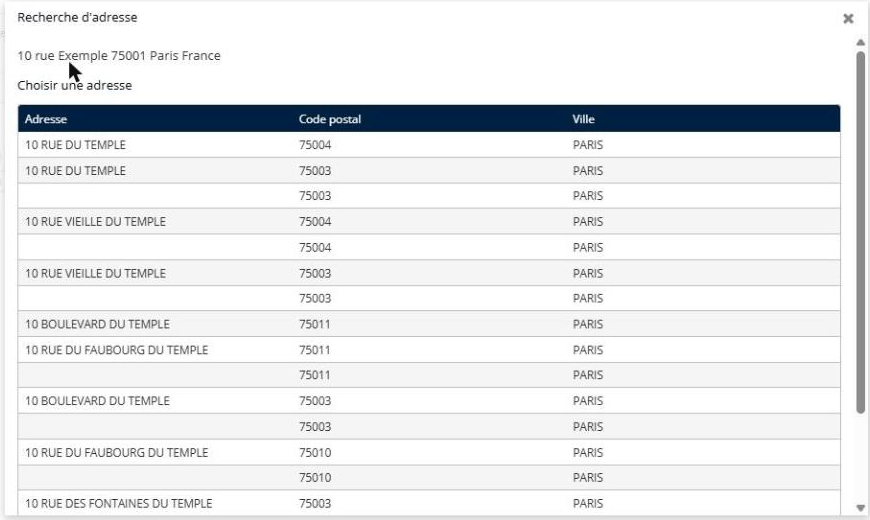
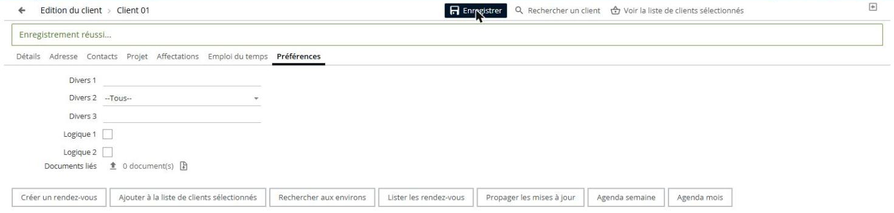

# Créer un client

Cette procédure permet de créer un client et de valider son adresse pour qu'il puisse être positionné sur la carte et planifié.

## Accéder à la fonctionnalité

**Navigation :** `Planification > menu Clients > Créer un client`

Le bouton **Créer un Client** est également disponible dans le panneau de recherche des clients.

## Renseigner les informations générales

L'écran **Edition du client > Nouveau Client** s'ouvre sur l'onglet **Détails**.

1. Saisissez la **Raison sociale**. Ce champ est obligatoire.
2. Complétez si besoin la **Référence externe**, le **Commanditaire**, la **Nature**, le **Type**, la **Priorité** et la **Description**.
3. Renseignez si besoin la **Dernière visite** et la **Prochaine date de visite**.

## Renseigner et valider l'adresse

1. Sélectionnez l'onglet **Adresse**.
2. Saisissez l'**Adresse**, le **Code postal**, la **Ville** et le **Pays**. Le code postal et la ville sont obligatoires.
3. Sélectionnez **Valider l'adresse**.

4. Dans la fenêtre **Recherche d'adresse**, sous **Choisir une adresse**, sélectionnez l'adresse correspondante.

L'adresse, le code postal, la ville et les **Coordonnées X, Y** sont alors renseignés. Le champ **Saisie initiale** conserve le texte que vous avez saisi.

Les boutons **Positionner**, **Plan** et **Street View** sont disponibles sous les coordonnées.

## Compléter les autres onglets

| Onglet              | Contenu                                                                                                                                                                   |
| ------------------- | ------------------------------------------------------------------------------------------------------------------------------------------------------------------------- |
| **Contacts**        | Création d'un contact : Contact principal, Titre, Description, Abbreviation, E-mail prof., Prénom, Nom, Téléphone prof., Téléphone portable, Type d'intervenant, Fax dom. |
| **Projet**          | Liste des projets du client et bouton **Ajouter un projet**                                                                                                               |
| **Affectations**    | **Site de travail** du client et intervenants **Requis**, **Souhaité** ou **Indésirable**                                                                                 |
| **Emploi du temps** | Interrupteur **Horaires d'ouverture**, horaires du matin et du soir par jour, **Périodes de fermeture**                                                                   |
| **Préférences**     | Champs **Divers 1** à **Divers 3**, **Logique 1** et **Logique 2**                                                                                                        |

## Enregistrer le client

Sélectionnez **Enregistrer**.

## Résultat

Le message **Enregistrement réussi...** s'affiche. Le titre de l'écran affiche le nom du client et de nouveaux boutons apparaissent en bas de la fiche, dont **Créer un rendez-vous**.

Pour la suite, consultez [Consulter et utiliser la fiche client](fiche-client.md).
