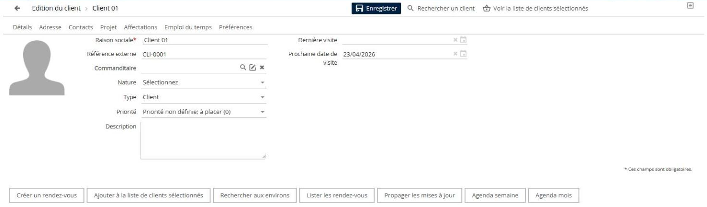
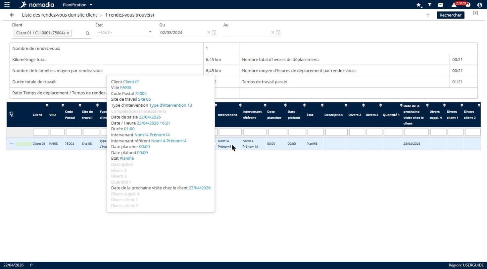

# Consulter et utiliser la fiche client

La fiche client affiche les informations du client et donne accès aux actions qui le concernent.

## Accéder à la fonctionnalité

Ouvrez la fiche depuis le résultat d'une [recherche de clients](rechercher-client.md). La fiche s'affiche également après la création d'un client.

## Repérer les onglets de la fiche

En haut de la fiche, le menu propose **Enregistrer**, **Rechercher un client**, **Voir la liste de clients sélectionnés** et **Afficher sur la carte**. Les informations sont réparties en onglets. L'affichage de chaque onglet dépend de vos droits.

| Onglet              | Contenu                                                                                                                                                                            |
| ------------------- | ---------------------------------------------------------------------------------------------------------------------------------------------------------------------------------- |
| **Détails**         | **Raison sociale** (obligatoire), **Référence externe**, **Commanditaire**, **Nature**, **Type**, **Priorité**, **Description**, **Dernière visite**, **Prochaine date de visite** |
| **Adresse**         | Adresse géocodée du client. Pour en savoir plus, consultez [Géocoder une adresse](../introduction/geocodage.md).                                                                   |
| **Contacts**        | Liste des contacts et formulaire **Nouveau contact (à enregistrer)**                                                                                                               |
| **Projet**          | Visites récurrentes à générer pour le client, avec le bouton **Ajouter un projet**                                                                                                 |
| **Affectations**    | Site de travail du client et préférences d'intervenants                                                                                                                            |
| **Emploi du temps** | **Horaires d'ouverture** par jour (matin et soir) et **Périodes de fermeture**                                                                                                     |
| **Préférences**     | Champs complémentaires et documents liés                                                                                                                                           |

### Onglet Détails

* La **Référence externe** identifie le client dans votre système d'information. Elle doit être unique.
* Le **Commanditaire** se gère avec les icônes placées à droite du champ : **Rechercher** pour en choisir un, **Editer** pour ouvrir sa fiche ou en créer un, **Enlever** pour le détacher du client.
* La **Priorité** influence le placement des rendez-vous du client quand les plannings sont chargés : **Priorité non définie; à placer (0)**, **Non prioritaire (5)**, **Placement souhaitable (25)**, **À placer (50)**, **Placement prioritaire (80)**, **Placement exigé (100)**. Plus la valeur est élevée, plus les rendez-vous ont de chances d'être placés. Réservez **Placement exigé** aux rendez-vous les plus importants.

### Onglet Contacts

1. Renseignez le formulaire **Nouveau contact (à enregistrer)** : **Titre**, **Nom**, **Prénom**, **E-mail prof.**, téléphones…
2. Cochez **Contact principal** s'il s'agit de l'interlocuteur principal.
3. Enregistrez la fiche client.

### Onglet Projet

Un projet décrit des visites récurrentes à générer pour le client, par exemple un contrôle annuel ou deux visites par mois. La liste des projets affiche la **Référence externe**, le **Nom**, le **Type d'intervention**, la **Périodicité**, la **Durée**, la **Date de début** et la **Date de fin**.

Sélectionnez **Ajouter un projet** pour en créer un.

### Onglet Affectations

1. Choisissez le **Site de travail** du client. L'icône **Récupérer les sites de travail triés par distance** propose les sites les plus proches de l'adresse du client.
2. Sélectionnez un ou plusieurs intervenants, puis utilisez **Ajouter les ressources sélectionnées** pour les placer dans la colonne voulue.
3. Enregistrez la fiche.

| Préférence      | Effet sur la planification                                                     |
| --------------- | ------------------------------------------------------------------------------ |
| **Requis**      | Les rendez-vous du client ne sont attribués qu'à l'un des intervenants requis. |
| **Souhaité**    | Les intervenants souhaités sont privilégiés, les autres restent possibles.     |
| **Indésirable** | Les rendez-vous du client ne sont jamais attribués à cet intervenant.          |

## Utiliser les actions de la fiche

Les boutons suivants sont affichés sous les informations du client :

* **Créer un rendez-vous** ;
* **Ajouter à la liste de clients sélectionnés** ;
* **Rechercher aux environs** ;
* **Lister les rendez-vous** ;
* **Propager les mises à jour** ;
* **Agenda semaine** ;
* **Agenda mois**.

Pour prendre un rendez-vous, consultez [Prendre un rendez-vous](../rendez-vous/prendre-rendez-vous.md).

**Propager les mises à jour** reporte les modifications du client sur ses rendez-vous qui ne sont pas encore planifiés. Les rendez-vous déjà planifiés ne sont pas modifiés.

## Lister les rendez-vous du client

1. Sélectionnez **Lister les rendez-vous**.
2. Ajustez si besoin les filtres **État**, **Du** et **Au**, puis sélectionnez **Rechercher**.

La page affiche des indicateurs pour la période : **Nombre de rendez-vous**, **Kilométrage total**, **Nombre de kilomètres moyen par rendez-vous**, **Durée totale de travail**, **Ratio Temps de déplacement / Temps de rendez-vous**, **Nombre total d'heures de déplacement**, **Nombre moyen d'heures de déplacement par rendez-vous** et **Temps de travail passé**.

Sous les indicateurs, la liste des rendez-vous s'affiche. Survolez une ligne pour afficher le détail du rendez-vous. Sélectionnez **•••** pour ouvrir sa fiche.

## Points d'attention

* Après la planification d'un rendez-vous, le champ **Prochaine date de visite** de la fiche client est mis à jour.
* Le champ **Documents liés** de l'onglet **Préférences** indique le nombre de documents rattachés au client.
