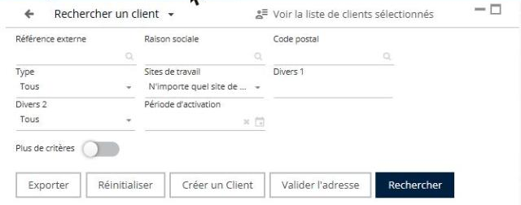
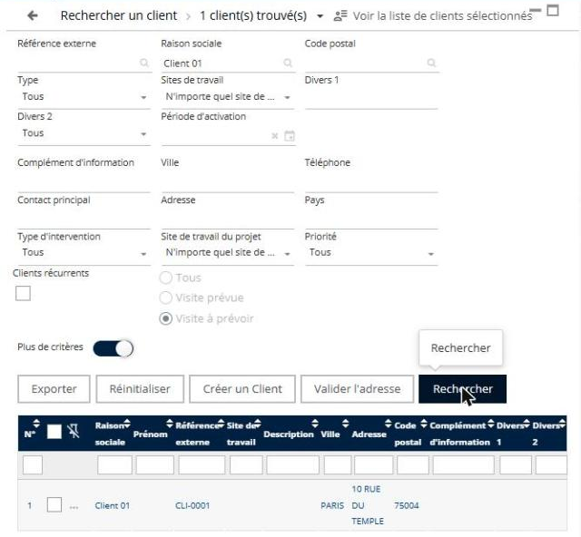

# Rechercher un client

La recherche de clients permet de retrouver un client pour consulter sa fiche ou lui prendre un rendez-vous.

## Accéder à la fonctionnalité

**Navigation :** `Planification > menu Clients > Rechercher des clients`

Vous pouvez aussi sélectionner le raccourci **RECHERCHER DES CLIENTS** sur l'écran d'accueil du module.

## Utiliser la fonctionnalité

1. Renseignez un ou plusieurs critères : **Référence externe**, **Raison sociale**, **Code postal**, **Type**, **Sites de travail**, **Divers 1**, **Divers 2**, **Période d'activation**.
2. Pour afficher des critères supplémentaires, activez **Plus de critères**.
3. Sélectionnez **Rechercher**.

Les critères supplémentaires sont : **Complément d'information**, **Ville**, **Téléphone**, **Contact principal**, **Adresse**, **Pays**, **Type d'intervention**, **Site de travail du projet**, **Priorité** et **Clients récurrents** (avec les options **Tous**, **Visite prévue**, **Visite à prévoir**).

## Résultat

Le titre indique le nombre de clients trouvés. Le tableau affiche notamment la **Raison sociale**, la **Référence externe**, le **Site de travail**, la **Ville**, l'**Adresse** et le **Code postal**.

## Consulter les clients en alerte

`Planification > Clients > Liste des clients en alerte` affiche les clients qui répondent aux critères d'alerte définis par votre administrateur. Le compteur en forme de triangle du bandeau affiche leur nombre.

## Points d'attention

* Les boutons **Exporter**, **Réinitialiser**, **Créer un Client** et **Valider l'adresse** sont disponibles sous les critères.
* Le lien **Voir la liste de clients sélectionnés** est affiché en haut du panneau.
