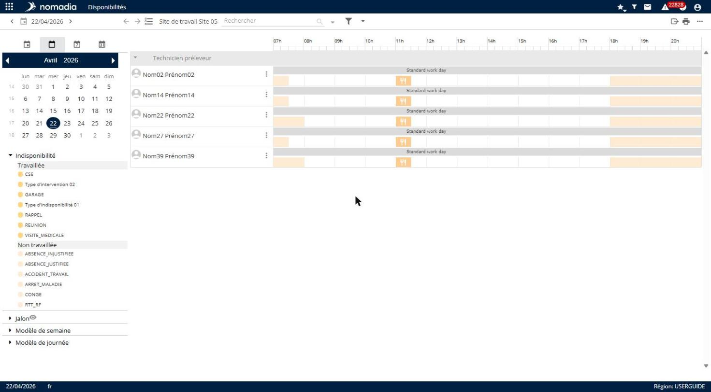
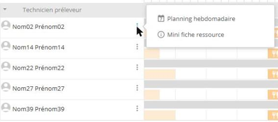
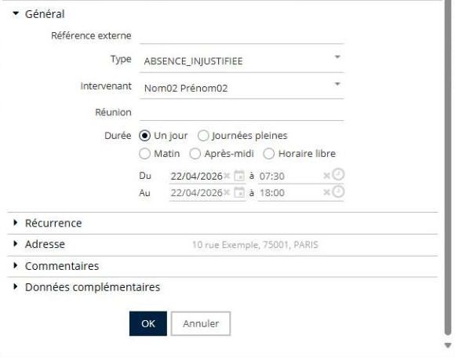

# Disponibilités

Le module Disponibilités affiche l'agenda de travail des intervenants : modèles de journée, pauses et indisponibilités. Il permet aussi d'ajouter une indisponibilité directement depuis l'agenda.

## Accéder au module

**Navigation :** `Lanceur d'applications > Disponibilités`

## Repérer les zones de l'écran

### Barre supérieure

| Élément                                    | Rôle                                                                                                       |
| ------------------------------------------ | ---------------------------------------------------------------------------------------------------------- |
| Flèches autour de la date                  | **Aller à la période précédente** / **Aller à la période suivante**                                        |
| Icône calendrier                           | **Configurer l'intervalle**                                                                                |
| Flèches                                    | **Revenir à l'agenda précédent** / **Rétablir l'agenda suivant**                                           |
| Icône liste                                | **Afficher la liste de rendez-vous**                                                                       |
| Périmètre (par exemple un site de travail) | **Choisir le périmètre de visualisation**                                                                  |
| Champ **Rechercher** et icônes associées   | **Ouvrir le panneau de réglages**, **Activer le filtre**, **Ouvrir le panneau de sélection de ressources** |
| Icônes à droite                            | **Exporter l'agenda**, **Imprimer l'agenda**, **Naviguer entre les services**                              |

### Panneau gauche

* Les icônes du haut permettent d'**Aller à la date du jour** et de choisir la vue : **Voir l'agenda de la journée**, **Voir l'agenda hebdomadaire**, **Voir l'agenda mensuel**.
* Le calendrier mensuel permet de choisir une date.
* La légende **Indisponibilité** distingue les types **Travaillée** et **Non travaillée**.
* Les sections **Jalon**, **Modèle de semaine** et **Modèle de journée** sont repliables.

### Agenda

Chaque ligne correspond à un intervenant. Le bandeau gris indique le modèle de journée appliqué, par exemple **Standard work day**. L'icône représentant des couverts signale la pause déjeuner.

## Utiliser le menu d'un intervenant

Sélectionnez l'icône **⋮** à droite du nom de l'intervenant. Le menu propose **Planning hebdomadaire** et **Mini fiche ressource**.

## Ajouter une indisponibilité depuis l'agenda

1. Survolez un créneau de l'intervenant. Une fenêtre affiche les **Heures travaillées disponibles** et le modèle de journée.
2. Sélectionnez l'icône **Ajouter une indisponibilité**.
3. Dans la fenêtre de création, renseignez le **Type**, la **Durée** et les dates. L'intervenant est prérempli.
4. Validez avec **OK**. Le bouton **Annuler** ferme la fenêtre sans créer d'indisponibilité.

Les champs de cette fenêtre sont les mêmes que dans la [gestion des indisponibilités](../indisponibilites/creer-indisponibilite.md).

## Points d'attention

* La fenêtre de survol propose aussi l'icône **Ajouter un poste**.

## Dans cette section

* [Modifier le planning de présence](modifier-planning.md)
