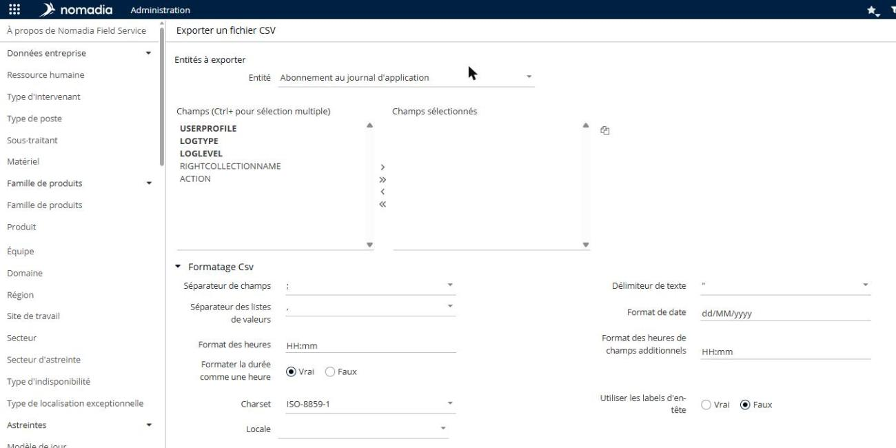

# Exporter un fichier CSV

Cette fonctionnalité permet d'exporter les données d'un type d'élément, en choisissant les champs et le format du fichier.

## Accéder à la fonctionnalité

**Navigation :** `Administration > Fichiers CSV > Exporter un fichier CSV`

## Utiliser la fonctionnalité

1. Dans **Entités à exporter**, sélectionnez l'**Entité**.
2. Dans la liste **Champs (Ctrl+ pour sélection multiple)**, sélectionnez les champs à exporter.
3. Utilisez les flèches pour les ajouter à la liste **Champs sélectionnés**.
4. Dans **Formatage Csv**, vérifiez les paramètres du fichier.
5. Sélectionnez **Exporter**.

## Paramètres de formatage

| Paramètre                                    | Description                                  |
| -------------------------------------------- | -------------------------------------------- |
| **Séparateur de champs**                     | Caractère séparant les colonnes              |
| **Délimiteur de texte**                      | Caractère entourant les textes               |
| **Séparateur des listes de valeurs**         | Caractère séparant les valeurs multiples     |
| **Format de date** / **Format des heures**   | Format des dates et des heures               |
| **Format des heures de champs additionnels** | Format des heures des champs complémentaires |
| **Formater la durée comme une heure**        | **Vrai** ou **Faux**                         |
| **Charset**                                  | Encodage du fichier                          |
| **Utiliser les labels d'en-tête**            | **Vrai** ou **Faux**                         |
| **Locale**                                   | Paramètre régional                           |
