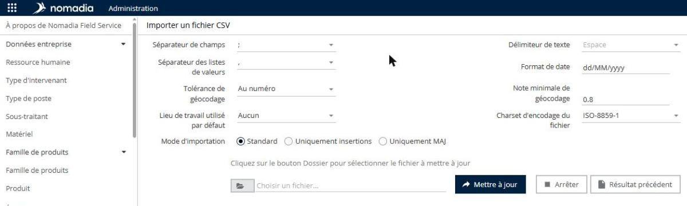

# Importer un fichier CSV

Cette fonctionnalité permet d'importer un fichier CSV dans Nomadia Field Service.

## Accéder à la fonctionnalité

**Navigation :** `Administration > Fichiers CSV > Importer un fichier CSV`

## Utiliser la fonctionnalité

1. Vérifiez les paramètres de lecture du fichier : **Séparateur de champs**, **Délimiteur de texte**, **Séparateur des listes de valeurs**, **Format de date** et **Charset d'encodage du fichier**.
2. Vérifiez les paramètres de géocodage : **Tolérance de géocodage** et **Note minimale de géocodage**.
3. Choisissez le **Lieu de travail utilisé par défaut**.
4. Choisissez le **Mode d'importation** : **Standard**, **Uniquement insertions** ou **Uniquement MAJ**.
5. Sélectionnez l'icône de dossier pour choisir le fichier.
6. Sélectionnez **Mettre à jour**.

## Points d'attention

* Les boutons **Arrêter** et **Résultat précédent** sont disponibles à côté de **Mettre à jour**.


Un import modifie les données de l'application. Vérifiez le contenu du fichier et le mode d'importation avant de sélectionner **Mettre à jour**.

