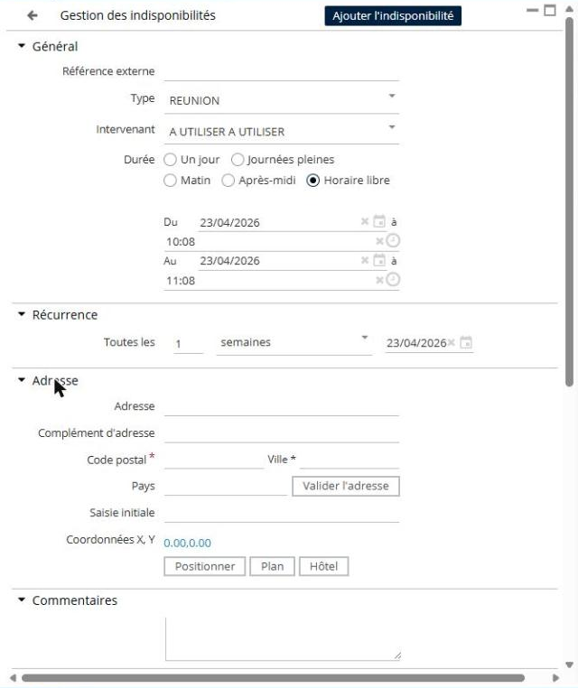
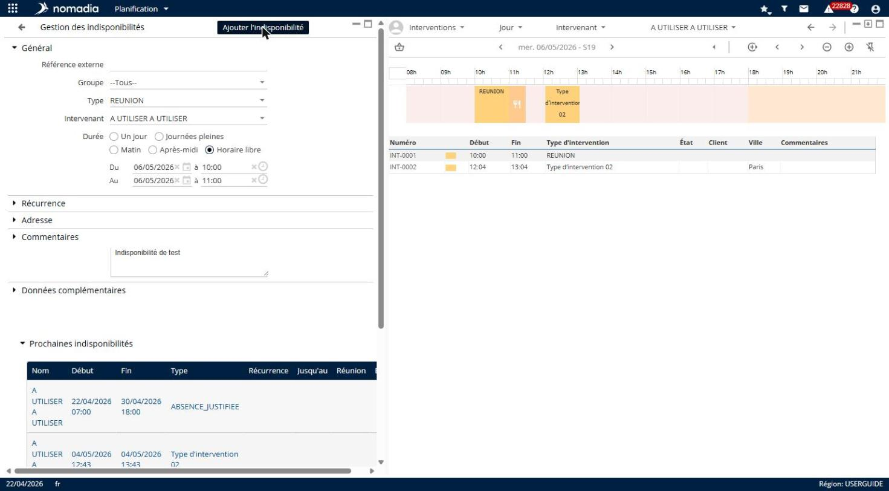

# Créer une indisponibilité

Cette procédure permet de déclarer une indisponibilité pour un intervenant, ponctuelle ou récurrente.

## Accéder à la fonctionnalité

**Navigation :** `Planification > menu Planification > Gérer des indisponibilités`

Le panneau **Gestion des indisponibilités** s'affiche à gauche. Le planning, à droite, affiche l'intervenant sélectionné à la date saisie.

## Utiliser la fonctionnalité

1. Dans la section **Général**, sélectionnez le **Type** d'indisponibilité.
2. Sélectionnez l'**Intervenant**.
3. Choisissez la **Durée** : **Un jour**, **Journées pleines**, **Matin**, **Après-midi** ou **Horaire libre**.
4. Renseignez les dates et heures **Du** et **Au**.
5. Si l'indisponibilité se répète, ouvrez la section **Récurrence**. Elle propose les champs **Toutes les** (nombre et unité : **jours**, **semaines** ou **mois**) et une date de fin.
6. Si besoin, renseignez l'**Adresse** et des **Commentaires**.
7. Sélectionnez **Ajouter l'indisponibilité**.

## Résultat

L'indisponibilité apparaît dans le planning de l'intervenant et dans la liste affichée sous le planning, avec ses heures de début et de fin et son type.

## Gérer un conflit avec des rendez-vous

Si l'indisponibilité chevauche des rendez-vous, un écran liste les rendez-vous concernés. Un avertissement signale les rendez-vous confirmés ou réservés. Selon vos droits et le paramétrage, vous pouvez :

* revenir à la saisie pour modifier l'indisponibilité ;
* **Forcer** : créer l'indisponibilité et retirer les rendez-vous en conflit du planning ;
* **Forcer/Gérer** : créer l'indisponibilité, retirer les rendez-vous en conflit, puis tenter de les replacer automatiquement. Un écran présente ensuite les rendez-vous réaffectés et non réaffectés : cochez les replacements à valider, puis sélectionnez **Continuer**.


Les rendez-vous retirés du planning redeviennent candidats. Par défaut, un rendez-vous planifié repasse à l'état **Demandé**, un rendez-vous confirmé ou réservé à l'état **Suspendu**. Ce comportement dépend du paramétrage.


Si l'indisponibilité chevauche une autre indisponibilité du même intervenant, elle n'est pas créée : modifiez les dates ou l'intervenant.

> **\[CAPTURE À PRENDRE]**
>
> * **Écran / Menu :** `Planification > Planification > Gérer des indisponibilités`, après validation d'une indisponibilité qui chevauche des rendez-vous
> * **Contexte / Données à afficher :** liste des rendez-vous en conflit avec les boutons **Forcer** et **Forcer/Gérer** (intervenant de test avec des rendez-vous planifiés).
> * **Rappel :** anonymiser les noms des clients et des ressources, ainsi que le nom de l'organisation de l'environnement de test.

## Points d'attention

* La liste **Prochaines indisponibilités**, en bas du panneau, affiche les indisponibilités à venir.
* La section **Adresse** propose les boutons **Valider l'adresse**, **Positionner**, **Plan** et **Hôtel**.
* Si le message **Déclaration d'indisponibilité répétée non valide** s'affiche, vérifiez les dates, les heures et la section **Récurrence**, ainsi que les indisponibilités déjà déclarées pour l'intervenant sur la période.
