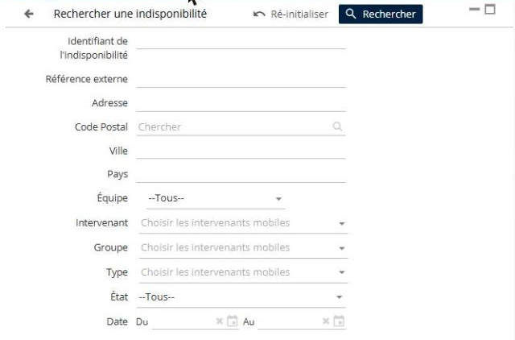
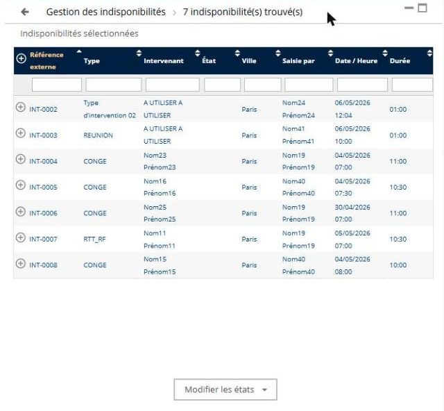

# Rechercher des indisponibilités

La recherche d'indisponibilités permet de retrouver les indisponibilités déclarées selon l'intervenant, le type, l'état ou la période.

## Accéder à la fonctionnalité

**Navigation :** `Planification > menu Planification > Rechercher des indisponibilités`

## Utiliser la fonctionnalité

1. Renseignez les critères souhaités : **Identifiant de l'indisponibilité**, **Référence externe**, **Adresse**, **Code Postal**, **Ville**, **Pays**, **Équipe**, **Intervenant**, **Groupe**, **Type**, **État**.
2. Renseignez la période dans **Date**, avec une date **Du** et une date **Au**.
3. Sélectionnez **Rechercher**.

## Résultat

La page **Gestion des indisponibilités** indique le nombre d'indisponibilités trouvées. Le tableau affiche la **Référence externe**, le **Type**, l'**Intervenant**, l'**État**, la **Ville**, la personne qui a saisi l'indisponibilité (**Saisie par**), la **Date / Heure** et la **Durée**.

## Points d'attention

* Le bouton **Modifier les états** est disponible sous le tableau des résultats.
* Le bouton **Ré-initialiser** est disponible à côté de **Rechercher**.
