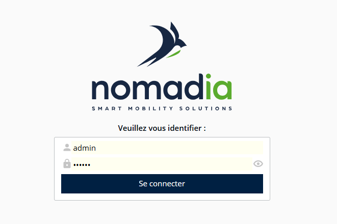

# Se connecter

La page de connexion vous permet d'accéder à Nomadia Field Service avec votre identifiant et votre mot de passe.

## Avant de commencer

Munissez-vous de l'adresse de l'application et de vos identifiants, fournis par votre administrateur.

## Se connecter avec un identifiant et un mot de passe

1. Ouvrez l'adresse de Nomadia Field Service dans votre navigateur.
2. Sous **Veuillez vous identifier :**, saisissez votre identifiant.
3. Saisissez votre mot de passe. L'icône en forme d'œil permet d'afficher le mot de passe saisi.
4. Sélectionnez **Se connecter**.

En cas d'erreur, un message s'affiche sous le formulaire.

## Réinitialiser un mot de passe oublié

Si votre administrateur a activé l'envoi de codes par e-mail, le lien **Mot de passe oublié ?** est proposé sur la page de connexion.

1. Sélectionnez **Mot de passe oublié ?**.
2. Saisissez votre identifiant, puis demandez l'envoi du code.
3. Ouvrez l'e-mail reçu et saisissez le code dans le champ **Code reçu par email**.
4. Saisissez puis confirmez votre nouveau mot de passe.
5. Validez, puis revenez à la page de connexion.

> **\[CAPTURE À PRENDRE]**
>
> * **Écran / Menu :** Page de connexion > lien **Mot de passe oublié ?**
> * **Contexte / Données à afficher :** formulaire de réinitialisation avec le champ **Code reçu par email** et les champs du nouveau mot de passe (environnement où l'envoi de codes par e-mail est activé).
> * **Rappel :** anonymiser les noms des clients et des ressources, ainsi que le nom de l'organisation de l'environnement de test.


Le code n'est envoyé que si votre compte possède une adresse e-mail. Il n'est valable que quelques minutes et pour un nombre d'essais limité. Sans adresse e-mail, contactez votre administrateur.


Si votre administrateur vous demande de renouveler votre mot de passe, la page de modification s'affiche directement après la connexion.

## Se connecter avec l'authentification unique

Si votre organisation utilise une authentification unique (SSO), vous vous connectez avec le compte de votre entreprise, sans mot de passe propre à Nomadia Field Service.

1. Sur la page de connexion, sélectionnez le bouton de votre fournisseur d'identité, par exemple **Se connecter avec SAML**.
2. Authentifiez-vous sur la page du fournisseur.
3. Vous êtes ensuite redirigé vers Nomadia Field Service.

Seuls les fournisseurs configurés pour votre environnement sont affichés. L'accès est refusé si l'identifiant transmis par le fournisseur, en général votre adresse e-mail, ne correspond à aucun utilisateur de Nomadia Field Service.

## Résultat

L'application s'ouvre sur le module défini comme point d'entrée pour votre compte, par exemple le **Portail**. À défaut, elle s'ouvre sur un module auquel votre profil donne accès.

Si aucun module ne vous est accessible, le message « Vous n'avez accès à aucun module » s'affiche : contactez votre administrateur.


Le numéro de version de l'application est affiché en bas à droite de la page de connexion.


## Se déconnecter

1. Sélectionnez l'icône utilisateur, en haut à droite de l'écran.
2. Sélectionnez **Déconnexion**.

Se déconnecter ou fermer le navigateur n'arrête pas les traitements déjà lancés, comme une optimisation ou un import : ils se poursuivent sur le serveur.

Vous pouvez également vous déconnecter depuis le Portail avec le bouton **Se déconnecter**. Pour en savoir plus, consultez [Portail](../portail.md).
