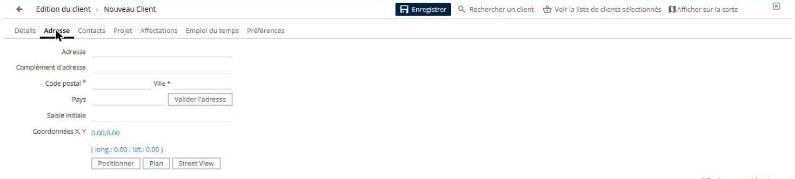
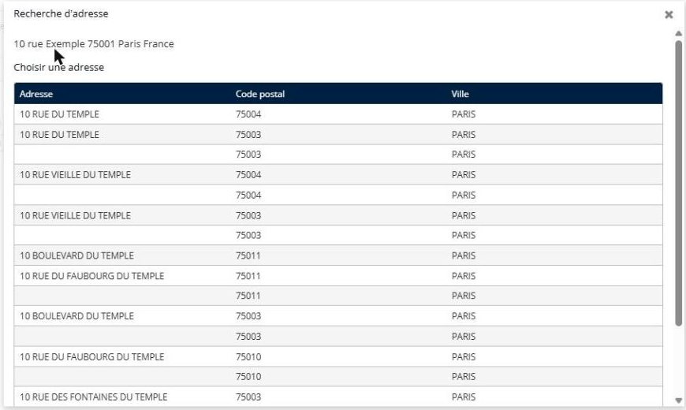

# Géocoder une adresse

Le géocodage positionne une adresse sur la carte en calculant ses coordonnées géographiques. Nomadia Field Service utilise cette position pour afficher l'objet sur la carte, calculer les temps de trajet et optimiser les plannings.

Une adresse mal géocodée fausse les trajets et donc les propositions de créneaux : vérifiez-la à chaque création ou modification.

## Objets concernés

Les objets localisés partagent le même bloc d'adresse : client, rendez-vous, ressource, site de travail, indisponibilité…

| Champ                        | Rôle                                                                                                              |
| ---------------------------- | ----------------------------------------------------------------------------------------------------------------- |
| **Adresse**                  | Numéro et nom de la voie.                                                                                         |
| **Complément d'adresse**     | Informations pratiques sur le lieu : bâtiment, étage, code d'accès… Ce champ n'est pas utilisé pour le géocodage. |
| **Code postal** et **Ville** | Commune de l'adresse.                                                                                             |
| **Pays**                     | Pays de l'adresse.                                                                                                |
| **Saisie initiale**          | Texte saisi avant la validation de l'adresse, en lecture seule.                                                   |
| **Coordonnées X, Y**         | Position calculée sur la carte.                                                                                   |

## Valider une adresse

1. Saisissez l'**Adresse**, le **Code postal**, la **Ville** et le **Pays**.
2. Sélectionnez **Valider l'adresse**.

3. Dans la fenêtre **Recherche d'adresse**, sous **Choisir une adresse**, sélectionnez l'adresse qui correspond.

4. Vérifiez les **Coordonnées X, Y**, puis enregistrez la fiche.

## Résultat

L'adresse, le code postal, la ville et les coordonnées sont mis à jour. Le champ **Saisie initiale** conserve le texte que vous aviez saisi.

Sous les coordonnées, selon l'écran et vos droits :

* **Positionner** place l'objet par un clic sur la carte ;
* **Plan** affiche le plan d'accès de l'adresse ;
* **Street View** ouvre l'adresse dans Google Street View. Une connexion Internet est nécessaire.

## Points d'attention


Commencez le champ **Adresse** par le numéro et le nom de la voie. Les mentions du type « Chez Mme Martin » ou « Résidence Les Lilas » en début d'adresse empêchent un géocodage correct : placez-les dans **Complément d'adresse**.


* Pour un exemple complet, consultez [Créer un client](../clients/creer-client.md).
