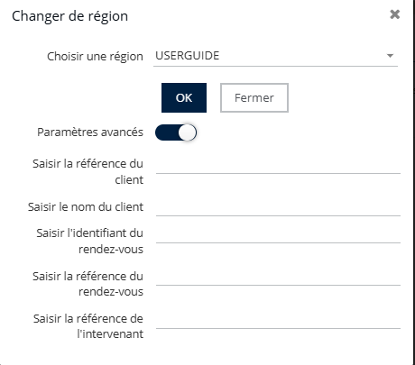
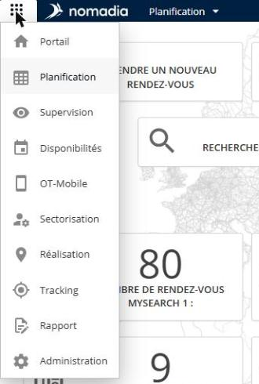
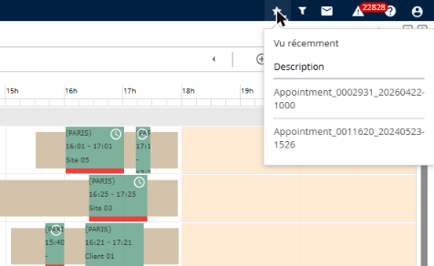
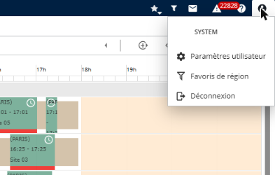
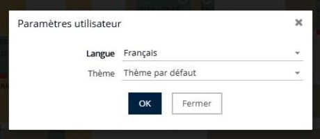

# Naviguer dans l'application

Tous les modules de Nomadia Field Service partagent un bandeau supérieur et une barre d'état inférieure.

## Bandeau supérieur

| Élément                               | Emplacement             | Rôle                                                                                   |
| ------------------------------------- | ----------------------- | -------------------------------------------------------------------------------------- |
| Lanceur d'applications (icône grille) | À gauche                | Ouvre la liste des modules                                                             |
| Nom du module                         | À gauche, après le logo | Indique le module ouvert. Dans le module **Planification**, il ouvre le menu du module |
| Étoile                                | À droite                | Affiche la liste **Vu récemment**                                                      |
| Entonnoir                             | À droite                | **Activer les favoris**                                                                |
| Enveloppe                             | À droite                | **Lister les messages non lus**                                                        |
| Triangle avec compteur                | À droite                | Accès aux clients en alerte                                                            |
| Point d'interrogation                 | À droite                | Ouvre la documentation en ligne dans un nouvel onglet, si votre profil y donne accès   |
| Icône utilisateur                     | À droite                | Ouvre le menu utilisateur                                                              |

## Barre d'état

La barre inférieure affiche la date du jour et la langue à gauche, et la région active à droite (**Région :**).

* Sélectionnez la langue pour ouvrir les **Paramètres utilisateur**.
* Sélectionnez **Région :** pour changer de région, si votre profil le permet.

## Changer de région

La région détermine le périmètre des données affichées : intervenants, clients, rendez-vous.

1. Dans la barre inférieure, sélectionnez **Région :**.
2. Dans la fenêtre **Changer de région**, sélectionnez la région dans **Choisir une région**.
3. Sélectionnez **OK**.

### Retrouver la région d'un client, d'un rendez-vous ou d'un intervenant

1. Dans la fenêtre **Changer de région**, activez **Paramètres avancés**.
2. Renseignez l'un des champs proposés :
   * **Saisir la référence du client** ;
   * **Saisir le nom du client** ;
   * **Saisir l'identifiant du rendez-vous** ;
   * **Saisir la référence du rendez-vous** ;
   * **Saisir la référence de l'intervenant**.
3. Sélectionnez **OK**.

## Changer de module

1. Sélectionnez le lanceur d'applications, en haut à gauche.
2. Sélectionnez le module à ouvrir.

## Consulter les éléments vus récemment

1. Sélectionnez l'étoile dans le bandeau supérieur.
2. Dans la liste **Vu récemment**, sélectionnez l'élément à rouvrir.

## Utiliser le menu utilisateur

Sélectionnez l'icône utilisateur, en haut à droite. Le menu affiche votre nom d'utilisateur et les entrées suivantes :

* **Paramètres utilisateur** ;
* **Favoris de région** ;
* **Déconnexion**.

## Modifier la langue ou le thème

1. Ouvrez le menu utilisateur.
2. Sélectionnez **Paramètres utilisateur**.
3. Choisissez la **Langue** et le **Thème**.
4. Sélectionnez **OK** pour appliquer, ou **Fermer** pour annuler.

## Agrandir ou réduire un panneau

Certains écrans, comme celui du module **Planification**, sont composés de plusieurs panneaux. Les icônes situées en haut à droite de chaque panneau permettent de le réduire ou de l'agrandir pour l'afficher sur toute la largeur de l'écran.
