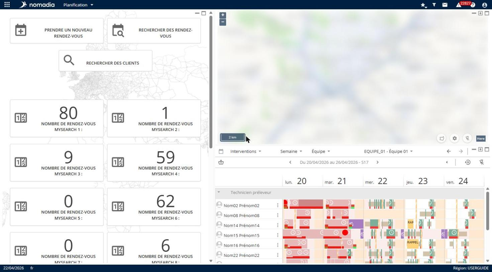
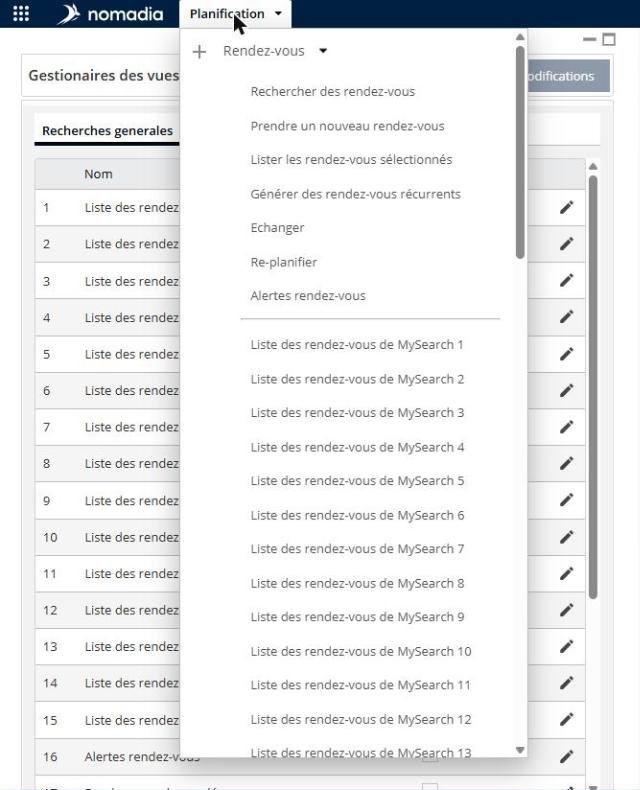

# Planification

Le module Planification est l'écran de travail principal des planificateurs. Il réunit la prise de rendez-vous, la recherche, la carte et le planning des intervenants.

## Accéder au module

**Navigation :** `Lanceur d'applications > Planification`

## Écran d'accueil

L'écran est composé de trois panneaux :

* à gauche, la zone de travail : raccourcis, formulaires de recherche, fiches ;
* en haut à droite, la carte ;
* en bas à droite, le planning des intervenants.

La zone de travail affiche à l'ouverture :

* les raccourcis **PRENDRE UN NOUVEAU RENDEZ-VOUS**, **RECHERCHER DES RENDEZ-VOUS** et **RECHERCHER DES CLIENTS** ;
* des cartes avec compteur, qui affichent le nombre de rendez-vous des vues de recherche (MySearch) cochées **Page d'accueil** : **NOMBRE DE RENDEZ-VOUS MYSEARCH N** pour les vues administrateur, ou le nom de compteur choisi pour les vues personnelles.

## Bandeau du module

En plus des éléments communs à tous les modules, le bandeau du module **Planification** peut afficher, selon vos droits et le paramétrage :

* l'icône de filtre **Activer les favoris** / **Désactiver les favoris**, qui restreint les listes de ressources, d'équipes et de sites de travail aux favoris choisis dans le menu utilisateur (**Favoris de région**) ;
* le compteur de messages non lus ;
* le compteur de clients en alerte.

Pour en savoir plus, consultez [Suivre les alertes et les messages](alertes-messagerie.md).

## Menu du module

Sélectionnez **Planification**, à côté du logo, pour ouvrir le menu du module.

| Section           | Entrées                                                                                                                                                                                                                                                                                                                        |
| ----------------- | ------------------------------------------------------------------------------------------------------------------------------------------------------------------------------------------------------------------------------------------------------------------------------------------------------------------------------ |
| **Rendez-vous**   | Rechercher des rendez-vous, Prendre un nouveau rendez-vous, Lister les rendez-vous sélectionnés, Générer des rendez-vous récurrents, Echanger, Re-planifier, Alertes rendez-vous, listes des rendez-vous de MySearch 1 à 15, listes de rendez-vous par état, vues personnelles                                                 |
| **Clients**       | Rechercher des clients, Créer un client, Liste de clients sélectionnés, Écart client, Liste des clients en alerte, recherches de projets                                                                                                                                                                                       |
| **Planification** | Rechercher des indisponibilités, Gérer des indisponibilités, listes d'indisponibilités enregistrées, Postes temporaires, Visualiser les clients, Attribution des sites de travail, Gérer les jalons, Localisations exceptionnelles, Emplacements d'hôtels, Journée verrouillée, Affectations de matériel, Gestion des secteurs |
| **Localisation**  | Rechercher aux environs, Calculer l'itinéraire, Convertir les coordonnées en Lat/Lon, Suivi de véhicule                                                                                                                                                                                                                        |
| **Exports**       | Liste des exports prédéfinis, Éditer la feuille de route                                                                                                                                                                                                                                                                       |

Le menu comporte également, tout en bas, les entrées **Alertes** et **Gestionaires des vues**. Cette dernière permet de créer et de configurer les vues de recherche (MySearch) : consultez [Gérer les vues de recherche](gerer-vues/).

## Dans cette section

* [Consulter le planning](consulter-planning.md)
* [Utiliser la carte](carte.md)
* [Agir sur un rendez-vous depuis le planning](agir-depuis-planning.md)
* [Gérer les vues de recherche](gerer-vues/)
* [Monitoring des ressources](monitoring-ressources/)
* [Gérer les autres éléments du planning](objets-planification.md)
* [Configurer les créneaux de passage par jour de la semaine](https://github.com/sebastientrang/nfsuserguidefr/tree/main/planification/creneaux-passage-jour-semaine.md)
* [Utiliser les outils de localisation et d'export](localisation-exports.md)
* [Suivre les alertes et les messages](alertes-messagerie.md)
