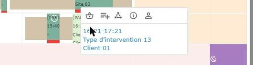
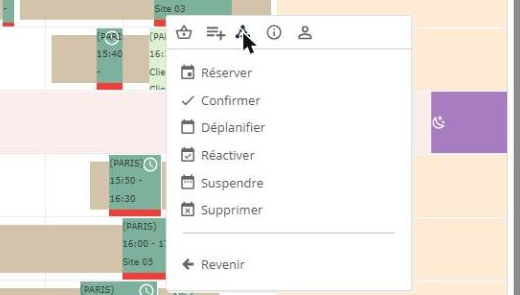

# Agir sur un rendez-vous depuis le planning

Le planning permet d'agir rapidement sur un rendez-vous sans passer par la recherche.

## Avant de commencer

Affichez le planning sur la période qui contient le rendez-vous. Pour en savoir plus, consultez [Consulter le planning](consulter-planning.md).

## Afficher les actions d'un rendez-vous

Survolez le rendez-vous dans le planning. Une fenêtre affiche l'horaire, le type d'intervention et le client, ainsi que les icônes suivantes :

| Icône              | Action                            |
| ------------------ | --------------------------------- |
| Panier             | Ajouter au panier                 |
| Liste avec un plus | Ajouter à la liste de sélection   |
| Triangle           | Modifier l'état de l'intervention |
| i                  | Ouvrir la fiche de l'intervention |
| Personne           | Ouvrir la fiche du client         |

## Modifier l'état d'un rendez-vous

1. Survolez le rendez-vous dans le planning.
2. Sélectionnez l'icône **Modifier l'état de l'intervention**.
3. Sélectionnez l'action à appliquer : **Réserver**, **Confirmer**, **Déplanifier**, **Réactiver**, **Suspendre** ou **Supprimer**.

Sélectionnez **Revenir** pour fermer le menu sans modifier l'état.

## Résultat

Le planning est mis à jour. Par exemple, après **Confirmer**, le rendez-vous s'affiche en vert foncé.


Vérifiez le rendez-vous sélectionné avant d'utiliser l'action **Supprimer**.


Pour comprendre les états, consultez [Comprendre les états des rendez-vous](../introduction/statuts-rendez-vous.md).
