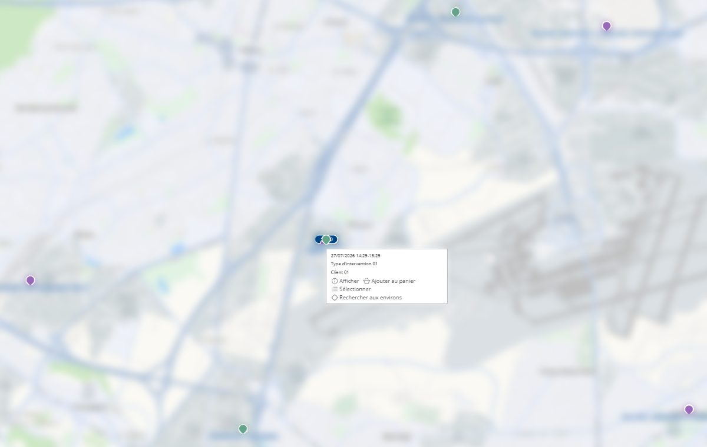

# Utiliser la carte

La carte, en haut à droite du module **Planification**, affiche les rendez-vous, les sites et les positions utiles à la planification. Elle tient compte de votre périmètre : région et droits.

## Accéder à la fonctionnalité

**Navigation :** `Planification`, panneau en haut à droite de l'écran.

## Se déplacer dans la carte

* Faites glisser la carte avec la souris pour vous déplacer.
* Utilisez la molette de la souris ou les boutons **Zoom in** et **Zoom out** pour zoomer et dézoomer.

## Choisir les éléments affichés

1. Sélectionnez le bouton **Configuration** de la carte.
2. Cochez les éléments à afficher :
   * **Afficher les rendez-vous** : vous pouvez filtrer par **Type d'intervention** et par période (**Du**, **Au**) ;
   * **Afficher les secteurs** : les secteurs dont des communes ont été renseignées dans leur fiche s'affichent sur la carte.

## Agir sur un rendez-vous depuis la carte

Sélectionnez un rendez-vous sur la carte pour afficher son info-bulle. Selon vos droits, elle propose :

| Action                      | Effet                                                          |
| --------------------------- | -------------------------------------------------------------- |
| **Afficher**                | Ouvre la fiche du rendez-vous.                                 |
| **Ajouter au panier**       | Ajoute le rendez-vous au panier de rendez-vous du planning.    |
| **Sélectionner**            | Ajoute le rendez-vous à la liste des rendez-vous sélectionnés. |
| **Rechercher aux environs** | Recherche des objets à proximité du rendez-vous.               |

Pour en savoir plus sur les recherches de proximité, consultez [Utiliser les outils de localisation et d'export](localisation-exports.md).
