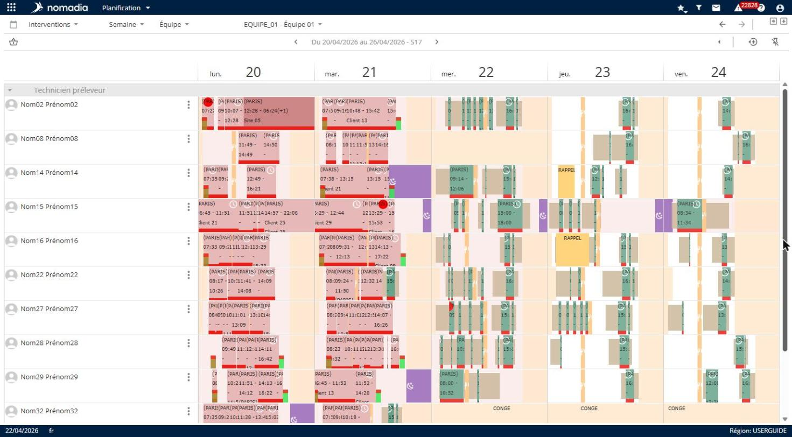
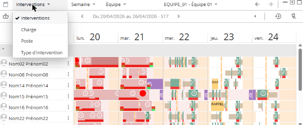
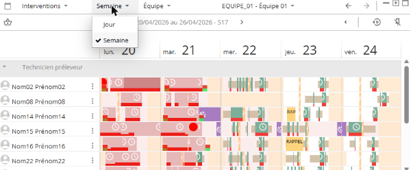
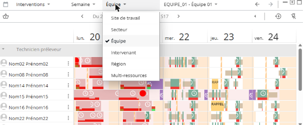
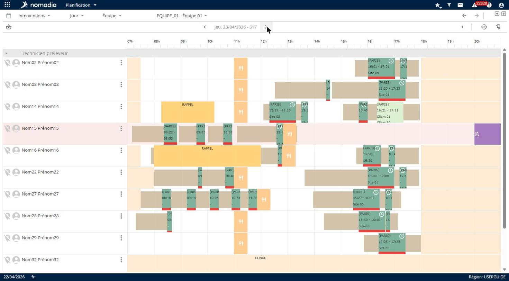
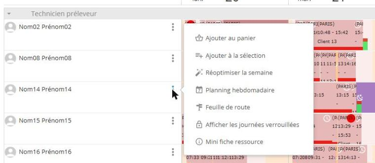
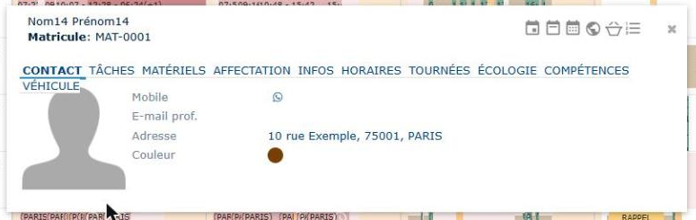

# Consulter le planning

Le planning affiche, pour chaque intervenant, les rendez-vous, les indisponibilités et les pauses sur la période choisie.

## Accéder au planning

**Navigation :** `Planification`, panneau en bas à droite de l'écran.

Pour afficher le planning sur toute la largeur de l'écran, utilisez l'icône d'agrandissement en haut à droite du panneau.

## Choisir l'affichage

La barre supérieure du planning contient trois listes.

| Liste              | Valeurs                                                                                         |
| ------------------ | ----------------------------------------------------------------------------------------------- |
| Nature de l'agenda | **Interventions**, **Charge**, **Poste**, **Type d'intervention**                               |
| Période            | **Jour**, **Semaine**                                                                           |
| Niveau             | **Site de travail**, **Secteur**, **Équipe**, **Intervenant**, **Région**, **Multi-ressources** |

À droite des listes, sélectionnez l'élément à afficher, par exemple l'équipe ou l'intervenant.

## Changer de période

* Utilisez les flèches situées de part et d'autre de la période affichée (par exemple `Du 20/04/2026 au 26/04/2026 - S17`) pour passer à la période précédente ou suivante.
* Les flèches **Agenda précédent** et **Agenda suivant**, en haut à droite, permettent de naviguer entre les agendas affichés.

## Lire le planning en vue Jour

En vue **Jour**, une graduation horaire s'affiche en haut du planning. Chaque ligne correspond à un intervenant.

* Les rendez-vous affichent leurs horaires de début et de fin.
* Les indisponibilités affichent leur type, par exemple **RAPPEL** ou **CONGE**.
* L'icône représentant des couverts signale la pause déjeuner.

## Utiliser le menu d'un intervenant

Sélectionnez l'icône **⋮** à droite du nom d'un intervenant. Le menu propose :

* **Ajouter au panier** ;
* **Ajouter à la sélection** ;
* **Réoptimiser la semaine** ;
* **Planning hebdomadaire** ;
* **Feuille de route** ;
* **Afficher les journées verrouillées** ;
* **Mini fiche ressource**.

## Consulter la mini fiche d'un intervenant

1. Ouvrez le menu **⋮** de l'intervenant.
2. Sélectionnez **Mini fiche ressource**.

La mini fiche affiche le nom et le matricule de l'intervenant, ainsi que des onglets : **CONTACT**, **TÂCHES**, **MATÉRIELS**, **AFFECTATION**, **INFOS**, **HORAIRES**, **TOURNÉES**, **ÉCOLOGIE**, **COMPÉTENCES** et **VÉHICULE**. L'onglet **CONTACT** affiche notamment le mobile, l'e-mail professionnel, l'adresse et la couleur de l'intervenant.

Les onglets affichés dépendent de la configuration de l'application. Pour afficher l'onglet **QUOTA** et des indicateurs complémentaires (réserve de temps, quantités, capacité du véhicule), consultez [Afficher les indicateurs de tournée dans la mini fiche ressource](monitoring-ressources/indicateurs-mini-fiche-ressource.md).

## Points d'attention

* L'icône représentant une punaise, en haut à droite du planning, permet d'**Activer/désactiver le gel du planning**.
* L'icône représentant un panier, en haut à gauche du planning, donne accès au **Panier de rendez-vous**.
