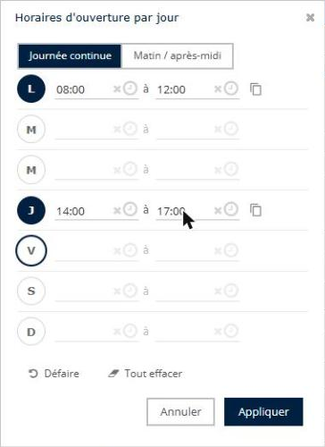
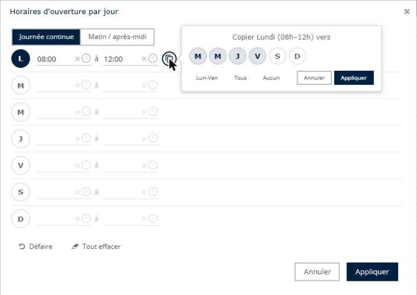
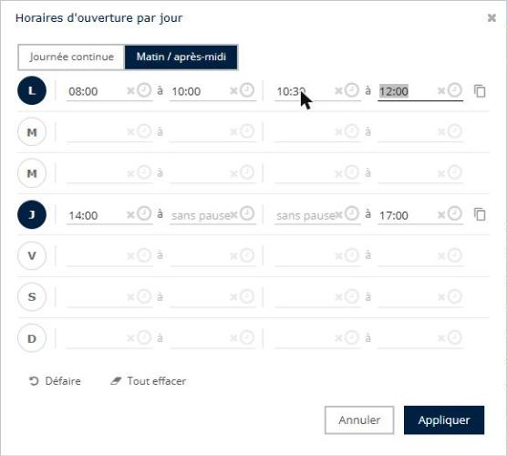
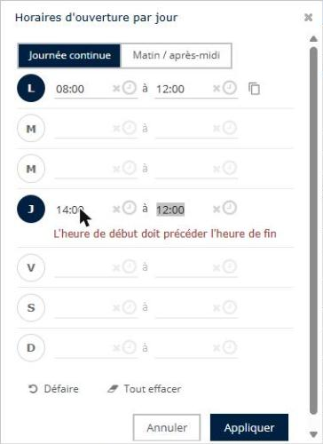
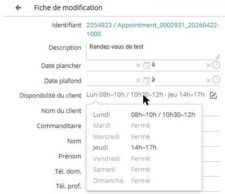
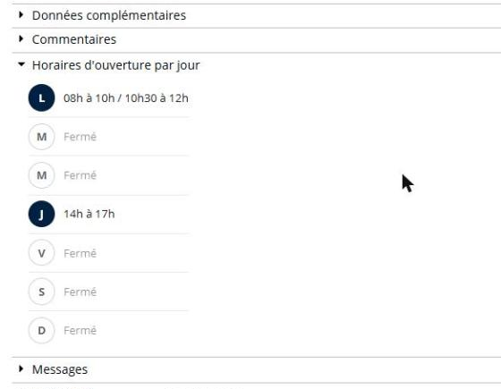
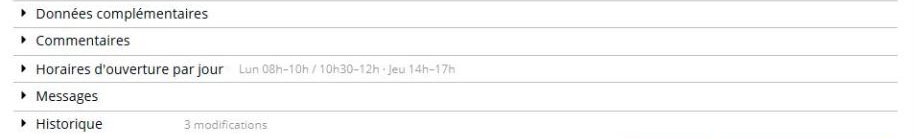
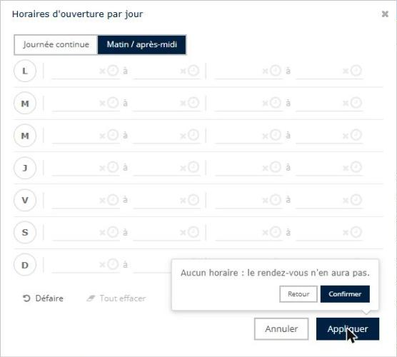
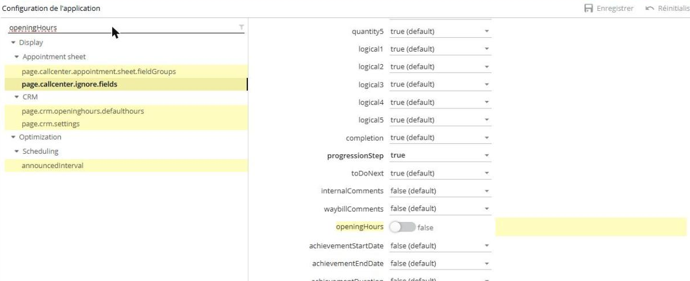
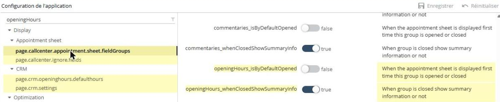

# Configurer les créneaux de passage par jour de la semaine

Les créneaux de passage par jour de la semaine permettent de définir, sur un rendez-vous, les horaires où l'intervention est possible, jour par jour. Par exemple : le lundi de 8h à 12h et le jeudi de 14h à 17h.

Ces créneaux forment la semaine propre du rendez-vous. Ils remplacent les horaires d'ouverture du projet et du client, et sont pris en compte par l'optimisation temps réel et par l'optimisation batch.


Un jour sans créneau est un jour fermé : le rendez-vous ne sera pas planifié ce jour-là. Un rendez-vous sans créneau propre continue d'utiliser les horaires du projet, puis ceux du client.


## Avant de commencer

* Le champ **Disponibilité du client** et la section **Horaires d'ouverture par jour** doivent être affichés. Consultez [Paramétrage](creneaux-passage-jour-semaine.md#parametrage).
* Pour modifier les créneaux, vous devez disposer du droit de modification des rendez-vous. Sans ce droit, le bouton de modification n'apparaît pas et les créneaux sont en consultation seule.

## Comprendre quels horaires s'appliquent

Pour chaque rendez-vous, Nomadia Field Service retient une seule source d'horaires, dans l'ordre suivant :

| Priorité | Source                          | Repère à l'écran                                              |
| -------- | ------------------------------- | ------------------------------------------------------------- |
| 1        | Créneaux propres du rendez-vous | Aucune icône                                                  |
| 2        | Horaires d'ouverture du projet  | Icône dossier, info-bulle **Horaires d'ouverture du projet**  |
| 3        | Horaires d'ouverture du client  | Icône personne, info-bulle **Horaires d'ouverture du client** |

Les sources ne se combinent pas : dès que le rendez-vous a ses propres créneaux, ceux du projet et du client sont ignorés, même si le client n'est pas disponible sur ce créneau.

**Exemple :** un rendez-vous a les créneaux lundi 08h–10h, mardi 16h–18h et vendredi 14h–16h. Le client est disponible le matin uniquement.

| Jour                     | Résultat                                                                   |
| ------------------------ | -------------------------------------------------------------------------- |
| Lundi                    | Planifiable entre 08h et 10h                                               |
| Mardi                    | Planifiable entre 16h et 18h, même en dehors de la disponibilité du client |
| Vendredi                 | Planifiable entre 14h et 16h                                               |
| Mercredi (aucun créneau) | Jour fermé : pas de planification ce jour-là                               |

## Accéder aux créneaux

| Écran                                                     | Ce que vous voyez                                                                        | Modification |
| --------------------------------------------------------- | ---------------------------------------------------------------------------------------- | ------------ |
| Fiche rendez-vous                                         | Section **Horaires d'ouverture par jour**. Fermée, elle affiche un résumé sur une ligne. | Consultation |
| Fiche de modification (**Modifier...**)                   | Champ **Disponibilité du client** : résumé des créneaux et bouton de modification        | Oui          |
| Prise de rendez-vous : demande et planification optimisée | Champ **Disponibilité du client** avec le bouton de modification                         | Oui          |
| Planification manuelle                                    | Résumé des créneaux, sans bouton                                                         | Consultation |

**Navigation :** `Fiche rendez-vous > Modifier... > Disponibilité du client`

## Saisir les créneaux

1. Ouvrez la fiche du rendez-vous, puis sélectionnez **Modifier...**. Pour en savoir plus, consultez [Modifier un rendez-vous](../rendez-vous/modifier-rendez-vous.md).
2. À côté de **Disponibilité du client**, sélectionnez le bouton de modification.\
   La fenêtre **Horaires d'ouverture par jour** s'ouvre. Elle est préremplie avec les horaires actuels : ceux du rendez-vous, sinon ceux hérités du projet ou du client.
3. Choisissez le mode de saisie :
   * **Journée continue** : un créneau par jour ;
   * **Matin / après-midi** : deux plages par jour, l'écart entre les deux correspond à la pause.
4. Sélectionnez la pastille d'un jour (**L**, **M**, **M**, **J**, **V**, **S**, **D**) pour l'ouvrir ou le fermer.
5. Saisissez l'heure de début et l'heure de fin. Si vous ne saisissez que le début, la fin est proposée automatiquement 2 heures plus tard.

6. Pour répéter le créneau d'un jour, sélectionnez l'icône **Copier vers d'autres jours** à droite de la ligne, choisissez les jours (raccourcis **Lun-Ven**, **Tous**, **Aucun**), puis sélectionnez **Appliquer** dans la bulle.

7. Sélectionnez **Appliquer**. Le résumé du champ **Disponibilité du client** est mis à jour.
8. Sélectionnez **Enregistrer** pour conserver les créneaux sur le rendez-vous.

En mode **Matin / après-midi**, les champs de pause vides affichent **sans pause**.

### Contrôles de saisie

Un message s'affiche sous le jour concerné lorsque la saisie est incomplète ou incohérente :

| Message                                                | Cause                                                           |
| ------------------------------------------------------ | --------------------------------------------------------------- |
| **Heures de début et de fin obligatoires**             | Un jour ouvert n'a pas ses deux heures.                         |
| **L'heure de début doit précéder l'heure de fin**      | L'heure de fin est avant l'heure de début.                      |
| **Le matin doit finir avant le début de l'après-midi** | En mode **Matin / après-midi**, les deux plages se chevauchent. |

### Autres actions de la fenêtre

* **Défaire** annule la dernière modification.
* **Tout effacer** ferme tous les jours.
* **Annuler** ou la croix de fermeture remettent les horaires de départ.

## Consulter les créneaux

Dans la fiche de modification, survolez le résumé du champ **Disponibilité du client** pour afficher le détail jour par jour. Les jours sans créneau sont indiqués **Fermé**.

Dans la fiche rendez-vous, la section **Horaires d'ouverture par jour** affiche les créneaux de chaque jour.

Lorsque la section est fermée, un résumé s'affiche à côté de son titre.

Quand le rendez-vous n'a pas de créneaux propres, le résumé montre les horaires hérités, précédés de l'icône du projet ou du client.

## Revenir aux horaires du projet ou du client

1. Dans la fenêtre **Horaires d'ouverture par jour**, sélectionnez **Tout effacer**.
2. Sélectionnez **Appliquer**, puis **Confirmer** dans le message affiché.
3. Enregistrez le rendez-vous.

| Message                                                     | Effet                                          |
| ----------------------------------------------------------- | ---------------------------------------------- |
| **Pas d'horaires propres : ceux du projet s'appliqueront.** | Le rendez-vous reprend les horaires du projet. |
| **Pas d'horaires propres : ceux du client s'appliqueront.** | Le rendez-vous reprend les horaires du client. |
| **Aucun horaire : le rendez-vous n'en aura pas.**           | Ni le projet ni le client n'ont d'horaires.    |


Si vous validez la fenêtre sans rien changer aux horaires hérités, aucun créneau propre n'est créé : le rendez-vous continue de suivre le projet ou le client, y compris s'ils sont modifiés plus tard.


## Importer et exporter les créneaux

Les créneaux figurent dans le fichier CSV des rendez-vous, avec les mêmes colonnes que les horaires d'ouverture du client.

| Colonnes                                                                 | Contenu                                                                                             |
| ------------------------------------------------------------------------ | --------------------------------------------------------------------------------------------------- |
| `DAYnBEGINTIME` / `DAYnENDTIME`                                          | Début et fin du créneau du jour n (1 = lundi, 7 = dimanche), au format HH:MM. `00:00` = jour fermé. |
| `DAYnBEGINLUNCHPERIOD` / `DAYnENDLUNCHPERIOD`                            | Début et fin de la pause du jour n. `00:00` = pas de pause.                                         |
| `DAYBEGINTIME`, `DAYENDTIME`, `DAYBEGINLUNCHPERIOD`, `DAYENDLUNCHPERIOD` | Valeurs appliquées à tous les jours. Import uniquement.                                             |

Les heures sont exprimées dans le fuseau horaire du client. Renseignez les 7 jours : une semaine incomplète n'est pas prise en compte.

## Paramétrage

**Navigation :** `Administration > Personnalisation > Configuration de l'application`

Filtrez sur `openingHours` pour afficher les paramètres concernés.

| Paramètre                                                                                     | Valeur par défaut | Effet                                                                           |
| --------------------------------------------------------------------------------------------- | ----------------- | ------------------------------------------------------------------------------- |
| `page.callcenter.ignore.fields` > **openingHours**                                            | false             | **false** : créneaux affichés. **true** : créneaux masqués sur tous les écrans. |
| `page.callcenter.appointment.sheet.fieldGroups` > **openingHours\_isByDefaultOpened**         | false             | Section de la fiche rendez-vous ouverte ou fermée à l'affichage.                |
| `page.callcenter.appointment.sheet.fieldGroups` > **openingHours\_whenClosedShowSummaryInfo** | true              | Résumé affiché à côté du titre de la section fermée.                            |

## Points d'attention

* Le créneau quotidien du rendez-vous (heures de début et de fin journalières) reste appliqué en plus des créneaux par jour : l'optimisation retient la partie commune des deux.
* Les fermetures du client et la pause saisie dans un créneau sont toujours respectées.
* Les créneaux saisis dans la fenêtre ne sont conservés qu'après l'enregistrement du rendez-vous.
