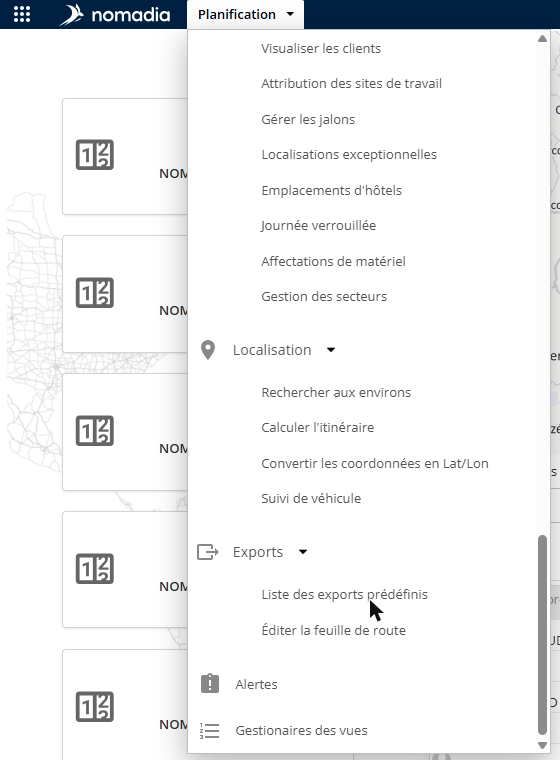
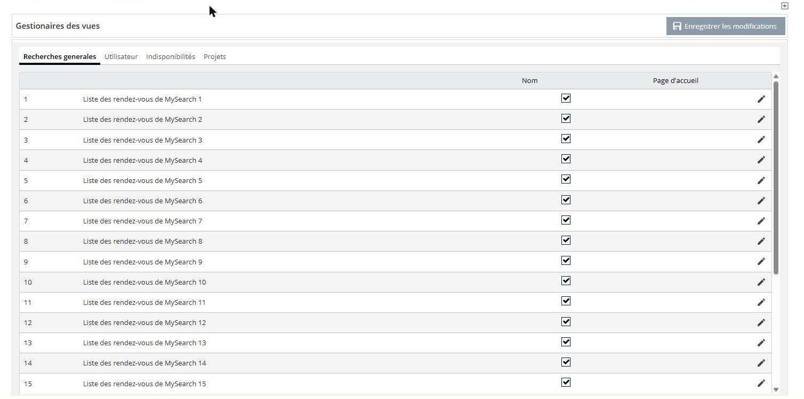
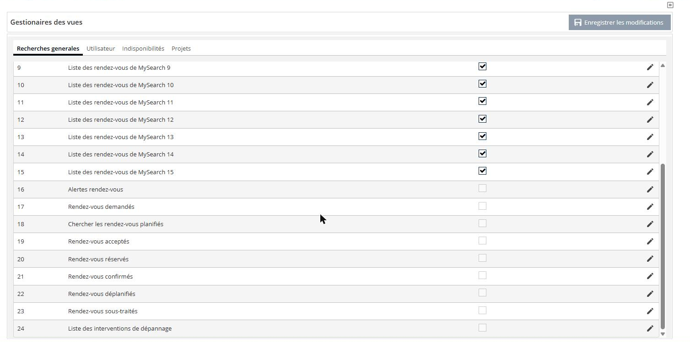
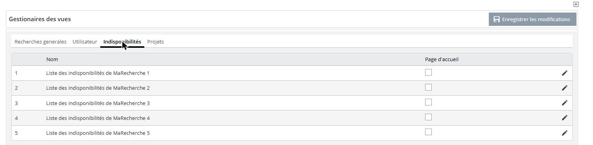
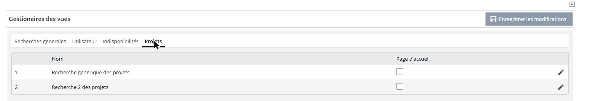
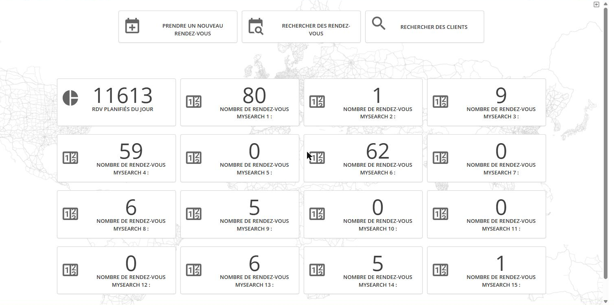

# Gérer les vues de recherche

Le gestionnaire de vues permet de construire des listes de rendez-vous sur mesure, appelées **MySearch** (ou **MaRecherche** dans l'interface). Une vue définit :

* les **filtres** appliqués aux rendez-vous (dates, états, types d'intervention, ressources, etc.) ;
* les **colonnes** affichées dans le tableau de résultats, et leur ordre ;
* les **actions** proposées sur chaque ligne (carte, agenda, planification…) et les **actions en masse** autorisées ;
* les **options d'affichage** : nom de la vue, taille maximale de la liste, compteur sur l'écran d'accueil.

Une fois enregistrée, la vue apparaît dans le menu **Rendez-vous** et s'ouvre en un clic, sans ressaisir les critères de recherche.

## Deux types de vues

|                         | **Vue administrateur (MySearch général)**                                      | **Vue utilisateur**                                              |
| ----------------------- | ------------------------------------------------------------------------------ | ---------------------------------------------------------------- |
| **Pour qui**            | Partagée : tous les utilisateurs qui ont le droit d'accès au MySearch concerné | Personnelle : visible uniquement par l'utilisateur qui l'a créée |
| **Onglet**              | **Recherches generales**                                                       | **Utilisateur**                                                  |
| **Création**            | 15 emplacements fixes (MySearch 1 à 15) que l'on configure                     | Libre, avec le bouton **Ajouter recherche**                      |
| **Copie / suppression** | Non : on reconfigure l'emplacement                                             | Oui : boutons **Copier** et **Supprimer**                        |
| **Nom**                 | Facultatif (sinon « Liste des rendez-vous de MySearch N »)                     | Obligatoire                                                      |
| **Droit requis**        | 1445                                                                           | 1446                                                             |

## Prérequis : les droits

Les droits se trouvent dans la famille **Callcenter**. Ils sont attribués aux utilisateurs par l'administrateur de l'application.

| Droit (libellé dans l'administration)                                                 | N°          | Ce qu'il permet                                                                                                          |
| ------------------------------------------------------------------------------------- | ----------- | ------------------------------------------------------------------------------------------------------------------------ |
| Autorise à modifier les view customizations applicatif                                | 1445        | Accéder aux onglets **Recherches generales**, **Indisponibilités** et **Projets**, et configurer les vues administrateur |
| Autorise la creation/modification/visualisation des view customizations d'utilisateur | 1446        | Accéder à l'onglet **Utilisateur**, créer ses vues personnelles et les voir dans le menu                                 |
| Autorise à modifier view customization                                                | 1433        | Afficher le bouton **Modifier MaRecherche** directement sur une liste de résultats                                       |
| Accès à la liste de rendez-vous mySearch N                                            | 1330 à 1344 | Voir le MySearch N (1 à 15) dans le menu. Un droit par MySearch                                                          |
| Accès à la liste d'indisponibilité mySearch N                                         | 1352 à 1356 | Même principe pour les MySearch d'indisponibilités (1 à 5)                                                               |


L'entrée de menu **Gestionaires des vues** n'apparaît que si l'utilisateur possède le droit 1445 **ou** le droit 1446. Un utilisateur qui n'a que le droit 1446 voit uniquement l'onglet **Utilisateur**.


## Accéder au gestionnaire de vues

### Depuis le menu

**Navigation :** `Planification > menu Planification > Gestionaires des vues`

1. Ouvrez le menu du module **Planification**.
2. Faites défiler le menu jusqu'en bas et sélectionnez **Gestionaires des vues** (libellé affiché tel quel à l'écran).

La page s'ouvre sur l'onglet correspondant à vos droits.

| Onglet                   | Contenu                                                                  | Visible avec                          |
| ------------------------ | ------------------------------------------------------------------------ | ------------------------------------- |
| **Recherches generales** | MySearch de rendez-vous 1 à 15, Alertes rendez-vous, recherches par état | Droit 1445 (onglet ouvert par défaut) |
| **Utilisateur**          | Vos vues personnelles de rendez-vous                                     | Droit 1446                            |
| **Indisponibilités**     | MySearch d'indisponibilités 1 à 5                                        | Droit 1445                            |
| **Projets**              | Recherches de projets                                                    | Droit 1445                            |

Sous les 15 MySearch, l'onglet **Recherches generales** liste aussi **Alertes rendez-vous** et les recherches par état (**Rendez-vous demandés**, **Chercher les rendez-vous planifiés**, **Rendez-vous acceptés**, etc.). Ces recherches se modifient avec le crayon, mais leur case **Page d'accueil** n'est pas modifiable.

### Depuis une liste de résultats

Sur la page de résultats d'un MySearch, d'une recherche par état ou des alertes, le bouton **Modifier MaRecherche** ouvre directement l'assistant de la vue affichée (droit 1433). C'est le moyen le plus rapide d'ajuster une vue existante.

## Choisir les vues affichées sur l'écran d'accueil

Chaque vue cochée dans la colonne **Page d'accueil** s'affiche sous forme de carte avec compteur sur l'écran d'accueil du module **Planification**.

1. Sélectionnez l'onglet souhaité.
2. Dans la colonne **Page d'accueil**, cochez ou décochez les vues.
3. Sélectionnez **Enregistrer les modifications**, en haut à droite de la page.

## Dans cette section

* [Configurer une vue avec l'assistant](assistant-configuration.md)
* [Créer une vue administrateur](creer-vue-administrateur.md)
* [Créer une vue utilisateur](creer-vue-utilisateur.md)
* [Modifier, copier ou supprimer une vue](modifier-copier-supprimer.md)
