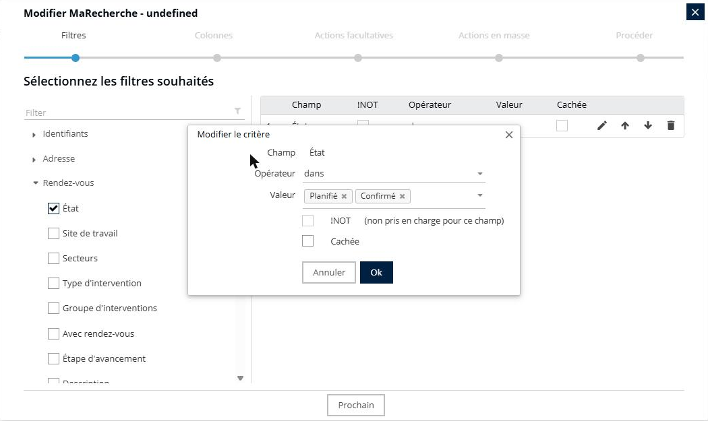
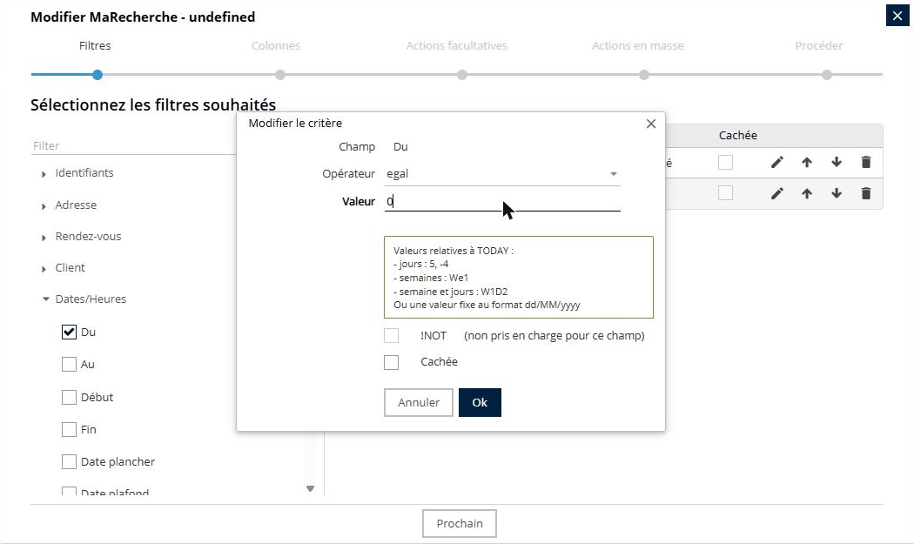
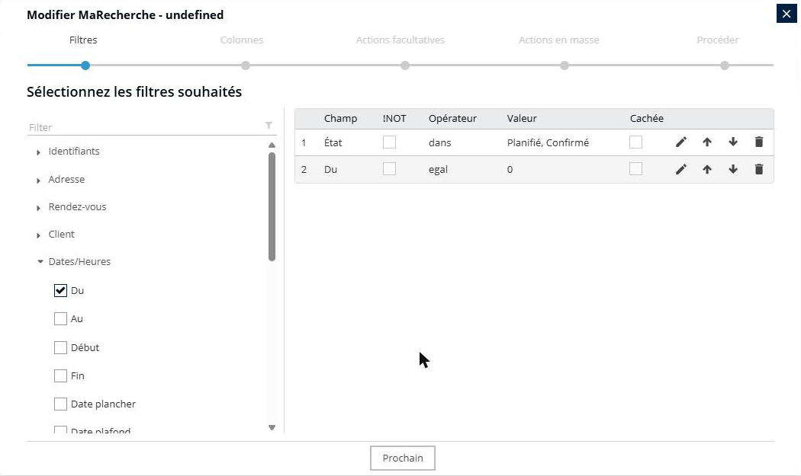
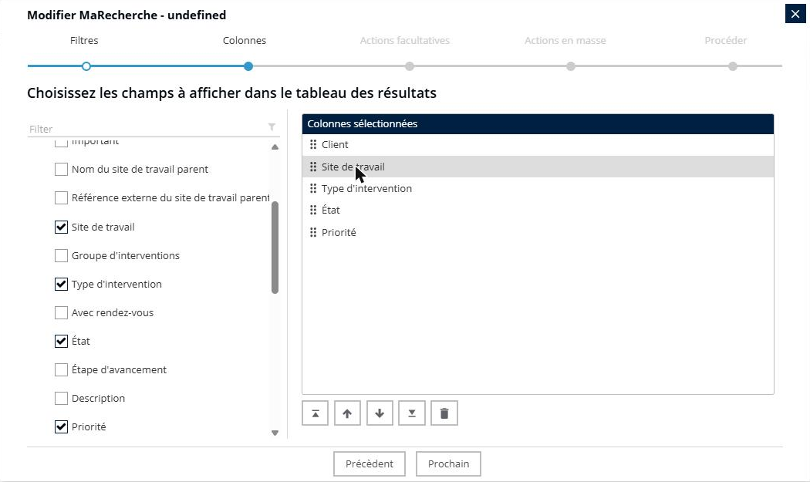
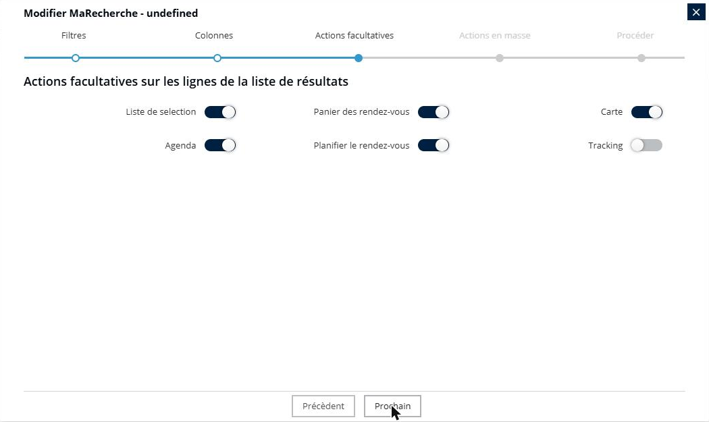
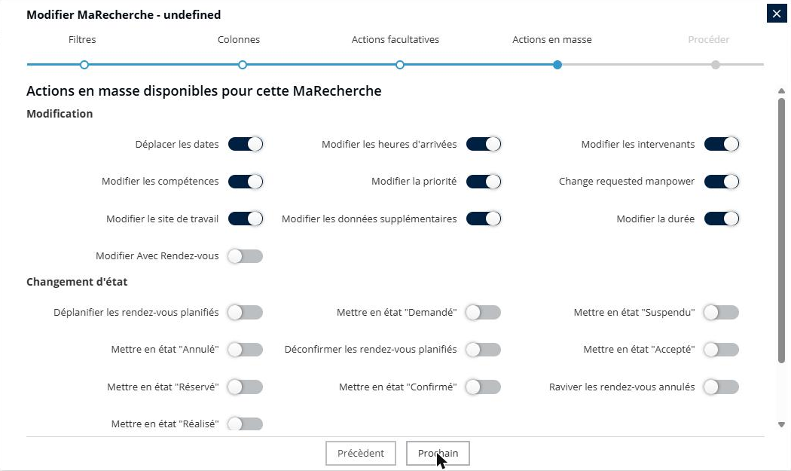
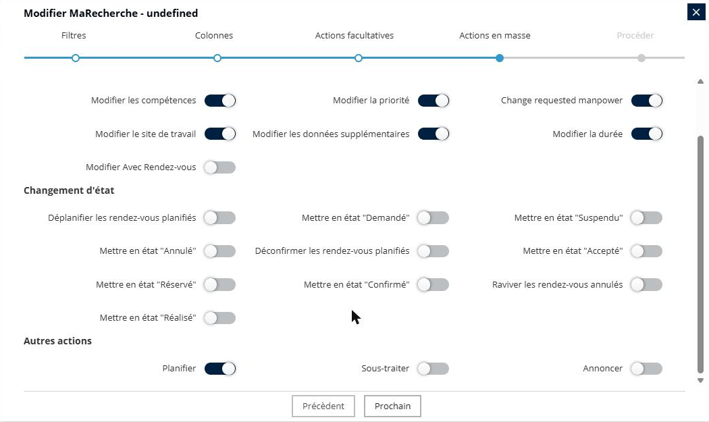
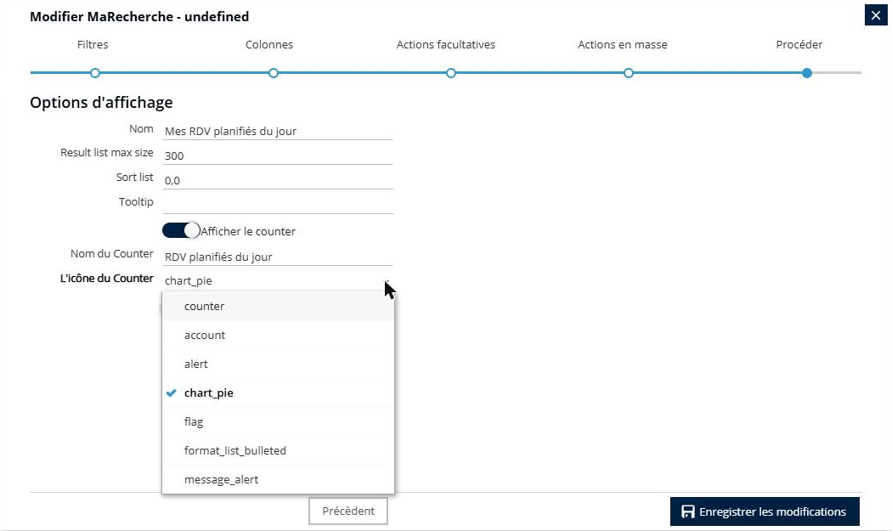
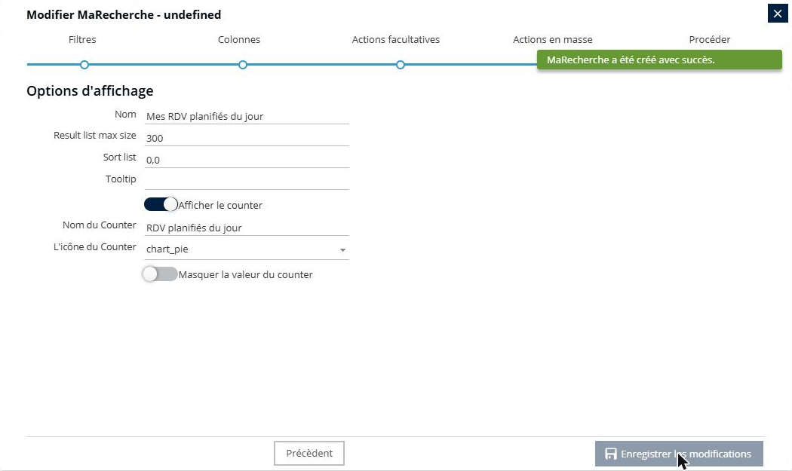

# Configurer une vue avec l'assistant

Qu'elle soit administrateur ou utilisateur, une vue se configure dans la même fenêtre **Modifier MaRecherche**. L'assistant comporte cinq étapes : **Filtres**, **Colonnes**, **Actions facultatives**, **Actions en masse** et **Procéder**.

Passez d'une étape à l'autre avec les boutons **Prochain** et **Précédent**, ou sélectionnez directement le nom de l'étape.

## Étape 1 : Filtres

Choisissez les critères qui sélectionnent les rendez-vous de la vue.

1. Dans l'arborescence par catégories (**Identifiants**, **Adresse**, **Rendez-vous**, **Client**, **Dates/Heures**, **Ressources**…), cochez les champs à filtrer. Le champ **Filter**, au-dessus, permet de rechercher un champ par son nom.
2. Chaque champ coché s'ajoute au tableau **Champ / !NOT / Opérateur / Valeur / Cachée**.
3. Sélectionnez le crayon d'une ligne pour ouvrir la fenêtre **Modifier le critère**.
4. Choisissez l'**Opérateur** et saisissez la **Valeur**, puis sélectionnez **Ok**.
5. Si besoin, cochez **Cachée** (le critère s'applique mais n'est pas affiché sur la liste de résultats) ou **!NOT** (inverse le critère).

Les opérateurs proposés dépendent du champ : egal, dans l'intervalle, moins que, plus grand que, dans, like, contient, is null, not null. Certains champs n'acceptent qu'un opérateur, et l'option **!NOT** est parfois indiquée « non pris en charge pour ce champ ».

| Type de champ                  | Saisie de la valeur                                                                                                                                                                                                                                              |
| ------------------------------ | ---------------------------------------------------------------------------------------------------------------------------------------------------------------------------------------------------------------------------------------------------------------- |
| Date                           | Valeur relative à aujourd'hui : jours (ex. **5** = dans 5 jours, **-4** = il y a 4 jours, **0** = aujourd'hui), semaines (ex. **We1**), semaine et jours (ex. **W1D2**). Ou date fixe au format **jj/mm/aaaa**. Une aide de saisie est affichée dans la fenêtre. |
| Heure, durée                   | Format **HH:mm**                                                                                                                                                                                                                                                 |
| Liste de valeurs (ex. État)    | Sélectionnez une ou plusieurs valeurs dans la liste. Retirez **--Tous--** pour ne garder que les valeurs choisies.                                                                                                                                               |
| Liste sans valeurs prédéfinies | Valeurs séparées par des **virgules**                                                                                                                                                                                                                            |

Les flèches de chaque ligne modifient l'ordre des critères ; la corbeille supprime un critère.


Au moins un critère est obligatoire. Sinon le message « Il doit y avoir au moins un critère » s'affiche.


## Étape 2 : Colonnes

Choisissez les champs à afficher dans le tableau des résultats.

1. Dans l'arborescence, cochez les champs à afficher. Ils s'ajoutent à la liste **Colonnes sélectionnées**.
2. Sélectionnez une colonne puis utilisez les boutons sous la liste pour l'organiser : passer à la première position, déplacer vers le haut, déplacer vers le bas, passer à la dernière position, supprimer.

L'ordre des colonnes est aussi celui de l'export CSV de la liste.


Au moins une colonne est obligatoire (« Il doit y avoir au moins une colonne »).


## Étape 3 : Actions facultatives

Activez les actions proposées sur chaque ligne de résultat : **Liste de selection**, **Panier des rendez-vous**, **Carte**, **Agenda**, **Planifier le rendez-vous** et **Tracking**. Toutes sont activées par défaut, sauf **Tracking**.

## Étape 4 : Actions en masse

Activez les actions en masse disponibles en bas de la liste de résultats. Elles sont réparties en trois catégories :

* **Modification** (activées par défaut) : **Déplacer les dates**, **Modifier les heures d'arrivées**, **Modifier les intervenants**, **Modifier les compétences**, **Modifier la priorité**, **Change requested manpower**, **Modifier le site de travail**, **Modifier les données supplémentaires**, **Modifier la durée**. Seule **Modifier Avec Rendez-vous** est désactivée par défaut.
* **Changement d'état** (désactivées par défaut) : déplanifier, déconfirmer, raviver les rendez-vous annulés, mettre en état **Demandé**, **Suspendu**, **Annulé**, **Accepté**, **Réservé**, **Confirmé** ou **Réalisé**.
* **Autres actions** : **Planifier** (activée par défaut), **Sous-traiter** et **Annoncer** (désactivées).


Une action en masse n'est proposée à un utilisateur que si elle est activée ici **et** qu'il possède le droit correspondant.


## Étape 5 : Procéder (options d'affichage)

| Champ                            | Rôle                                                                                                                                             |
| -------------------------------- | ------------------------------------------------------------------------------------------------------------------------------------------------ |
| **Nom**                          | Nom de la vue, affiché dans le menu et en titre de la liste. Obligatoire pour une vue utilisateur.                                               |
| **Result list max size**         | Nombre maximum de lignes affichées (**300** par défaut).                                                                                         |
| **Sort list**                    | Tri initial de la liste. Conservez la valeur par défaut (**0,0**) sauf besoin particulier.                                                       |
| **Tooltip**                      | Texte d'aide affiché au survol.                                                                                                                  |
| **Afficher le counter**          | Affiche la vue sous forme de carte avec compteur sur l'écran d'accueil. Fait apparaître les champs **Nom du Counter** et **L'icône du Counter**. |
| **Masquer la valeur du counter** | Vues utilisateur uniquement : affiche la carte sans le nombre de rendez-vous. Activé par défaut quand vous activez le compteur.                  |

**L'icône du Counter** propose sept icônes : **counter**, **account**, **alert**, **chart\_pie**, **flag**, **format\_list\_bulleted** et **message\_alert**.

## Enregistrer et fermer

1. Sélectionnez **Enregistrer les modifications**. En création, ce bouton n'apparaît qu'à l'étape **Procéder** ; en modification, il est disponible à toutes les étapes.
2. Le message **MaRecherche a été créé avec succès.** (ou **…enregistré avec succès.**) confirme l'opération.
3. Fermez la fenêtre avec la croix, en haut à droite.

* En cas d'oubli (critère, colonne, nom), l'assistant revient automatiquement sur l'étape à corriger.
* Si vous fermez la fenêtre sans avoir enregistré vos modifications, une confirmation vous est demandée.

## Points d'attention

* Lors de la première modification d'une vue, renseigner le champ **Tooltip** peut effacer le **Nom** et le **Nom du Counter** : vérifiez ces champs avant d'enregistrer (anomalie connue).
* En création, le titre de la fenêtre affiche « Modifier MaRecherche - undefined » tant que la vue n'est pas enregistrée.
* Le nombre de lignes est limité par **Result list max size** : un point d'exclamation à côté de la pagination signale que la limite est atteinte.
