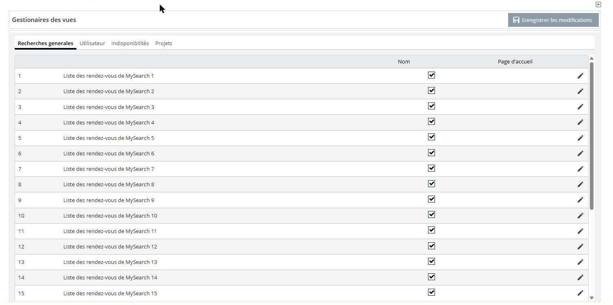

# Créer une vue administrateur

Une vue administrateur met à disposition une liste de rendez-vous commune à un ensemble d'utilisateurs, par exemple « RDV à confirmer J+2 » pour toute l'équipe de planification.


**Prérequis :** droit **1445** (Autorise à modifier les view customizations applicatif).


## Accéder à la fonctionnalité

**Navigation :** `Planification > menu Planification > Gestionaires des vues > onglet Recherches generales`

## Configurer la vue

1. Ouvrez **Gestionaires des vues**. L'onglet **Recherches generales** s'affiche.
2. Repérez un MySearch libre, c'est-à-dire qui porte encore son nom par défaut **Liste des rendez-vous de MySearch N**, et notez son numéro N.
3. Sélectionnez le crayon (**Modifier**) de cette ligne. L'assistant **Modifier MaRecherche** s'ouvre.
4. Renseignez les étapes **Filtres**, **Colonnes**, **Actions facultatives** et **Actions en masse**. Pour le détail, consultez [Configurer une vue avec l'assistant](assistant-configuration.md).
5. À l'étape **Procéder**, saisissez un **Nom** explicite : c'est lui qui apparaîtra dans le menu de tous les utilisateurs.
6. Sélectionnez **Enregistrer les modifications**, puis fermez la fenêtre.
7. Facultatif : pour afficher la vue en carte sur l'écran d'accueil, cochez la case **Page d'accueil** de la ligne, puis sélectionnez **Enregistrer les modifications** en haut de la page.
8. Attribuez le droit **Accès à la liste de rendez-vous mySearch N** (même numéro N) aux utilisateurs qui doivent voir la vue.

La vue apparaît dans le menu **Rendez-vous**, à la place de « Liste des rendez-vous de MySearch N », pour les utilisateurs qui ont le droit d'accès.


Sans le droit **Accès à la liste de rendez-vous mySearch N**, la vue n'apparaît dans le menu de personne, même si elle est correctement configurée.

Les vues administrateur ne se suppriment pas : pour en « supprimer » une, retirez le droit d'accès aux utilisateurs ou reconfigurez l'emplacement pour un autre usage.


## Vues d'indisponibilités et de projets

Les onglets **Indisponibilités** (MySearch d'indisponibilités 1 à 5) et **Projets** fonctionnent de la même façon : sélectionnez le crayon de la ligne, configurez la vue, puis enregistrez. Pour les indisponibilités, le droit d'accès correspondant est **Accès à la liste d'indisponibilité mySearch N**.
