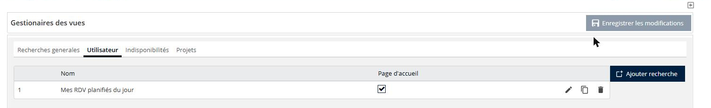
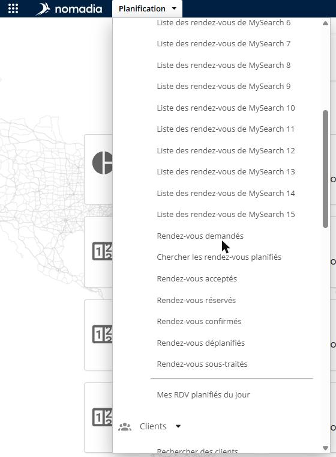
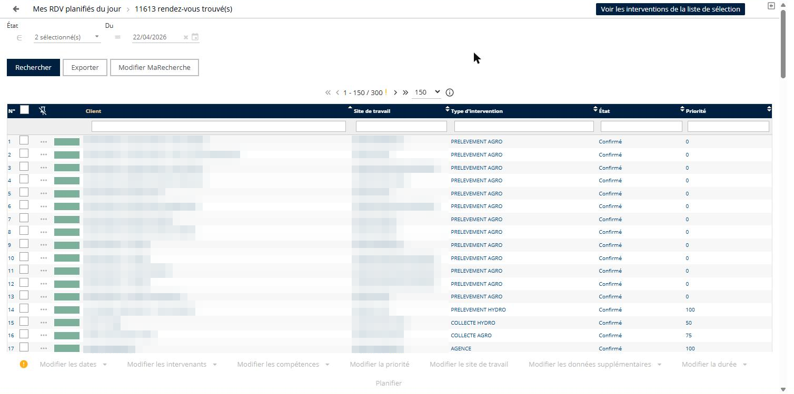

# Créer une vue utilisateur

Une vue utilisateur est une liste personnelle, par exemple « Mes RDV planifiés du jour », qui n'a aucun impact sur les autres utilisateurs.


**Prérequis :** droit **1446** (Autorise la creation/modification/visualisation des view customizations d'utilisateur).


## Accéder à la fonctionnalité

**Navigation :** `Planification > menu Planification > Gestionaires des vues > onglet Utilisateur`

## Créer la vue

1. Ouvrez **Gestionaires des vues**, puis l'onglet **Utilisateur**.
2. Sélectionnez **Ajouter recherche**. L'assistant **Modifier MaRecherche** s'ouvre.
3. Renseignez les étapes **Filtres**, **Colonnes**, **Actions facultatives** et **Actions en masse**. Pour le détail, consultez [Configurer une vue avec l'assistant](assistant-configuration.md).
4. À l'étape **Procéder**, saisissez obligatoirement un **Nom**. Activez si besoin **Afficher le counter**, puis réglez **Nom du Counter**, **L'icône du Counter** et **Masquer la valeur du counter**.
5. Sélectionnez **Enregistrer les modifications**, puis fermez la fenêtre.
6. La vue apparaît dans la liste de l'onglet **Utilisateur**. Facultatif : cochez ou décochez **Page d'accueil**, puis sélectionnez **Enregistrer les modifications** en haut de la page.

## Retrouver la vue

La vue apparaît à la fin de la section **Rendez-vous** du menu du module, sous le nom choisi, après les recherches par état. Si elle n'apparaît pas tout de suite, rafraîchissez la page.

Si le compteur est activé, la vue s'affiche aussi en carte sur l'écran d'accueil, avec l'icône et le nom de compteur choisis.

La liste de résultats reprend les critères de la vue en haut de page. Vous pouvez les ajuster ponctuellement puis sélectionner **Rechercher**, sans modifier la vue. Les boutons **Exporter** et **Modifier MaRecherche** sont également disponibles.


Une vue utilisateur est strictement personnelle : elle n'est pas visible par les autres utilisateurs et ne peut pas être partagée. Pour une vue commune, créez une [vue administrateur](creer-vue-administrateur.md).

Il n'y a pas de limite au nombre de vues utilisateur.

