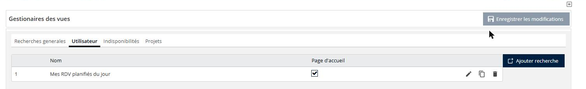
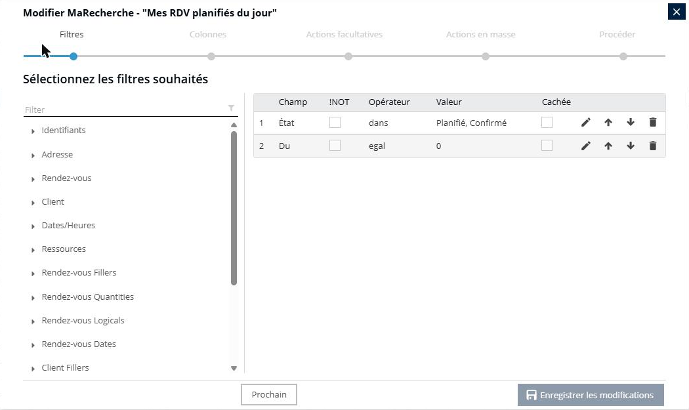

# Modifier, copier ou supprimer une vue

## Accéder à la fonctionnalité

**Navigation :** `Planification > menu Planification > Gestionaires des vues`

Vous pouvez aussi sélectionner **Modifier MaRecherche** sur la liste de résultats d'une vue (droit 1433).

## Actions disponibles

| Action             | Vue administrateur                                                                             | Vue utilisateur                                                                       |
| ------------------ | ---------------------------------------------------------------------------------------------- | ------------------------------------------------------------------------------------- |
| **Modifier**       | Crayon dans l'onglet **Recherches generales**, ou bouton **Modifier MaRecherche** sur la liste | Crayon dans l'onglet **Utilisateur**, ou bouton **Modifier MaRecherche** sur la liste |
| **Copier**         | Non disponible                                                                                 | Bouton **Copier** : crée une copie nommée « \<nom> (2) »                              |
| **Supprimer**      | Non disponible                                                                                 | Bouton **Supprimer** : suppression **immédiate, sans confirmation**                   |
| **Page d'accueil** | Case à cocher, puis **Enregistrer les modifications** en haut de la page                       | Case à cocher, puis **Enregistrer les modifications** en haut de la page              |

## Modifier une vue

1. Sélectionnez le crayon de la vue, ou **Modifier MaRecherche** depuis sa liste de résultats.
2. L'assistant s'ouvre avec le nom de la vue en titre et les réglages enregistrés.
3. Modifiez les étapes souhaitées. En modification, **Enregistrer les modifications** est disponible à toutes les étapes.
4. Sélectionnez **Enregistrer les modifications**, puis fermez la fenêtre.

Pour le détail des étapes, consultez [Configurer une vue avec l'assistant](assistant-configuration.md).

## Points d'attention

* La suppression d'une vue utilisateur ne demande pas de confirmation : en cas de doute, faites d'abord une **copie**.
* Lors de la première modification d'une vue, renseigner le champ **Tooltip** peut effacer le **Nom** et le **Nom du Counter** : vérifiez ces champs avant d'enregistrer (anomalie connue).
* Une vue nouvellement créée ou renommée peut nécessiter un **rafraîchissement** de la page pour apparaître dans le menu (anomalie connue).
* L'ordre des vues dans le menu n'est pas modifiable : il suit le numéro du MySearch pour les vues administrateur, et l'ordre de création pour les vues utilisateur.
* L'export CSV d'une liste reprend les colonnes et l'ordre définis dans la vue.
