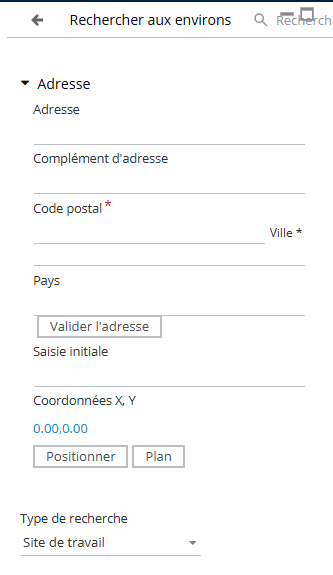

# Utiliser les outils de localisation et d'export

Les rubriques **Localisation** et **Exports** du menu du module **Planification** regroupent des outils cartographiques et des exports prêts à l'emploi.

## Accéder à la fonctionnalité

**Navigation :** `Planification > Localisation` ou `Planification > Exports`

Les entrées affichées dépendent de vos droits et du paramétrage de votre environnement.

## Rechercher aux environs d'une adresse

Cette fonction recherche les éléments situés à proximité d'une adresse : sites de travail, véhicules, clients, hôtels ou rendez-vous.

1. Ouvrez `Planification > Localisation > Rechercher aux environs`.
2. Saisissez l'adresse, puis sélectionnez **Valider l'adresse**. Pour en savoir plus, consultez [Géocoder une adresse](../introduction/geocodage.md).
3. Choisissez le **Type de recherche** : **Site de travail**, **Véhicules théoriques**, **Véhicules GPS**, **Client**, **Hôtel** ou **Rendez-vous**.
4. Pour une recherche de rendez-vous, précisez si besoin l'**État**, la période (**Du**, **Au**) et le **Type d'intervention**.
5. Sélectionnez **Rechercher**.

## Calculer un itinéraire

1. Ouvrez `Planification > Localisation > Calculer l'itinéraire`.
2. Renseignez et validez l'adresse de **Départ**, puis celle d'**Arrivée**.
3. Renseignez la **Date**.
4. Sélectionnez **Calculer l'itinéraire**.

Sélectionnez **Ré-initialiser** pour vider le formulaire.

## Obtenir la latitude et la longitude d'une adresse

1. Ouvrez `Planification > Localisation > Convertir les coordonnées en Lat/Lon`.
2. Saisissez et validez l'adresse.
3. Sélectionnez **Convertir**. Le champ **Latitude / Longitude** affiche le résultat.

## Suivre les véhicules géolocalisés

L'entrée `Planification > Localisation > Suivi de véhicule` affiche les **Positions et états des véhicules géolocalisés**.

* Filtrez la liste par **Site de travail**.
* Cochez **Rafraîchissement automatique** pour mettre à jour les positions régulièrement.

## Lancer un export prédéfini

L'entrée **Liste des exports prédéfinis** n'apparaît que si votre administrateur a paramétré au moins un export.

1. Ouvrez `Planification > Exports > Liste des exports prédéfinis`.
2. Dans **Exporter**, choisissez l'export.
3. Filtrez les données : **Région**, **Site de travail**, **Ressources**, **Équipe**, **Type d'intervention**.
4. Lancez l'export.

## Éditer une feuille de route

1. Ouvrez `Planification > Exports > Éditer la feuille de route`.
2. Dans **Configuration de la feuille de route**, choisissez l'**Intervenant** ou l'**Équipe**. Cochez **Inclure la hiérarchie descendante** pour inclure les équipes rattachées.
3. Choisissez la période : **Jour** ou **Semaine**.
4. Sélectionnez **Continuer** pour afficher la feuille de route, ou **Envoyer** pour l'envoyer.

La feuille de route est aussi accessible depuis le menu **⋮** d'un intervenant dans le planning.
