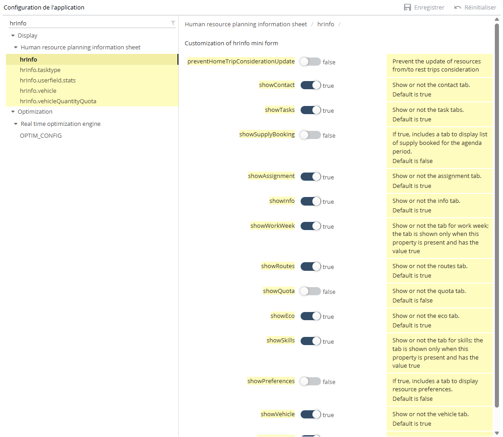
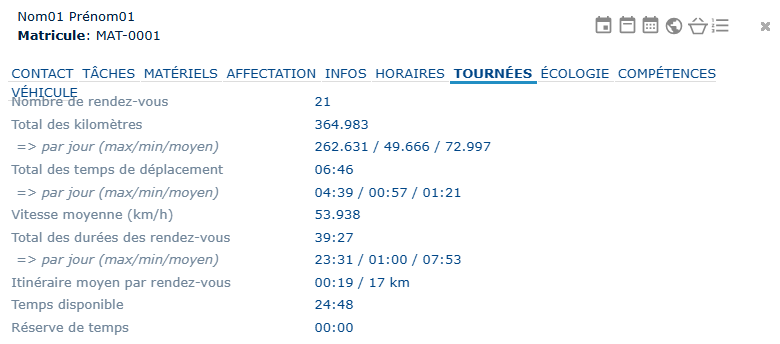
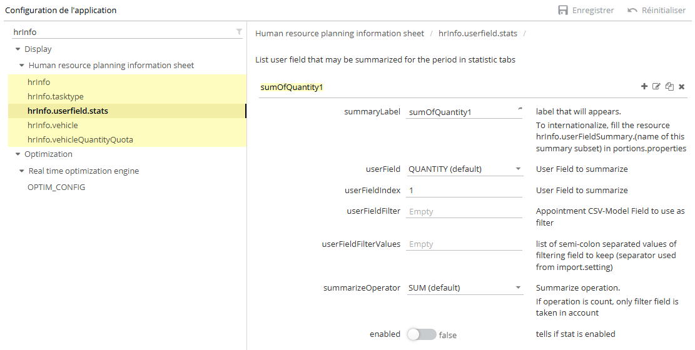
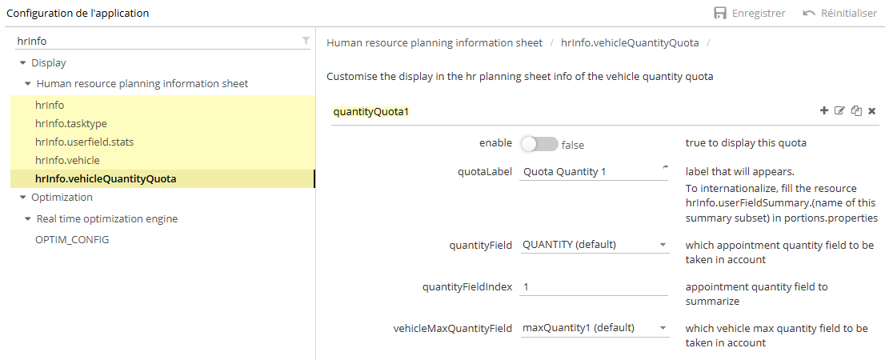
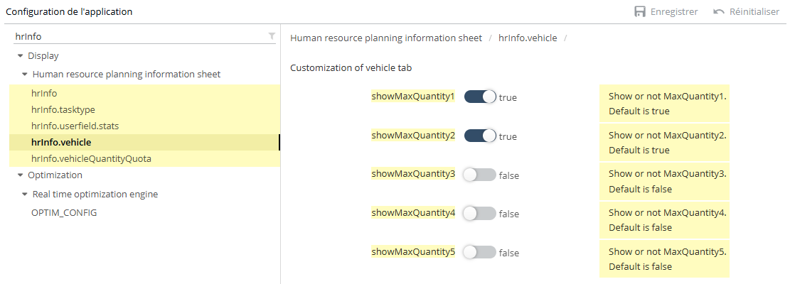

# Afficher les indicateurs de tournée dans la mini fiche ressource

La mini fiche ressource peut afficher des indicateurs complémentaires sur la charge d'un intervenant pour la période affichée dans le planning : temps disponible, réserve de temps, ratios de tournée, quantités à livrer et capacité du véhicule. Le planificateur évalue ainsi en un coup d'œil si la tournée d'un intervenant est équilibrée.

## Avant de commencer

* La configuration se fait dans l'administration, avec un compte autorisé à modifier la **Configuration de l'application**.
* Les paramètres s'appliquent à tous les utilisateurs de l'application.
* Les indicateurs de quantité et de quota supposent que les rendez-vous portent une quantité et que l'intervenant dispose d'un véhicule avec une quantité maximale renseignée.

Pour ouvrir la mini fiche d'un intervenant, consultez [Consulter le planning](../consulter-planning.md).

## Accéder aux paramètres

**Navigation :** `Administration > Personnalisation > Configuration de l'application`

1. Saisissez `hrInfo` dans le champ **Filtre** en haut de l'arborescence.
2. Dépliez `Display > Human resource planning information sheet`.

Quatre paramètres concernent ces indicateurs :

| Paramètre                       | Rôle                                                                 |
| ------------------------------- | -------------------------------------------------------------------- |
| **hrInfo**                      | Affiche ou masque chaque onglet de la mini fiche                     |
| **hrInfo.userfield.stats**      | Ajoute une somme de quantités dans l'onglet **TOURNÉES**             |
| **hrInfo.vehicleQuantityQuota** | Ajoute un quota de quantité dans l'onglet **QUOTA**                  |
| **hrInfo.vehicle**              | Choisit les quantités maximales affichées dans l'onglet **VÉHICULE** |

## Afficher les onglets Tournées, Quota et Véhicule

1. Sélectionnez **hrInfo**.
2. Activez les interrupteurs suivants :
   * **showRoutes** pour l'onglet **TOURNÉES** ;
   * **showQuota** pour l'onglet **QUOTA** (désactivé par défaut) ;
   * **showVehicle** pour l'onglet **VÉHICULE**.
3. Sélectionnez **Enregistrer**.

## Lire l'onglet Tournées

L'onglet **TOURNÉES** résume l'activité de l'intervenant sur la période affichée dans le planning :

* **Nombre de rendez-vous** ;
* **Total des kilomètres** et **Total des temps de déplacement**, avec le détail par jour (max/min/moyen) ;
* **Vitesse moyenne (km/h)** ;
* **Total des durées des rendez-vous**, avec le détail par jour ;
* **Itinéraire moyen par rendez-vous** ;
* **Temps disponible** ;
* **Réserve de temps**.

## Ajouter la somme d'une quantité dans l'onglet Tournées

Vous pouvez afficher dans l'onglet **TOURNÉES** la somme d'une quantité des rendez-vous planifiés, par exemple le nombre d'articles à livrer.

1. Sélectionnez **hrInfo.userfield.stats**.
2. Complétez le bloc de statistique (par exemple `sumOfQuantity1`), ou ajoutez-en un avec l'icône **+** :
   * **summaryLabel** : libellé affiché dans l'onglet ;
   * **userField** : type de champ à additionner, par exemple `QUANTITY` ;
   * **userFieldIndex** : numéro du champ, par exemple `1` pour la quantité 1 ;
   * **userFieldFilter** et **userFieldFilterValues** (facultatifs) : champ du rendez-vous et liste de valeurs, séparées par des points-virgules, pour ne retenir que certains rendez-vous ;
   * **summarizeOperator** : opération appliquée, `SUM` par défaut ;
   * **enabled** : activez l'interrupteur pour afficher la statistique.
3. Sélectionnez **Enregistrer**.

Une ligne portant le libellé choisi s'ajoute en bas de l'onglet **TOURNÉES**, avec la somme calculée sur la période.

## Lire l'onglet Quota

L'onglet **QUOTA** présente des ratios calculés sur la période :

* **Ratio route** : temps de trajet / (temps d'intervention + temps de trajet) ;
* **Taux de remplissage** : (temps d'intervention + temps de trajet) / temps disponible ;
* un ou plusieurs quotas de quantité, si vous les avez configurés (voir ci-dessous).

## Ajouter un quota de quantité dans l'onglet Quota

Le quota de quantité compare la quantité des rendez-vous planifiés à la capacité maximale du véhicule de l'intervenant, en pourcentage.

1. Sélectionnez **hrInfo.vehicleQuantityQuota**.
2. Complétez le bloc de quota (par exemple `quantityQuota1`), ou ajoutez-en un avec l'icône **+** :
   * **enable** : activez l'interrupteur pour afficher ce quota ;
   * **quotaLabel** : libellé affiché dans l'onglet ;
   * **quantityField** et **quantityFieldIndex** : quantité des rendez-vous à prendre en compte, par exemple `QUANTITY` et `1` ;
   * **vehicleMaxQuantityField** : quantité maximale du véhicule à utiliser, par exemple `maxQuantity1`.
3. Sélectionnez **Enregistrer**.

**Exemple :** un intervenant a deux rendez-vous d'une quantité 1 égale à `1` et son véhicule a une quantité maximale 1 égale à `3`. Le quota affiché est de `66.67%`.

## Afficher les quantités maximales dans l'onglet Véhicule

L'onglet **VÉHICULE** affiche les informations du véhicule affecté à l'intervenant, dont ses quantités maximales. Si aucun véhicule n'est affecté, l'onglet affiche « Aucun véhicule affecté. ».

1. Sélectionnez **hrInfo.vehicle**.
2. Activez les interrupteurs **showMaxQuantity1** à **showMaxQuantity5** des quantités maximales à afficher. Seules les deux premières sont affichées par défaut.
3. Sélectionnez **Enregistrer**.

## Points d'attention


Les indicateurs sont calculés sur la période affichée dans le planning (jour ou semaine).

