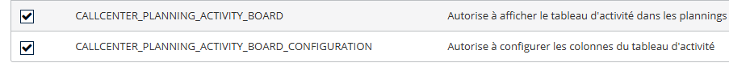
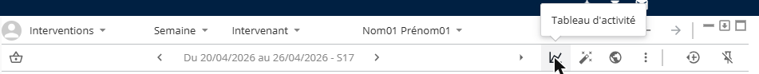
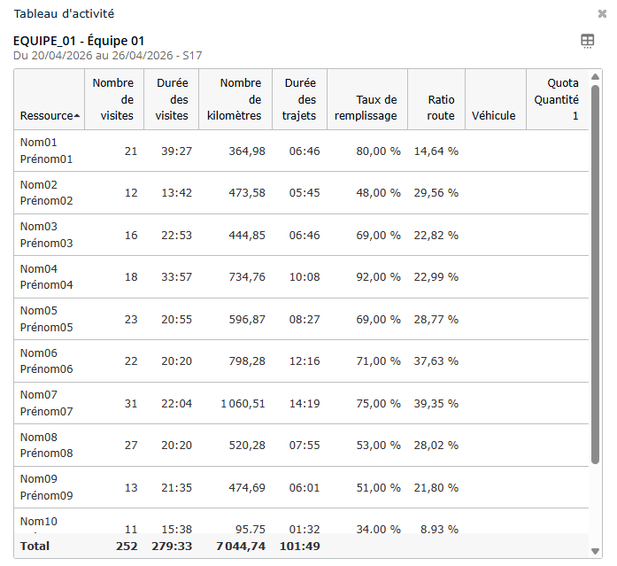
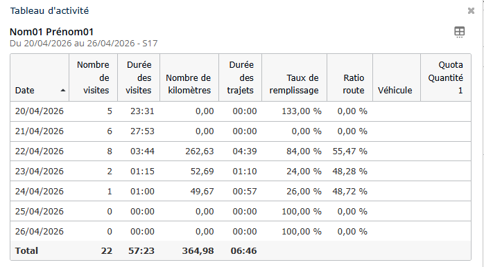
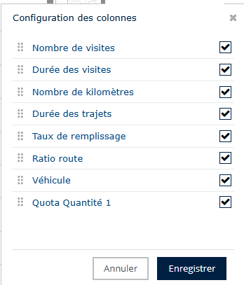

# Consulter le tableau d'activité des ressources

Le tableau d'activité regroupe dans une seule fenêtre les statistiques des intervenants affichés dans le planning : nombre et durée des visites, kilomètres, temps de trajet, taux de remplissage, ratio route et quotas. Le planificateur compare ainsi la charge de plusieurs intervenants sans ouvrir la mini fiche de chacun.

## Avant de commencer

Deux droits contrôlent la fonctionnalité. Ils se trouvent dans la collection de droits, onglet **Planification**, section **Agenda** :

| Droit                                              | Description                                                  |
| -------------------------------------------------- | ------------------------------------------------------------ |
| `CALLCENTER_PLANNING_ACTIVITY_BOARD`               | Autorise à afficher le tableau d'activité dans les plannings |
| `CALLCENTER_PLANNING_ACTIVITY_BOARD_CONFIGURATION` | Autorise à configurer les colonnes du tableau d'activité     |

**Navigation :** `Administration > Utilisateurs > Collection de droits`

1. Ouvrez la collection de droits du profil concerné.
2. Dans l'onglet **Planification**, cochez les droits voulus.
3. Sélectionnez **Enregistrer**.

## Ouvrir le tableau d'activité

**Navigation :** `Planification`, panneau du planning.

1. Affichez le planning voulu : choisissez la période (**Jour** ou **Semaine**) et le niveau (**Équipe**, **Intervenant**, **Multi-ressources**…).
2. Dans la barre du planning, sélectionnez l'icône représentant un graphique, **Tableau d'activité**. Si l'icône n'est pas visible, sélectionnez la flèche située à gauche des icônes pour afficher les boutons masqués.

La fenêtre **Tableau d'activité** s'ouvre. Elle rappelle en en-tête l'élément affiché (équipe ou intervenant) et la période.

## Lire le tableau

### Planning d'une équipe

Chaque ligne correspond à un intervenant affiché dans le planning. La ligne **Total** additionne les nombres, durées et distances de l'équipe.

### Planning d'un intervenant

Chaque ligne correspond à une journée de la période affichée, dans la colonne **Date**. Vous suivez ainsi l'évolution quotidienne de l'activité de l'intervenant.

### Colonnes disponibles

| Colonne                  | Contenu                                                     |
| ------------------------ | ----------------------------------------------------------- |
| **Nombre de visites**    | Nombre de rendez-vous sur la période                        |
| **Durée des visites**    | Durée cumulée des rendez-vous                               |
| **Nombre de kilomètres** | Distance parcourue                                          |
| **Durée des trajets**    | Temps de déplacement cumulé                                 |
| **Taux de remplissage**  | (temps d'intervention + temps de trajet) / temps disponible |
| **Ratio route**          | temps de trajet / (temps d'intervention + temps de trajet)  |
| **Véhicule**             | Véhicule affecté à l'intervenant                            |

Les quotas de quantité configurés pour la mini fiche ressource s'ajoutent comme colonnes supplémentaires, par exemple **Quota Quantité 1**. Pour les configurer, consultez [Afficher les indicateurs de tournée dans la mini fiche ressource](indicateurs-mini-fiche-ressource.md).

### Trier le tableau

Sélectionnez l'en-tête d'une colonne pour trier les lignes selon cette colonne. Une flèche indique la colonne de tri.

## Configurer les colonnes

Ce paramétrage nécessite le droit `CALLCENTER_PLANNING_ACTIVITY_BOARD_CONFIGURATION`.

1. Dans la fenêtre **Tableau d'activité**, sélectionnez l'icône **Configuration des colonnes**, en haut à droite.
2. Décochez les colonnes à masquer, ou cochez celles à afficher. Une colonne décochée passe en bas de la liste.
3. Pour changer l'ordre des colonnes, faites glisser une ligne par la poignée située à sa gauche.
4. Sélectionnez **Enregistrer**, ou **Annuler** pour fermer sans modifier.

Le tableau reprend aussitôt la sélection et l'ordre choisis. La configuration est conservée lors des ouvertures suivantes.

## Points d'attention


Le tableau présente les statistiques du planning affiché. Changez de période, d'équipe, d'intervenant ou de niveau d'affichage, puis ouvrez le tableau pour consulter les statistiques correspondantes.


* La colonne **Véhicule** et les colonnes de quota restent vides pour un intervenant sans véhicule affecté.
