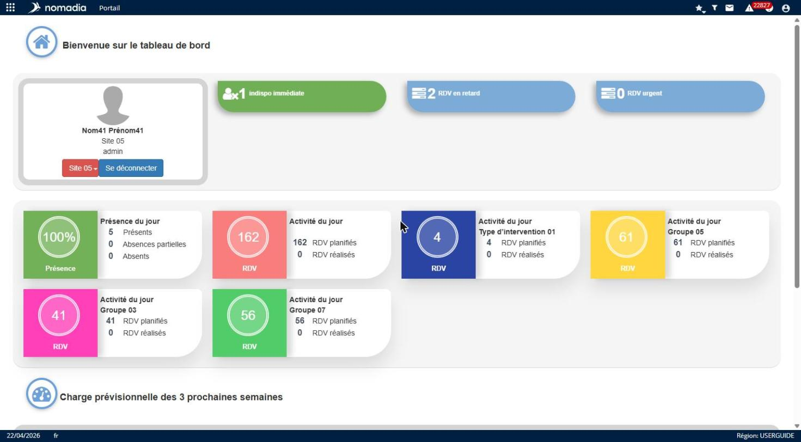
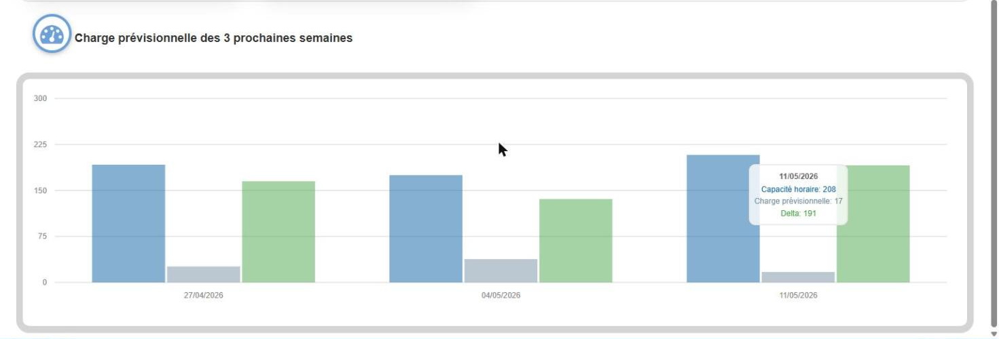

# Portail

Le Portail affiche un tableau de bord qui résume la présence des intervenants, l'activité du jour et la charge des semaines à venir.

## Accéder au Portail

**Navigation :** `Lanceur d'applications > Portail`

## Lire le tableau de bord

La page **Bienvenue sur le tableau de bord** comporte plusieurs zones.

### Carte utilisateur

La carte affiche votre nom, votre site et votre identifiant. Elle contient :

* un bouton de sélection du site, qui propose **Tous** ou votre site ;
* le bouton **Se déconnecter**.

### Indicateurs d'alerte

Trois indicateurs affichent les nombres suivants :

* **indispo immédiate** ;
* **RDV en retard** ;
* **RDV urgent**.

### Présence et activité du jour

* La tuile **Présence du jour** affiche le taux de présence et le nombre de **Présents**, d'**Absences partielles** et d'**Absents**.
* Les tuiles **Activité du jour** affichent le nombre de **RDV planifiés** et de **RDV réalisés**, d'abord pour l'ensemble de l'activité, puis par type ou groupe d'interventions.

### Charge prévisionnelle

La zone **Charge prévisionnelle des 3 prochaines semaines** présente un histogramme par semaine. Au survol d'une semaine, une info-bulle affiche la **Capacité horaire**, la **Charge prévisionnelle** et le **Delta**.

