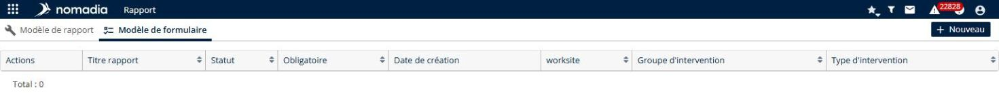
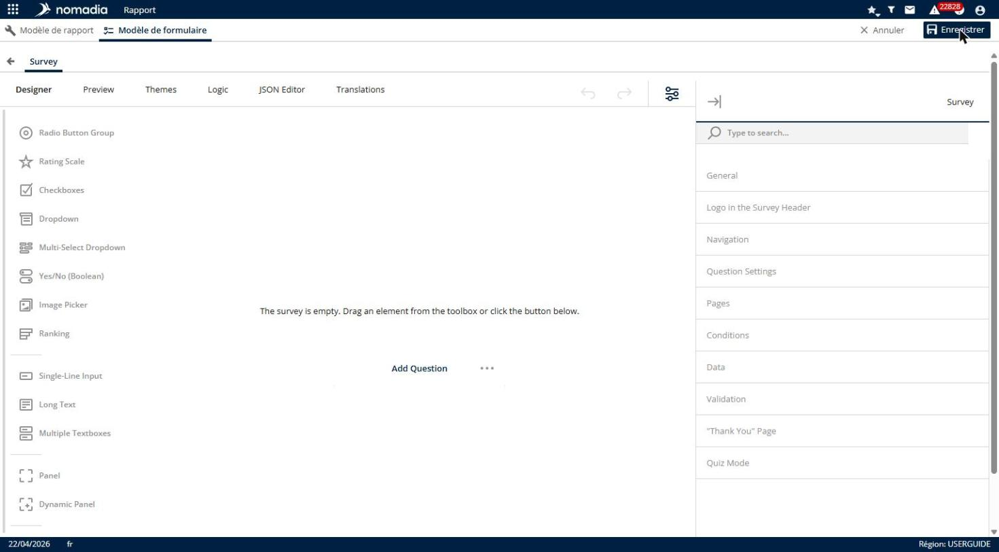

# Rapport

Le module Rapport permet de gérer les modèles de rapports et les modèles de formulaires associés aux interventions. Les modèles de rapports servent à générer automatiquement les rapports d'intervention au format PDF.

## Accéder au module

**Navigation :** `Lanceur d'applications > Rapport`

Le module comporte deux onglets :

* **Modèle de rapport** ;
* **Modèle de formulaire**.

Chaque onglet affiche la liste des modèles, avec les colonnes **Actions**, **Titre rapport**, **Statut**, **Date de création**, **Worksite**, **Groupe d'intervention** et **Type d'intervention**. L'onglet **Modèle de formulaire** affiche en plus la colonne **Obligatoire**. Le nombre de modèles est indiqué sous la liste (**Total**).

## Créer un modèle de formulaire

1. Sélectionnez l'onglet **Modèle de formulaire**.
2. Sélectionnez **Nouveau**.
3. Construisez le formulaire dans l'éditeur.
4. Sélectionnez **Enregistrer**, ou **Annuler** pour quitter l'éditeur sans enregistrer.

L'éditeur de formulaire s'affiche en anglais. Il comporte :

* les onglets **Designer**, **Preview**, **Themes**, **Logic**, **JSON Editor** et **Translations** ;
* à gauche, la liste des éléments à ajouter : choix multiples, listes, échelles, champs de saisie, panneaux, etc. ;
* au centre, la zone de construction, avec **Add Question** ;
* à droite, le panneau de propriétés du formulaire.

## Dans cette section

* [Générer des rapports d'intervention](generer-rapport.md)
* [Préparer le modèle Word d'un rapport](modele-word-rapport.md)
