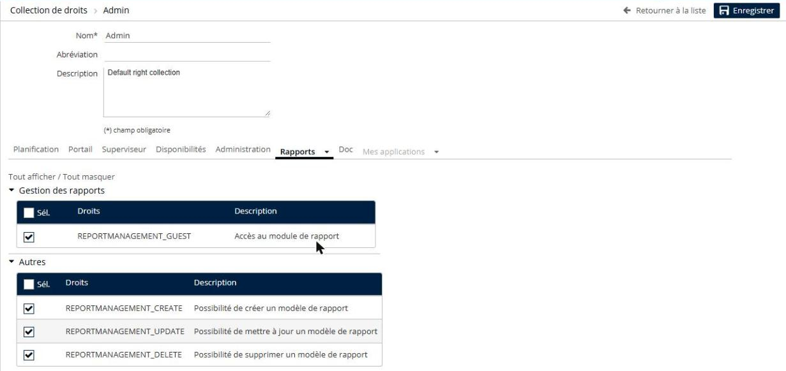
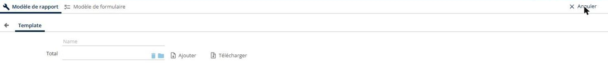
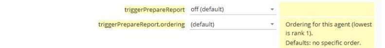
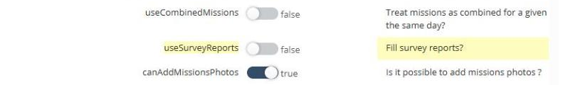
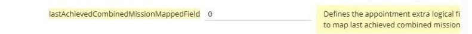

# Générer des rapports d'intervention

Nomadia Field Service peut produire automatiquement un rapport d'intervention au format PDF. Le rapport est construit à partir d'un modèle Word qui contient des champs reliés aux données de l'intervention : client, intervenant, produits, réponses aux formulaires, photos et signatures.

## Fonctionnement général

1. Vous préparez un modèle de rapport dans Word, avec des champs de fusion. Pour en savoir plus, consultez [Préparer le modèle Word d'un rapport](modele-word-rapport.md).
2. Vous déposez ce modèle dans le module **Rapport**.
3. Vous attribuez les droits nécessaires aux profils concernés.
4. Vous activez la génération automatique.
5. Lorsqu'un rendez-vous passe à l'état **Réalisé**, le rapport PDF est généré s'il n'existe pas déjà de rapport PDF attaché au rendez-vous.

## Avant de commencer

* Vous devez avoir accès au module **Rapport** et à l'**Administration**.
* Préparez votre modèle de rapport au format Word.

## Étape 1 : attribuer les droits

**Navigation :** `Administration > Utilisateurs > Collection de droits`

1. Ouvrez la collection de droits du profil concerné.
2. Ouvrez l'onglet **Rapports** (menu **Modules**).
3. Cochez les droits nécessaires :

| Droit                     | Description affichée                              |
| ------------------------- | ------------------------------------------------- |
| `REPORTMANAGEMENT_GUEST`  | Accès au module de rapport                        |
| `REPORTMANAGEMENT_CREATE` | Possibilité de créer un modèle de rapport         |
| `REPORTMANAGEMENT_UPDATE` | Possibilité de mettre à jour un modèle de rapport |
| `REPORTMANAGEMENT_DELETE` | Possibilité de supprimer un modèle de rapport     |

4. Pour les profils qui publient les rapports, ouvrez l'onglet **Planification**, section **Rendez-vous**, et cochez le droit `CALLCENTER_PUBLISH_REPORT` (**Permettre la publication d'un rapport**).
5. Sélectionnez **Enregistrer**.

## Étape 2 : déposer le modèle de rapport

**Navigation :** `Rapport > Modèle de rapport`

1. Sélectionnez **Nouveau**.
2. Dans l'onglet **Template**, saisissez le nom du modèle dans le champ **Name**.
3. Sélectionnez l'icône de dossier (**Sélectionner un fichier**) et choisissez votre fichier Word.
4. Sélectionnez **Ajouter** pour déposer le fichier.

* Le bouton **Télécharger** permet de récupérer le fichier Word du modèle.
* L'icône de corbeille (**Désélectionner un fichier**) retire le fichier sélectionné.
* **Annuler** quitte l'écran sans créer le modèle.

### Modifier un modèle

Modifiez le fichier Word, puis déposez la nouvelle version depuis le modèle de rapport.

## Étape 3 : activer la génération automatique

**Navigation :** `Administration > Personnalisation > Configuration de l'application`

1. Dans le champ de filtre, en haut de l'arborescence, saisissez `triggerPrepareReport`.
2. Sélectionnez le nœud **appointment.completion.agent.activation** (**Application > Agents**).
3. Pour le paramètre **triggerPrepareReport**, sélectionnez **on**.
4. Sélectionnez **Enregistrer**.


La configuration de l'application s'applique à tous les utilisateurs. Faites valider ce changement par l'administrateur de votre environnement.


## Résultat

Lorsqu'un rendez-vous passe à l'état **Réalisé**, un rapport PDF est généré à partir du modèle, si aucun rapport PDF n'est déjà attaché au rendez-vous.

## Proposer des formulaires sur l'application mobile

Les formulaires créés dans **Rapport > Modèle de formulaire** permettent au technicien de saisir des réponses pendant l'intervention. Ces réponses peuvent ensuite être reprises dans le rapport PDF.

Pour rendre les formulaires disponibles sur l'application mobile :

1. Dans **Configuration de l'application**, filtrez sur `useSurveyReports`.
2. Activez le paramètre **useSurveyReports** (**Fill survey reports?**).
3. Sélectionnez **Enregistrer**.

Le technicien voit alors, dans l'onglet **Rapport** de l'application mobile, les formulaires disponibles pour son intervention.

## Générer un seul rapport pour des missions combinées

Pour regrouper plusieurs interventions dans un seul rapport :

1. Dans **Configuration de l'application**, activez le paramètre **useCombinedMissions** (**Treat missions as combined for a given … the same day?**).
2. Renseignez le paramètre **lastAchievedCombinedMissionMappedField** avec un nombre de 1 à 15. Ce nombre désigne le champ logique complémentaire du rendez-vous qui identifie la dernière intervention.
3. Sélectionnez **Enregistrer**.

Le rapport est généré lorsque la dernière intervention se termine.
